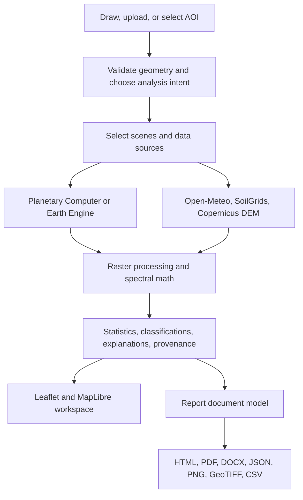

# SEVA.GIS

**Spatial Evaluation & Vegetation Analytics** is a browser-first geospatial workspace for inspecting any selected Area of Interest (AOI). It combines satellite imagery, terrain, weather, soil, hydrology, spectral indices, map tools, and reports for students, researchers, GIS analysts, agricultural professionals, and curious non-technical users.

> **Current status:** Active rebuild. The current application is usable, but the map performance, localization, report-export, GeoTIFF, and automated-verification work described in [plan.md](plan.md) is still in progress.

## Product Principles

- AOI-first analysis instead of farm-only assumptions
- Source, date, resolution, scale, CRS, and limitations shown with results
- Browser-first processing with an optional authenticated Earth Engine service
- Local persistence through IndexedDB and optional OPFS/File System Access
- Plain-language explanations alongside scientific values
- Honest sensor resolution: Sentinel-2 analysis is not sub-meter imagery
- No credentials in frontend bundles

## Architecture



### Main code areas

| Area | Files |
|---|---|
| React entry and shell | `src/main.tsx`, `src/Auth.tsx`, `src/App.tsx` |
| 2D and 3D maps | `src/IndicatorMap.tsx`, `src/Walk3D.tsx` |
| Satellite and DEM ingestion | `src/lib/seva.ts` |
| Raster and index processing | `src/lib/raster.ts`, `src/lib/indicators.ts` |
| Hydrology and agronomy | `src/lib/hydro.ts`, `src/lib/agro.ts` |
| Earth Engine client | `src/lib/earthEngineClient.ts` |
| Earth Engine service | `backend/main.py` |
| Reports and exports | `src/report.ts`, `src/reportBuilder.ts`, `src/ReportPanel.tsx`, `src/lib/pdfGenerator.ts` |
| Local storage | `src/lib/db.ts`, `src/lib/fs-vault.ts` |

## Current Capabilities

- AOI creation and local persistence
- Leaflet basemaps and MapLibre terrain views
- Sentinel-2 spectral indices including NDVI, EVI, SAVI, MSAVI, GNDVI, NDRE, NDMI, NDWI, MSI, BSI, LAI, and chlorophyll-related signals
- Copernicus DEM elevation, slope, aspect, hillshade, TWI, flow, ponding, and terrain proxies
- Open-Meteo weather and SoilGrids soil estimates
- Irrigation, drainage, crop, and hydrology panels
- Earth Engine map tiles, zonal statistics, time series, change analysis, DEM, and alerts
- Land-cover and management-zone analysis
- GeoJSON/KML and report-oriented export workflows
- Local account, guest mode, report history, and guided Mitra tour

All estimates must be interpreted with their source and limitations. A candidate borewell or pipeline is not a confirmed infrastructure survey, and a simplified hydrology result is not automatically a validated SWAT-CUP calibration.

## Data Sources

- ESA Copernicus Sentinel-2 L2A through Microsoft Planetary Computer and Google Earth Engine
- Copernicus GLO-30 DEM
- Open-Meteo weather services
- ISRIC SoilGrids
- Esri and OpenStreetMap basemaps and nearby features where enabled

## Local Development

```bash
npm install
npm run dev
```

The repository also contains a `pnpm-lock.yaml`; use the package manager selected by the project environment and keep the lockfile consistent. Validate changes with:

```bash
npm exec -- tsc --noEmit
npm run build
```

The Earth Engine proxy can be run separately:

```bash
cd backend
pip install -r requirements.txt
python -m uvicorn main:app --port 8080 --reload
```

See [backend/README.md](backend/README.md) for service configuration. Never commit `.env` files, service-account keys, or API credentials.

## Rebuild Plan

The authoritative requirements, phased checklist, acceptance tests, and release gate are in [plan.md](plan.md).

Important planned work includes:

- Web Worker raster processing and cancellable AOI switching
- AOI-centered map fitting, clipping, collision-free cartography, and real GeoTIFF export
- Explicit English, Telugu, and Hindi localization without DOM-mutating Google Translate
- A single report document model shared by preview and downloads
- Dynamic AOI-specific hydrology and classifications
- Security cleanup, API contracts, browser smoke tests, and release verification

## Credits and Reference Projects

SEVA.GIS uses open geospatial standards and takes design or algorithmic inspiration from QGIS, Esri cartography, Google Earth Engine, Microsoft Planetary Computer, MathWorks numerical methods, `morluto/rea`, `motion-web`, and the projects listed in [docs/CREDITS.md](docs/CREDITS.md). These references are not automatically runtime dependencies.

## Deployment

Deployment is intentionally not described as complete until the release gate in [plan.md](plan.md) passes. The repository contains Firebase, Docker, Cloud Run, and static-hosting configurations; one supported production path must be selected and verified before public release.

## License

MIT. See [LICENSE](LICENSE).
