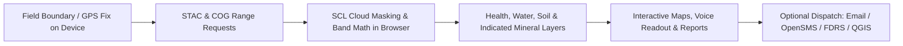

# SEVA.GIS — Where Satellites Meet Soil

[](https://github.com/virahitvin8/seva-gis/releases/latest)
[](LICENSE)
[](https://github.com/virahitvin8/seva-gis/actions/workflows/ci.yml)
[](https://github.com/virahitvin8/seva-gis/pkgs/container/seva-gis)
[](https://github.com/virahitvin8/seva-gis/releases/latest/download/seva-gis-latest.apk)

**SEVA.GIS** (**S**patial **E**valuation & **V**egetation **A**nalytics, **G**eographic **I**nformation **S**ystem) is a free, local-first satellite agronomy, field survey, and precision GIS platform built for farmers, researchers, field officers, and engineers — in **English**, **తెలుగు (Telugu)**, and **हिन्दी (Hindi)**.

> **No subscription. No cloud lock-in. No black-box guesswork.**  
> Draw or walk your field boundary. SEVA.GIS streams public Sentinel-2 L2A & Sentinel-1 scenes, Copernicus 30 m elevation, ISRIC soil grids, and live weather inside your browser or Capacitor Android APK. When a remote source is unreachable, SEVA.GIS shows **"Data unavailable"** with the exact reason and a Retry button instead of inventing numbers.

---

## Live Sites & Domains

| Surface | URL | TLS / Hosting Status |
|---|---|---|
| **Primary Production Web App** | [https://sevagis.dpdns.org](https://sevagis.dpdns.org) | Live over HTTPS (GitHub Pages custom `CNAME`) |
| **Mirror Domain** | [https://sevagis.is-a.bot](https://sevagis.is-a.bot) | Live over HTTPS (`HTTP/2 200` via Cloudflare SSL) |
| **Vercel Edge & API Proxy** | [https://seva-gis.vercel.app](https://seva-gis.vercel.app) | Live — hosts serverless `/api/send-report` & `/api/opensms-proxy` |
| **Latest Android APK** | [seva-gis-latest.apk](https://github.com/virahitvin8/seva-gis/releases/latest/download/seva-gis-latest.apk) | Auto-built in CI (`android-build.yml`) with live web OTA popup sync |
| **`sevagis.is-a.dev` Alias** | [https://sevagis.is-a.dev](https://sevagis.is-a.dev) | Needs DNS/proxy update (see note below) |

> **Why browsers show `"Your connection is not private"` on `sevagis.is-a.dev`:**  
> GitHub Pages only permits one custom domain in [`public/CNAME`](public/CNAME) (`sevagis.dpdns.org`), so direct DNS from `sevagis.is-a.dev` to `185.199.111.153` receives GitHub's `*.github.io` wildcard certificate (`NET::ERR_CERT_COMMON_NAME_INVALID`). Fix this outside git by either adding `sevagis.is-a.dev` in Vercel Project Settings -> Domains and pointing the `is-a-dev/register` `CNAME` record to `cname.vercel-dns.com`, or enabling Cloudflare Full SSL proxy in front of GitHub Pages / Vercel. See [SECURITY.md](SECURITY.md).

---

## What's New in v4.7.0

- **Simplified (Lite) & Advanced (Pro) Dual Experience (`src/lib/uiMode.tsx`, `src/components/LiteShell.tsx`)**:
  - **Mobile App (Android APK / Standalone PWA)** runs **Simplified Mode** exclusively with a Three-Lines (`≡`) drawer, mobile bottom bar, weather-reactive sky header, Area of Interest Condition (`/100` score), tick-box map layers clipped strictly to the selected polygon, clickable `(i)` satellite/formula references, time-lapse comparisons, and one-tap Simplified Report sharing via Email, WhatsApp, or SMS.
  - **Website (`sevagis.dpdns.org`)** provides a top-bar switcher between **Simplified** and **Advanced** workbench views.
- **Verified Auth & 10-Second Atomic Clockwise Dial (`src/Auth.tsx`)**:
  - `Continue with Google` opens an explicit account selector (never auto-picks a placeholder account), `Continue as Guest` prompts for the user's profile name, Sign-up/Sign-in verify real credentials cleanly, and the Clockwise visualizer steps every 10 seconds with atomic dispersion/reformation across all discipline blocks.
- **Inline Handy GPS & Cleaner Workspace (`src/components/InlineHandyGpsBar.tsx`)**:
  - Drop NASA WorldWind pushpins, record walked GPS boundaries, inspect 6 coordinate formats (DD, DMS, DDM, UTM, MGRS, DIGIPIN), project waypoints, and export GPX/KML/CSV directly inside the workspace without modal clutter.

### Previous v4.6.1 Highlights

- **Self-Hosted Open-Source Mail & Cross-Origin Relay (`deploy/mail/`, `server/directMailService.js`, `api/`)**:
  - Eliminates `HTTP 405` errors on static hosts (`sevagis.dpdns.org`) and Capacitor Android APKs by enabling explicit-origin CORS on `/api/send-report` & `/api/opensms-proxy`, automatic cross-origin relay fallback (`seva-gis.vercel.app`), and direct HTTPS Worker dispatch.
  - Built-in adapters & deployment templates for **Stalwart Mail Server** (`stalwartlabs/mail-server` — RFC 8620 JMAP submission), **Cloudflare Edge Mail Worker** (`hieunc229/mailflare` zero-server pattern written Apache-2.0), **`docker-mailserver`** (MIT SMTP + DKIM/DMARC/SPF), **Mailcow Dockerized** (external groupware relay), and **Eigen** (`eigen-is/eigen` MIT workspace), plus OpenSMS reachability probing (`probeOpenSmsGateway`) alongside 1-tap Phone SMS & WhatsApp links.
- **FreeLLMAPI Multi-Provider Bandit Router (`src/services/freeLlmRouter.ts`)**:
  - Derived cleanly from [`tashfeenahmed/freellmapi`](https://github.com/tashfeenahmed/freellmapi) (MIT License).
  - Thompson/Beta-posterior candidate scoring across four presets (`balanced`, `smartest`, `fastest`, `reliable`) with bounded headroom guardrails, escalating cooldown ladder (`2m -> 10m -> 1h -> 24h`), authoritative `Retry-After` handling, and half-time recovery probes.
  - Configurable directly inside **Gemini 4 Argon Cognitive GeoAI Advisor** (`FreeLLMAPI /v1` gateway, `Groq`, `OpenRouter`, and `Google Gemini`), falling back cleanly to the offline **FAO-56 agronomic engine** when no key/gateway is active.
- **NASA WorldWind Field Imagery Kit & SEVA.GIS Branded Android Launcher (`public/images/field-kit/`)**:
  - Integrated NASA WorldWind Java SDK / Blue Marble sprite assets (`notched-compass.png`, `earth-map-512x256.png`, `BMNG_world.topo.bathy.200405.3.2048x1024.jpg`, crosshairs, layer manager icons, and pushpin markers) across **Precision Dashboard**, **Tactical Map**, **Geodesy Tools**, and **Waypoint Metadata Sheet**.
  - Kept the signature SEVA.GIS banyan emblem as the Web PWA touch icon (`apple-touch-icon.png`) and generated multi-density Android launcher icons (`mipmap-*`) + splash drawables from [`public/logo.png`](public/logo.png).
- **Farm Data Relay System (FDRS) Firmware Config Export**:
  - Export ready-to-compile Arduino/ESP32 `fdrs_node_config.h` headers (`#define USE_LORA` / `#define USE_ESPNOW`, reading ID, gateway MAC) directly from the Field Studio Voice Memo & Telemetry joint (`exportFdrsNodeConfigHeader()`).
- **Automated Multi-Package Release & Container Pipeline**:
  - `CI` ([`.github/workflows/ci.yml`](.github/workflows/ci.yml)): verifies `pnpm-lock.yaml` (`--frozen-lockfile`), TypeScript check, full Node test suite, EN/HI/TE localization parity, production bundle, and `gitleaks` secret scan.
  - `Docker Package (GHCR)` ([`.github/workflows/docker.yml`](.github/workflows/docker.yml)): builds and pushes multi-arch `linux/amd64` + `linux/arm64` images to `ghcr.io/virahitvin8/seva-gis`.
  - `Android APK Auto-Build & Multi-Package Release` ([`.github/workflows/android-build.yml`](.github/workflows/android-build.yml)): publishes `seva-gis-latest.apk`, `seva-gis-v<ver>.apk`, `latest-android.yml` (SHA-512 updater metadata), `seva-gis-web-v<ver>.tar.gz`, and QGIS/ArcGIS plugins to GitHub Releases on `main` pushes and `v*` tags.

---

## Core Capabilities

| Capability | Details |
|---|---|
| **Crop & Vegetation Intelligence** | Client-side STAC discovery & Cloud-Optimized GeoTIFF streaming for Sentinel-2 L2A & Sentinel-1 SAR (NDVI, NDRE, NDMI, EVI, SAVI, MSAVI, GNDVI, BSI) with Scene Classification (SCL) cloud masking. |
| **Hydrology, Soil & Minerals** | Copernicus 30 m DEM slope/drainage/TWI, ISRIC soil texture/organic carbon/pH, weather + NASA POWER fallback, and surface mineral cluster indicators ("Likely / Indicated"). |
| **Mobile Field Studio (Web + Android)** | Two modes — **Simple 1-Tap Farmer Mode** with voice readout (EN/HI/TE) and **Industrial Precision Mode**: live GNSS averaging, 7 datums, exact UTM/MGRS/DDM/PlusCode/Maidenhead/DIGIPIN, IAGA IGRF-14 Epoch 2025 magnetic declination, EGM2008 orthometric height, MapLibre GL offline tile planner (Z13-Z16), GPX/KML/CSV export, and Web Audio voice memos. |
| **Remote Field Scout & Dispatch** | Shareable browser scout link (`/api/scout`) with GPS watermark stamp, plus Direct Dispatch Console supporting `/api/send-report` (SMTP/Resend/SendGrid/Brevo) and `/api/opensms-proxy` / LAN OpenSMS SIM gateway. |
| **Live Website-to-APK Sync** | Installed Android APKs poll [`/version.json`](public/version.json) and [`/updates/latest.json`](public/updates/latest.json), prompting users with an in-app 1-tap update dialog whenever `main` deploys. |
| **Local-First Privacy** | Farm polygons, tracklogs, waypoints, and optional API keys remain in browser `IndexedDB` / `localStorage` on your device unless you choose to export or share them. |

---

## Use It in 3 Steps

1. **Mark or import your land (AOI)** — Draw on the map, trace vertices by walking in **Field Studio**, look up an Indian village/DIGIPIN, or upload GeoJSON, KML, or zipped Shapefile.
2. **Stream open satellite & terrain layers** — SEVA.GIS queries public STAC catalogs, decodes GeoTIFF pixel windows in-browser, masks clouds, and adds Copernicus 30 m elevation + local weather.
3. **Inspect, compare & export** — Review plain-language field advisories in English, Telugu, or Hindi, view mineral/anomaly clusters on the map, or export PDF, HTML, `.doc`, GPX/KML/CSV, QGIS/ArcGIS packages, or Docker self-hosted deployments.

---

## How Data Flows



---

## Install & Run Everywhere

| Platform | Command / Link |
|---|---|
| **Web Browser / PWA** | Open [https://sevagis.dpdns.org](https://sevagis.dpdns.org) (or [https://seva-gis.vercel.app](https://seva-gis.vercel.app)) |
| **Android APK** | Download [`seva-gis-latest.apk`](https://github.com/virahitvin8/seva-gis/releases/latest/download/seva-gis-latest.apk) or install [`releases/seva-gis-latest.apk`](releases/seva-gis-latest.apk) |
| **Docker (GHCR Multi-Arch)** | `docker run -p 8080:8080 ghcr.io/virahitvin8/seva-gis:main` |
| **Self-Hosted Mail & Cloudflare Worker** | Compose templates & Worker under [`deploy/mail/`](deploy/mail/README.md) (`stalwartlabs/mail-server`, `mailflare` pattern Worker, `docker-mailserver`, `mailcow`, `eigen`) |
| **QGIS / ArcGIS Plugins** | Install [`public/plugins/seva_gee_flow_qgis.zip`](public/plugins/seva_gee_flow_qgis.zip), [`seva_gis_qgis_plugin.zip`](public/plugins/seva_gis_qgis_plugin.zip), or [`seva_gee_flow_arcgis.zip`](public/plugins/seva_gee_flow_arcgis.zip) |
| **Local Development** | `git clone https://github.com/virahitvin8/seva-gis && pnpm install --frozen-lockfile && npm run dev` |

### Local Verification Commands

```bash
pnpm install --frozen-lockfile --ignore-scripts
npm run typecheck
npm test
npm run build
```

---

## Documentation & Governance

- [GLOSSARY.md](GLOSSARY.md) — Canonical definitions for domain concepts (`AOI`, `DIGIPIN`, `Bandit Router`, `FDRS`, `OTA`, `IAGA IGRF-14`).
- [CREDITS.md](CREDITS.md) — Third-party attributions including `tashfeenahmed/freellmapi` (MIT), NASA WorldWind Java / Blue Marble (`NASA-1.3`), `Farm-Data-Relay-System` (MIT), `IAGA IGRF-14`, `MapLibre GL`, and `Capacitor`.
- [CONTRIBUTING.md](CONTRIBUTING.md) — Branch rules, verification requirements, and attribution policy.
- [SECURITY.md](SECURITY.md) — Local-first key storage rules, secret scanning policy, and multi-domain TLS guidance.

---

## Licenses

- **Core Web App, Server Proxies, Mobile Field Suite, ArcGIS Toolbox & Octave Scripts**: [Apache License 2.0](LICENSE) (see [NOTICE](NOTICE)).
- **QGIS Plugin**: [GNU GPL v3.0 or later](plugins/qgis/LICENSE).
- **Third-Party Components**: Documented with license tags in [CREDITS.md](CREDITS.md) and [THIRD_PARTY_LICENSES.md](THIRD_PARTY_LICENSES.md).

---

Created and architected by **N. Akshit Vinay** (MSc GIS & Remote Sensing, BSc Agriculture).
