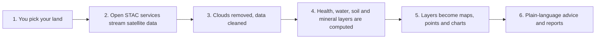
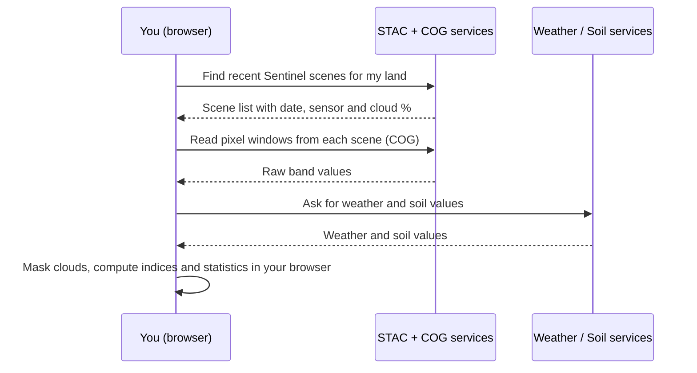

# 🛰️ SEVA.GIS: Where Satellites Meet Soil

**SEVA.GIS** stands for **S**patial **E**valuation & **V**egetation **A**nalytics, **G**eographic **I**nformation **S**ystem.

> **No money. No keys. No code. No data processing.**  
> Pick your land on the map. SEVA.GIS tells you how it is, why it is that way, where things are, what to do and what not to do.

Free and open source, for everyone: farmers, students, officers, researchers, builders. Use it on the web — on a computer or on your phone.

---

## Live sites & domains

| Where | Link | Status |
|---|---|---|
| **Main production site** | [https://sevagis.dpdns.org](https://sevagis.dpdns.org) | Live — serving over HTTPS |
| **is-a.dev domain** | [https://sevagis.is-a.dev](https://sevagis.is-a.dev) | Merged & active (is-a-dev/register#57108) |
| **is-a.bot domain** | [https://sevagis.is-a.bot](https://sevagis.is-a.bot) | Merged & active (free-domains/is-a.bot#555) |

---

## ⚡ What's new in v2.5

- **Clockwise Parameter Engine**: Interactive 320×320 orbital radar sweep (1 → 2 → 3 → 4 → 5 → 6) cycling through 4 Domain Intelligence pillars (Precision Agriculture, Hydrology & Water, Soil & Terrain, Agro-Meteorology) with live spectral formulas and quality masks.
- **Tinker (Thinking Machine) GeoAI Engine**: Cloud fine-tuning and inference pipeline in `tinker-seva-gis/` connecting Sentinel-2 spectral indices to predictive crop stress and agronomic advisories.
- **Open Design MCP Architecture**: Local headless design protocol integration with prebundled daemon support.
- **Official Brand SVG Emblem**: Shield-pin with cyan-to-emerald gradient, sky-blue water droplet, and dual ascending agricultural leaves.

---

## Why use SEVA.GIS?
- **Zero technical barrier:** You do not need to know GIS, remote sensing, mathematics, or coding.
- **Zero financial cost:** You do not need to pay subscription fees, buy tokens, or sign up for cloud API keys.
- **Actionable clarity:** You get answers in plain words, with maps, charts, and clear next steps.
- **Universal compatibility:** Your files open seamlessly in QGIS, ArcGIS, Excel, Google Earth Engine, or tractor consoles when you want to explore further.

---

## Use it in 3 steps
1. **Draw or upload your land** (AOI = Area of Interest). Draw on the interactive map or import GeoJSON, KML, or zipped Shapefile.
2. **Wait while satellites do the work.** SEVA.GIS streams Sentinel-2 L2A and Sentinel-1 radar scenes from the open Microsoft Planetary Computer STAC API, reads the pixels straight from Cloud-Optimized GeoTIFFs in your browser, and adds Copernicus 30 m elevation, ISRIC soil grids and local weather from open services.
3. **Read your land report.** Open the map, explore the cards, inspect the high-resolution layers, and download the complete dossier (email delivery when the optional email backend is configured).

---

## What you get
| Section | In plain words |
|---|---|
| **Crop health** | How green, dense, and vigorous the crops are, and how that changed over time (hover the chart for exact date and value). |
| **Water and drainage** | Where water collects, where it runs off, slope steepness, flow paths, and which terrain factors matter most. |
| **Soil** | Clay, sand, silt, organic carbon, pH acidity, and cation exchange capacity of your soil. |
| **Minerals** | Where surface minerals are likely (tap **Show points** to inspect clusters directly on your field map). |
| **Weather** | Live rain, temperature, soil temperature, and water balance, with automatic NASA POWER backup if primary servers are busy. |
| **Pests and disease** | Early warning spectral anomaly patches to guide on-ground scouting. |
| **Farm shape** | Width, compactness, autonomous tractor/drone path planning, and nearby farm relationships. |
| **Reports** | Print-ready PDF, Word (.doc), ZIP dossier, HTML, JSON, and georeferenced cartographic map images — saved to your device, or emailed when the optional email backend is configured. |
| **Languages** | Full native support across **English**, **తెలుగు (Telugu)**, and **हिन्दी (Hindi)**. |

---

## How it works (the methodology)

### Step by step:
1. **Your land:** You delineate a polygon in standard EPSG:4326 latitude/longitude coordinates.
2. **Satellite data:** Sentinel-2 L2A (multispectral surface reflectance) and Sentinel-1 (C-band SAR radar) scenes are discovered through the Microsoft Planetary Computer STAC API; pixel values are read directly from each scene's Cloud-Optimized GeoTIFF with HTTP range requests, inside your browser. Copernicus 30 m DEM elevation and ISRIC soil grids come from open services.
3. **Cleaning:** Cloud pixels, cirrus, and terrain shadows are masked using the Scene Classification Layer (SCL).
4. **Layers:** Over 30 vegetative, hydrological, soil, and mineral indices are computed specifically for your boundaries.
5. **Meaning:** Raw pixel statistics are converted into intuitive color maps, cluster points, time-series charts, and agronomic guidance.
6. **Delivery:** Displayed on screen, exportable to standard GIS formats, or sent to your inbox when the optional email backend is configured.

---

## Behind the scenes

- **Front end (what you see):** React 19, TypeScript, Leaflet and MapLibre GL map engines, Tailwind CSS v4, Dexie (IndexedDB) local storage, and smooth motion graphics in English, Telugu, and Hindi. Runs in any modern browser and can be added to the home screen as a web app (a web manifest is included; offline caching is not implemented yet, so a connection is required).
- **Where the computing happens:** Almost everything runs inside your browser — scene discovery (STAC), pixel reads (COG range requests), cloud masking (SCL), index math, statistics and charts. There is no central server for the core pipeline, and your field boundaries stay on your device.
- **Optional back end:** The repository ships two optional helpers for people who want server-side Earth Engine processing or email dispatch: `backend/` (a FastAPI + Google Earth Engine service; see `backend/README.md`) and `server/geeServer.ts` (a Node.js skeleton for the same). They are used only when a deployment sets `VITE_API_BASE`, which the public site does not.

### How they connect:

If any remote service is temporarily unreachable, SEVA.GIS displays **"Data unavailable"** along with the specific technical reason and a retry button. It never fills gaps with artificial numbers.

---

## Layers and how they relate
- **Base map:** High-resolution optical satellite imagery and topographic street maps.
- **Your land (AOI):** The field boundary that clips and standardizes all data layers.
- **Crop health layers:** NDVI, NDRE, NDMI, EVI, SAVI, MSAVI, GNDVI, and canopy chlorophyll content.
- **Water & drainage layers:** NDWI, Topographic Wetness Index (TWI), slope degrees, flow direction, and drainage stream channels.
- **Soil and ground layers:** Soil texture, Bare Soil Index (BSI), and residue coverage.
- **Mineral layers:** Iron oxide, hydrothermal clay, carbonate, ferrous silicates, and quartz enrichment ratios.
- **Reference layers (optional):** Historic mineral occurrences from USGS MRDS records.

Every layer is clipped precisely to your AOI, shares the same observation timestamps, and can be toggled, adjusted with the live opacity slider, and exported.

---

## Minerals and points
Open the **Minerals** section under Field Intelligence. Each mineral card includes a **Show points** button.
- When clicked, real anomaly cluster points appear directly on your field map.
- The map legend updates with the mineral name, color code, cluster count, and "Likely (Indicated)" badge.
- Clicking any cluster point opens an interactive popup showing its exact centroid coordinates, ratio intensity, cluster area in hectares, regional soil type, sensor, and acquisition date.
- Satellite ratios detect surface spectral characteristics in bare topsoil, providing **indicated** exploratory guidance rather than subsurface borehole confirmation.

---

## The engine boxes (no typing, no code)
In the **Workflow** view, you can design spatial analysis pipelines using visual engine boxes:
- Dedicated boxes for **Google Earth Engine**, **QGIS**, **ArcMap / ArcGIS**, **MATLAB / Octave**, and **SEVA.GIS Client Engine**.
- Tap any port toggle to activate or deactivate inputs and outputs.
- Drag connections between boxes:
  - **Green dotted line:** The inputs and outputs match and form a valid processing pipeline.
  - **Red line:** Schema or format mismatch, accompanied by a plain-language explanation of why they cannot be joined.
- **Compare Engines Mode:** Run the same AOI through two engines side-by-side (e.g., GEE vs. PyQGIS) with automated parity verification (tolerance ≤ 1.0%).

---

## Plugins

| Plugin | What it does | File |
|---|---|---|
| **QGIS Plugin** | Connects SEVA.GIS with your local QGIS session; pulls active field boundaries and pushes Earth Engine raster composites directly onto the QGIS map canvas. | `public/plugins/seva_gee_flow_qgis.zip` |
| **ArcGIS / ArcMap Toolbox** | Standalone Python Toolbox (`.pyt`) enabling 1-click import of SEVA.GIS GeoJSON, automatic Map Algebra index calculation, and raster extraction. | `public/plugins/seva_gee_flow_arcgis.zip` |
| **Octave / MATLAB Scripts** | High-performance numerical matrix scripts for smoothing temporal noise, calculating unmixing endmembers, and statistical validation. | `bridges/` |

### Installing the QGIS Plugin:
1. Open QGIS (version 3.16 or newer).
2. Go to **Plugins** → **Manage and Install Plugins...** → **Install from ZIP**.
3. Choose `public/plugins/seva_gee_flow_qgis.zip` and click **Install Plugin**.
4. Check the box next to **SEVA.GIS Flow** in your installed plugins list.

### Installing the ArcGIS Toolbox:
1. Open ArcGIS Pro or ArcMap 10.x.
2. Open the **Catalog** pane, right-click **Toolboxes**, and select **Add Toolbox**.
3. Navigate to and select `SEVA_GEE_Flow.pyt`.

---

## Install & Run Everywhere

| Platform | How to run |
|---|---|
| **Web Browser** | Open [https://sevagis.dpdns.org](https://sevagis.dpdns.org). On Android or desktop, use the browser's **Install app / Add to Home Screen** option to pin it as an app. |
| **Android / iOS** | Use the web app today. A native Android package is planned but **not published yet**; when one is built it will appear on the Releases page. |
| **Windows Desktop** | Use the web app in any browser today. A desktop installer is planned but **not published yet**; when one is built it will appear on the Releases page. |
| **Developers** | `git clone https://github.com/virahitvin8/seva-gis`, then `npm install`, and `npm run dev`. Copy `.env.example` to `.env` only if you want to point the app at an optional backend (`VITE_API_BASE`). |

---

## Releases
There are **no tagged releases with installers yet** — the Releases page is currently empty. Until packages are published there:
- Use the live site, or build the web app from source (see above).
- The QGIS plugin and ArcGIS toolbox sources live in this repository (see **Plugins**); zipped builds are attached to Releases once released.
- When the Android package, Windows installer and plugin zips are ready, they will be attached to a tagged GitHub Release with plain-language notes.

---

## Licences
- **Core Web Application, Backend Server, Mobile, Desktop, ArcGIS Toolbox, and Octave Scripts:** Licensed under the [Apache License 2.0](LICENSE) (see `LICENSE` and `NOTICE`).
- **QGIS Integration Plugin:** Licensed under the [GNU General Public License v3.0 (GPL-3.0-or-later)](plugins/qgis/LICENSE) in compliance with QGIS ecosystem standards.
- **Third-Party Libraries and Datasets:** All dependencies retain their original open-source licenses as documented in [CREDITS.md](CREDITS.md) and [THIRD_PARTY_LICENSES.md](THIRD_PARTY_LICENSES.md).

---

## Credits
SEVA.GIS was created and architected by **N. Akshit Vinay** (MSc GIS & Remote Sensing, BSc Agriculture) as an autonomous vibe-coded project built with **Claude Code**, **Google Antigravity**, **FreeBuff**, and **Figma**.

Heartfelt gratitude to the maintainers of all open-source projects, tools, and planetary datasets listed in [CREDITS.md](CREDITS.md).

---

## Contributing
We welcome contributions from GIS researchers, software developers, agronomists, and students worldwide!
1. Open an issue or submit a pull request on GitHub.
2. Maintain our strict standard of authentic data (no artificial or placeholder metrics).
3. Provide clear test results and visual evidence for any changes to spatial models or interface layouts.
