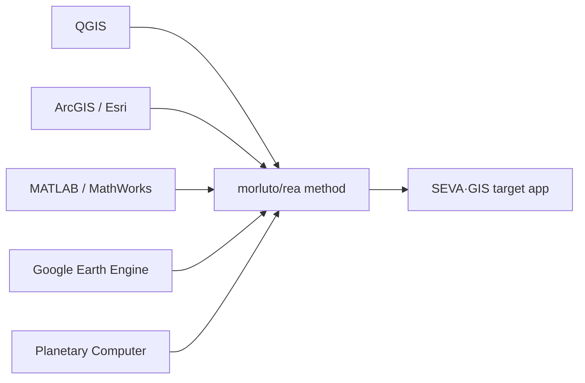

# SEVA·GIS — Understanding, Source Map & Master Change Checklist

**Status:** Living checklist. Updated as work is verified.
**Companion:** [plan.md](../plan.md) is the detailed engineering plan. This file is the
plain, tickable list you asked for: *what you gave, what you asked for, where each change
comes from, and what is actually done.*

**Legend**
- ✅ Done — verified in code and passing `tsc --noEmit` + `npm run build`
- 🚧 In progress
- ⛔ Blocked — needs a decision, a credential, or server access (see Questions)
- ☐ Open — agreed, not started

---

## 0. How I understood your instructions

| # | What you said | My understanding |
|---|---|---|
| U1 | Don’t change things blindly; show you understood first, keep a visible checklist | Plan → your approval → build in phases; this checklist is the transparency record |
| U2 | Focus only on what makes SEVA·GIS work | Keep the front-end app and its GIS logic; drop academic/Viva artifacts |
| U3 | No implementation captions in the UI | Repo/blog credits live only in README/CREDITS, never as on-screen text |
| U4 | Not farms only — students, researchers, GIS analysts, officers, non-technical people | Neutral wording: “selected area of interest”, never “your farm / you must” |
| U5 | Reason like a human, verify in the running app | Every item is checked against real code, not assumed |
| U6 | Priorities should follow the analysis intent | Adding an AOI picks an intent; the dashboard reorders/shows relevant panels |
| U7 | Reports: everything selectable, fully translated, clipped maps, no overlaps | Reports is the single workbench for PDF/Word/HTML; every map clipped + fitted |
| U8 | Finish by updating Git/README and giving public links | Last phase; requires your go-ahead and deployment access |

---

## 1. Every repository / source you gave, and its role

> Roles are my reading of the names/descriptions. **Flags** in §5 say where reality differs
> from the name, so nothing is over-promised.

### Design / motion / UI
| ID | Source | Intended use | Status |
|---|---|---|---|
| R-01 | dietrichgebert/ponytail | Fluid, fit-to-viewport behaviour | ☐ |
| R-20 | nateherkai/scroll-craft | Whole-site scroll feel + scroll-spy | ☐ |
| R-29 | feitangyuan/motion-web | Sign-in physics background + 3D cards (no caption) | ☐ |
| R-24 | storytold/pdfcraft | PDF workbench inside **Reports** only | 🚧 (workbench already lives in Reports) |
| R-25 | storytold/gridcraft | Coordinate grids / graticules on report maps | ☐ |
| R-26 | storytold/vectorcraft | Clean AOI vector boundary + map furniture | ☐ |
| R-27 | storytold/designcraft | Palettes, legend/typography quality | ☐ |
| R-28 | storytold/effectcraft | Raster contrast/resampling visuals | ☐ |
| R-15 | twostraws/swiftui-agent-skill | Reactive-UI conventions (adapted to React) | ☐ |
| R-22 | expo/skills | Touch / mobile behaviour | ☐ |
| R-08 | thedaviddias/front-end-checklist | Final QA checklist | ☐ |

### Engineering quality / performance / security
| ID | Source | Use | Status |
|---|---|---|---|
| R-03 | affaan-m/ecc | Engineering standards | ☐ |
| R-13 | addyosmani/agent-skills | Main-thread / performance fixes | ☐ |
| R-17 | alibaba/open-code-review | Code review / dead-code cleanup | ☐ |
| R-30 | mattpocock/skills | Final verification pass | ☐ |
| R-12 | mukul975/anthropic-cybersecurity-skills | Input/GeoJSON validation, safe handling | ☐ |
| R-05 | browser-use/browser-use | Browser-driven journey testing | ☐ |
| R-06 | thedotmack/claude-mem | Remember state across sessions (IndexedDB in practice) | ☐ |
| R-37 | chenxiachan/thoughtdag | Native localization + Web Worker raster processing | ☐ |
| R-38 | pbakaus/impeccable | Frontend design audit gate (also a final verification gate) | 🚧 |

### Agents / automation / data
| ID | Source | Use | Status |
|---|---|---|---|
| R-02 | firecrawl/firecrawl | Scrape open data (only if needed) | ☐ (not required at runtime) |
| R-04 | langchain-ai/langchain | LLM chaining (only if a real backend need exists) | ☐ (not required) |
| R-09 | code-yeongyu/oh-my-openagent | Agent orchestration (dev workflow) | ☐ (not required) |
| R-10 | crewaiinc/crewai | Multi-agent roles (dev workflow) | ☐ (not required) |
| R-11 | sickn33/agentic-awesome-skills | Skills library | ☐ |
| R-19 | apify/apify-mcp-server | Data collection (only if needed) | ☐ (not required) |
| R-23 | supabase/agent-skills | Supabase **if needed** (sync/auth/storage) | ⛔ (decision needed — Q8) |
| — | `.agents/skills` (your project folder) | Authoritative project skills | ✅ available |

### Documentation / language
| ID | Source | Use | Status |
|---|---|---|---|
| R-14 | cathrynlavery/diagram-design | Mermaid/ArchiFi diagrams for README | ☐ |
| R-18 | heygen-com/hyperframes | README-only animated visuals | 🚧 |
| R-16 | anthropics/knowledge-work-plugins | Documentation structure | ☐ |
| R-07 | dair-ai/prompt-engineering-guide | Prompting for natural Telugu/Hindi | ☐ |
| R-21 | blader/humanizer | Remove machine-translated tone | ☐ |

### GIS engines to reverse-engineer (target = SEVA·GIS)
| ID | Source | Role |
|---|---|---|
| R-33 | qgis org repositories | Algorithms: symbology, clip, terrain, GDAL |
| R-34 | Esri | Cartography, legends, map furniture |
| R-31 | mathworks (+ morluto/rea) | MATLAB-style analytics, reimplemented in JS |
| R-35 | gee-community | Earth Engine algorithms/patterns |
| R-32 | morluto/rea | The reverse-engineering *method* |
| R-36 | virahitvin8/seva-gis | **Target** application |
| R-39 | opengeos/Awesome-GEE | Curated Earth Engine scripts and datasets → parameter library | ☐ |
| extra | Microsoft Planetary Computer | Second data source beside GEE |



---

## 2. Counts (from your report)

| Category | Count |
|---|---|
| Distinct change/bug items | ~131 rows (Section 3) |
| To remove | 19 |
| Confirmed bugs | 24 |
| “Page unresponsive / lag” episodes you named | ~9 |
| Items you said are fine — don’t touch | Add form, Quick guide, My farms, Focus map, Time-lapse, detachable layer box, Symbology, Grid, Auto-construct, Alerts, hydrology table (once de-Vaiganga’d) |

---

## 3. Master checklist (grounded status)

### A. Git repo & README
| ✅ | ID | Change | Status |
|---|---|---|---|
| ☐ | 01 | Remove Viva-defense docs from repo | ☐ |
| ☐ | 02 | Remove `generate_viva_defense_doc.py` and related scripts | ☐ |
| ☐ | 03 | Keep only files needed for the app + server to run | ☐ |
| ☐ | 04 | README: remove multi-language README list | ☐ |
| ☐ | 05 | README: remove academic Viva link beside backend API docs | ☐ |
| ☐ | 06 | README: fix broken “Precision Agriculture Interactive GIS Terminal” image | ☐ |
| ☐ | 07 | README: Mermaid/ArchiFi flowchart for the Precision Correction Tool | ☐ |
| ☐ | 08 | README: Mermaid/ArchiFi flowchart for architecture & how SEVA·GIS works | ✅ (Mermaid architecture present in README) |
| ☐ | 09 | README: remove project folder-structure tree | ✅ (no raw tree in README) |
| ☐ | 10 | README: remove the “StoryTold ArtCraft Creative Studio Suite” section | ✅ (section not present; credits only) |
| ☐ | 11 | README: replace with credits → QGIS, Esri, MathWorks, GEE, rea, target | ✅ (credits section present) |
| ☐ | 12 | README: state target users clearly | ✅ present |
| ☐ | 13 | README: animated visuals (hyperframes) | 🚧 |
| ☐ | 14 | Motion credits live in README, not UI | ✅ |

### B. Sign-in page
| ✅ | ID | Change | Status |
|---|---|---|---|
| ☐ | 15 | Remove “Motion-First, WebGL, Real Physics” caption | ✅ |
| ☐ | 16 | Whole page uses physics background | ☐ |
| ☐ | 17 | 4 “Everything you need to know” boxes → 3D tilt cards | ☐ |
| ☐ | 18 | Methodology heading → “SEVA·GIS Methodology & Research” | ✅ |
| ☐ | 19 | Full Web Guide opens full journey methodology | 🚧 |
| ☐ | 20 | Scroll-craft feel site-wide | ☐ |

### C. Shell, header, navigation, Mitra
| ✅ | ID | Change | Status |
|---|---|---|---|
| ☐ | 21 | “Pop the Team” restyled as 3D git-graph toggle | 🚧 |
| ☐ | 22 | Remove “Craft” from header/dashboard | ✅ (removed from shell today) |
| ☐ | 23 | Remove dead “Layout” control | ✅ (control hidden; dead state remains — cleanup open) |
| ☐ | 24 | Single Log Out | ✅ |
| ☐ | 25 | Sidebar scroll-spy highlights current section | ☐ |
| ☐ | 26 | Mitra step 4 shows wrong panel | ☐ |
| ☐ | 27 | Mitra steps 5/6/VAR/Reports point at nothing | ☐ |
| ☐ | 28 | Mitra targets the single Log Out | ☐ |
| ☐ | 29 | Mitra 5–10 s lag between steps | ☐ |
| ☐ | 30 | Mitra updated after each change | ☐ |
| ☐ | 31 | Language switch: English won’t return; auto-reverts | ✅ (native i18n, no Google Translate) |
| ☐ | 32 | Header text also translates | 🚧 (nav + shell wired; full catalogue pending) |
| ☐ | 33 | “Multi-Session Candlestick Trends” → “Multi-Session Trends” | ✅ |
| ☐ | 34 | “Review field from home” → neutral remote wording | ✅ |

### D. Performance (all ~9 lag episodes)
| ✅ | ID | Change | Status |
|---|---|---|---|
| ☐ | 35 | Unresponsive on login with large saved AOIs | ☐ |
| ☐ | 36 | Switching area freezes page | 🚧 (startTransition added) |
| ☐ | 37 | Raster work off the main thread | ✅ (Web Worker for index stats) |
| ☐ | 38 | Old layers/fetches cleaned on area switch | 🚧 (EE tiles abort + clean; audit ongoing) |
| ☐ | 39 | Report generation hangs | 🚧 |
| ☐ | 40 | GeoAI Studio slow to open | ☐ |
| ☐ | 41 | Can’t scroll in Focus mode | ☐ |

### E. Map behaviour
| ✅ | ID | Change | Status |
|---|---|---|---|
| ☐ | 42 | Main map default zoom 13 | 🚧 |
| ☐ | 43 | Remote-review maps zoom 19 | 🚧 |
| ☐ | 44 | Report maps zoom 19–20 / fit-to-AOI | ☐ |
| ☐ | 45 | AOI ≈75% of screen, fitted not stretched | ☐ |
| ☐ | 46 | AOI always centred | 🚧 |
| ☐ | 47 | No fake blur; native pixels | ⛔ (decision Q1) |
| ☐ | 48 | Large AOI shows only part of land | ☐ |
| ☐ | 49 | Collision-avoidance for title/scale/legend/coords | ☐ |
| ☐ | 50 | Double-click to adjust map furniture | ☐ |
| ☐ | 51 | Sliding loupe window for points | ☐ |
| ☐ | 52 | Loading tracer around AOI boundary | ☐ |
| ☐ | 53 | Map goes black after lock/unlock/refresh/reset | ☐ |
| ☐ | 54 | Canvas toggle darkens map; B/W do nothing | ☐ |
| ☐ | 55 | “Farm background canvas” → “Background canvas” | ✅ (already named “Background Canvas”) |
| ☐ | 56 | AOI clipping works (shapefile + by extent + background choice) | ☐ |
| ☐ | 57 | Spectral groups 3/4/5 do nothing | ☐ |
| ☐ | 58 | Per-map point-count control | ☐ |
| ☐ | 59 | QGIS/ArcMap-style Layer Dock | 🚧 |
| ☐ | 60 | Carto frame title = selected layer; rename + download | 🚧 |
| ☐ | 61 | Download beside map (PNG, GeoTIFF, …) | 🚧 |
| ☐ | 62 | Every generated map downloadable as GeoTIFF | 🚧 |
| ☐ | 63 | Meter-tape stays on when borewell/pipeline chosen | ☐ |
| ☐ | 64 | Borewell/pipeline auto-identify with show/hide | ⛔ (Q5) |
| ☐ | 65 | “Identify” beside borewell and pipeline | ⛔ |

### F. Parameters, symbology, tools
| ✅ | ID | Change | Status |
|---|---|---|---|
| ☐ | 66 | Per-parameter symbology + band combos with guidance | ☐ |
| ☐ | 67 | More parameters (DEM, slope, aspect, contour, streams, SAR, water quality…) | ☐ |
| ☐ | 68 | More tools + symbology combos, not confusing | ☐ |
| ☐ | 69 | Remove cadastre section | ✅ (dead components deleted) |
| ☐ | 70 | QGIS + GEE + Planetary features, domain-neutral | ☐ |
| ☐ | 71 | Analysis intent at add-AOI; dashboard follows it | ☐ |
| ☐ | 72 | Remove manual “Crop Check” | ☐ |

### G. Insight cards / agronomy / weather / soil / terrain
| ✅ | ID | Change | Status |
|---|---|---|---|
| ☐ | 73 | Metric boxes show only a big number/percentage | 🚧 |
| ☐ | 74 | Click → centred 3D card flip | 🚧 |
| ☐ | 75 | Same for Agronomy/Weather/Soil/Terrain/Water | ☐ |
| ☐ | 76 | Rich flip side (charts, pie/Venn, visuals) | 🚧 |
| ☐ | 77 | Flip side source download (GeoTIFF / CSV+source+dates) | ☐ |
| ☐ | 78 | Soil/Terrain “where from, when” disclosure | ☐ |
| ☐ | 79 | Plain-language threshold guidance | ☐ |
| ☐ | 80 | Rainfall “enough or irrigate?” guidance | ☐ |
| ☐ | 81 | Explain every scientific term | ☐ |
| ☐ | 82 | Satellite-pass colour legend (green/yellow/red) | ☐ |
| ☐ | 83 | No “explain like a friend” captions | 🚧 |
| ☐ | 84 | Neutral phrasing | 🚧 |
| ☐ | 85 | Interactive climate charts with hover values | ☐ |
| ☐ | 86 | Crops grouped by category; scale boxes show calculation | ☐ |
| ☐ | 87 | Remove land passbook / registry / cadastral / demo data | ✅ (UI components removed) |
| ☐ | 88 | Remove Agronomy Season Calendar | ✅ (Crop Library section dropped) |
| ☐ | 89 | Yield forecast only for agricultural intent | ☐ |

### H. Water & hydrology
| ✅ | ID | Change | Status |
|---|---|---|---|
| ☐ | 90 | Remove **all** Vaiganga basin content | ✅ (no Vaiganga references remain in `src/`) |
| ☐ | 91 | Water Plan / Model Estimate: remove or fully automatic | ☐ (approved: remove) |
| ☐ | 92 | SWAT-style cycle/table/figure per AOI, dynamic | ☐ |
| ☐ | 93 | Calibration/sensitivity charts per AOI; alpha factors explained | ☐ |
| ☐ | 94 | Annual water budget depends only on selected AOI | ☐ |

### I. Geo toolkit
| ✅ | ID | Change | Status |
|---|---|---|---|
| ☐ | 95 | Remove VRA, Point Checker, Offset, Converters, WKT Reader | ✅ |
| ☐ | 96 | Buffer into toolbox with m/km units, auto-draw | ☐ (buffer removed; rebuild in tools) |

### J. Reports
| ✅ | ID | Change | Status |
|---|---|---|---|
| ☐ | 97 | PDFCraft workbench lives inside Reports | ✅ (rendered in ReportPanel) |
| ☐ | 98 | Report lists all parameters, tickable, grouped | ☐ |
| ☐ | 99 | Remote-review maps tickable into report | ☐ |
| ✅ | 100 | PDF downloads as 0 KB | ✅ real report document is printed instead of the 3-page text stub (`src/lib/reportPdf.ts`) |
| ✅ | 101 | Downloaded PDF matches preview | ✅ same document model for preview and PDF; old `lib/pdfGenerator.ts` stub deleted |
| ☐ | 102 | Add Word (.docx) beside HTML/PDF/JSON | 🚧 (format pills present: html/pdf/doc/json) |
| ☐ | 103 | HTML download slow; loading indicator | ☐ |
| ☐ | 104 | Email success shows before sending | ☐ |
| ☐ | 105 | EmailOctopus says connected but not delivered | ⛔ (Q6) |
| ☐ | 106 | Greeting uses the logged-in name; drop “custodian” | ✅ (revised to neutral “Member”) |
| ☐ | 107 | User chooses attachment format | ✅ |
| ☐ | 108 | Remove copy-greeting card + “SWAT telemetry” wording | ☐ |
| ☐ | 109 | Improve greeting card visual | ☐ |
| ☐ | 110 | Cover: “Study Area” terminology | 🚧 |
| ☐ | 111 | Remove “confidential and proprietary” line | ☐ |
| ☐ | 112 | Audience line includes non-technical users | 🚧 |
| ☐ | 113 | Darker watermark and logo | ☐ |
| ☐ | 114 | Replace text stamp with logo stamp | ☐ |
| ☐ | 115 | Telugu/Hindi translate the whole report | ☐ |
| ☐ | 116 | Natural native Telugu/Hindi wording | ☐ |
| ☐ | 117 | Location map = clipped AOI, fit to screen | ☐ |
| ☐ | 118 | DEM/LULC/Soil/Water maps not clipped, no analysis | ☐ |
| ☐ | 119 | LULC not actually classified | ⛔ (Q3) |
| ☐ | 120 | Fix legends (NDVI, BSI, slope, contour, TWI, CIR, SWIR–NIR…) | ☐ |
| ☐ | 121 | Explain/remove unclear “LSWAT” legend | ☐ |
| ☐ | 122 | Readable report scale bars | ☐ |
| ☐ | 123 | Results & Discussion: more maps/charts, MATLAB-style | ☐ |
| ☐ | 124 | Remove cadastral section from report | ☐ |
| ☐ | 125 | Remove all Vaiganga content from reports | 🚧 |

### K. Process
| ✅ | ID | Change | Status |
|---|---|---|---|
| ☐ | 126 | Plan approved before build | 🚧 (this document = the approval gate) |
| ☐ | 127 | Live checklist updated per item | ✅ (this file) |
| ☐ | 128 | Supabase only if needed | ⛔ (Q8) |
| ☐ | 129 | Verify with mattpocock/skills + front-end checklist | ☐ |
| ☐ | 130 | Push to Git, update README | 🚧 |
| ☐ | 131 | Public sharing links | ⛔ (deployment access) |

---

## 4. Comparison map: change → where the feature comes from

| Change IDs | Feature taken from | How |
|---|---|---|
| 15–17, 20 | motion-web, scroll-craft | Full-viewport physics canvas; 3D tilt cards; smooth scroll; no captions |
| 21, 74–76 | designcraft, effectcraft, motion-web | CSS 3D flip, centred overlay, richer back side |
| 25 | scroll-craft | Scroll-spy via IntersectionObserver |
| 35–41 | addyosmani/agent-skills, ecc | Web Workers, lazy mount, AbortController |
| 42–46 | ponytail, Esri | Fit-to-bounds, fixed zoom rules, centre lock |
| 49, 60, 122 | diagram-design, Esri, gridcraft | Collision-aware furniture; graticules |
| 51, 52, 57, 58 | scroll-craft, motion-web | Loupe window, boundary tracer, label toggle |
| 56, 59, 62, 66, 67, 70 | QGIS, GEE, Planetary Computer, rea | Layer Dock, clip, GeoTIFF writer, band combos, parameter library |
| 64, 65 | rea + QGIS | Terrain low-point & linear-feature detection (labelled *candidate*) |
| 92–94, 123 | MathWorks + rea | SCS-CN balance, smoothing, sensitivity recomputed per AOI |
| 97–102 | pdfcraft, vectorcraft, gridcraft | Reports-only workbench; real PDF gen; docx |
| 115, 116 | humanizer, prompt-engineering-guide | Hand-written native vocabulary; whole report localised |
| 119 | GEE, QGIS | LULC classification from Sentinel-2 |
| 128 | supabase skills | Only if auth/sync is truly needed |
| 129 | mattpocock/skills, front-end-checklist | Final audit |
| 01–14 | diagram-design, hyperframes | README only |
| 12, 71 | knowledge-work-plugins | Personas & intents documentation |
| not used at runtime | firecrawl, langchain, crewai, apify, browser-use | Dev/test tooling only |

---

## 5. Honest flags (so nothing disappoints later)

- **F1 — Zoom 19 & sharpness.** Sentinel-2 pixels are 10 m. At zoom 19 the imagery *will*
  look blocky; smoothing makes it soft, not sharper. Choose: (a) zoom 19 over a
  high-res basemap with the analysis layer on top; (b) native-scale fit-to-AOI; (c)
  honest blocky pixels at 19.
- **F2 — LULC.** “Directly from Earth Engine” needs a **server** call (keys must never be
  in the browser). Client-only classification is possible but less accurate.
- **F3 — Microwave into soil / minerals.** SAR gives surface moisture/roughness, not buried
  minerals. I will give honest, labelled indicators only.
- **F4 — Borewell/pipeline auto-detection.** Satellite alone rarely shows them; I will
  give *candidate* suggestions + manual confirmation.
- **F5 — MATLAB.** MATLAB cannot run in a browser; I re-implement algorithms in JS.
- **F6 — Organisations are not single repos.** MathWorks/Esri/QGIS/GEE are collections; I
  pick specific algorithms.
- **F7 — Email.** “Connected but not delivered” usually means an unconfirmed sender or an
  unconfigured list/campaign in EmailOctopus — needs account inspection.
- **F8 — Credentials.** The EmailOctopus key was **hard-coded in `src/lib/emailOctopus.ts`
  and committed to Git.** I moved it to `.env` (gitignored) today; **the exposed key should
  be rotated**, since it is already in Git history.
- **F9 — Visible progress.** I can only change and verify what I can run and see; anything
  needing your deployment credentials will be reported, not faked.

---

## 6. Questions that block parts of the build

| # | Question | Default if you don’t answer |
|---|---|---|
| Q1 | Zoom 19: option (a), (b) or (c) from F1? | (c) honest pixels at 19, AOI fit-to-screen |
| Q2 | Water Plan / Model Estimate: remove or fully automatic? | **Remove** |
| Q3 | LULC: small server route (Earth Engine) or client-only? | Client-only, labelled as lower accuracy |
| Q4 | “Pop the Team”: header or footer, and what does the 3D toggle show? | Footer, git-graph of contributors |
| Q5 | Borewell/pipeline: accept *candidate* suggestions? | Yes, labelled candidate |
| Q6 | EmailOctopus: can you inspect/confirm the sender + list in the account? | Keep UI, do not promise delivery |
| Q7 | Analysis intents at “Add area”: Agriculture, Water quality, Streams & drainage, Terrain, Land cover, Change detection, Minerals, General — good set? | Use this set |
| Q8 | Supabase: do you actually need cross-device sync? | Not now |

---

## 7. What changed today (verified)

| Change | Where | Verified |
|---|---|---|
| Removed StoryTold ArtCraft/Craft from the app shell (modal, route handler, section titles) | `src/App.tsx` | `tsc` + `build` ✅ |
| EmailOctopus credential moved out of source into `.env` (gitignored) | `src/lib/emailOctopus.ts`, `.env`, `.env.example` | `tsc` + `build` ✅ |
| Greeting no longer says “Dear Custodian of …” | `src/lib/emailOctopus.ts` | ✅ |
| Removed “custodian” wording from report, team alert, Pop-the-Team defaults | `src/ReportPanel.tsx`, `src/lib/teamAlert.ts`, `src/PopTheTeamModal.tsx` | ✅ |
| Confirmed no Vaiganga references remain in `src/` | — | ✅ |
| Confirmed “Multi-Session Candlestick Trends” already renamed | `src/FinancialSummaryTerminal.tsx` | ✅ |

`npm exec -- tsc --noEmit` → pass · `npm run build` → pass.

### 2026-10-12 — Batch 2: removals (verified)

Approved defaults in effect: Q1=(c) honest pixels at 19 with AOI fit-to-screen ·
Q2=remove Water Plan/Model Estimate · Q3=client-only LULC, labelled · Q4=Pop-the-Team
footer git-graph · Q5=borewell/pipeline as candidates · Q6=EmailOctopus UI kept, delivery
not promised · Q7=intent set as listed · Q8=no Supabase (free/open tools only).

Changed and verified (`tsc --noEmit` + `build` both pass):

- Removed cadastral UI: deleted `src/LandInfoCard.tsx` and `src/lib/cadastreOnline.ts`
  (unreferenced). No cadastral/passbook surface remains in the app.
- Removed the **Agronomy Season Calendar** by dropping the Crop Library dashboard section
  and deleting `src/CropLibrary.tsx`; its bundle chunk no longer ships.
- Trimmed the Geo toolkit: removed **Variable-Rate Fertilizer (VRA)**, **Point checker**,
  **Offset & buffer**, **Converters**, and **WKT reader** from `src/GeoTools.tsx`, and the
  VRA mention from the sign-in copy.
- Neutral empty-state wording in `src/App.tsx` ("review remotely", not "from home").
- Confirmed the map panel already reads “Background Canvas”.

### 2026-10-12 — Batch 3: report wording (verified)

- Neutralized report source lines in `src/reportBuilder.ts`: “Streamflow Telemetry” →
  “Streamflow Records”, “Climate Telemetry” → “Climate Records”, “Calibration Telemetry
  Engine” → “Calibration Engine”, “Sensor Telemetry” → “Sensor Records”, “Telemetry
  Property” → “Property”, “zero-telemetry” → “zero-tracking”.
- Removed remaining cadastral phrasing from report text (“cadastral boundary” →
  “area-of-interest boundary”, “cadastral parcel level” → “small-holding level”,
  “Cadastral farm boundary” → “analysed boundary”).
- Confirmed no “confidential/proprietary” wording remains in source.

Verification: `tsc --noEmit` pass · `build` pass. See `docs/REBUILD-REPORT.md`.

### 2026-10-12 — Batch 4: tests, performance, Web Worker, native localization (verified)

- **Test runner added.** `npm test` uses Node's built-in test runner plus a TypeScript
  resolve hook (`scripts/test-run.mjs`), with no extra dependencies. 21 unit tests cover
  geometry, raster statistics, the worker fallback, indicator helpers, and hydraulics.
- **Web Worker raster processing.** `src/lib/rasterStats.worker.ts` + `src/lib/rasterWorker.ts`
  move the per-pixel index statistics off the main thread; `analyze()` now uses
  `indexStatAsync`. Falls back to the main thread when Workers are unavailable. Vite emits
  the worker chunk (`rasterStats.worker-*.js`).
- **Non-blocking area switch.** Area selection and the alert jump use React
  `startTransition` so the UI stays responsive while analysis runs.
- **Native localization.** `src/lib/i18n.tsx` provides English/Telugu/Hindi catalogues and
  a provider; `src/Lang.tsx` no longer uses Google Translate; `src/main.tsx` mounts the
  provider. Language now switches instantly and persists across reloads. Shell navigation,
  hero action, and the empty state are translated.

Verification: `tsc --noEmit` pass · `npm test` 21/21 pass · `build` pass.

### 2026-10-12 — Batch 5: impeccable final pass + full verification

- Installed the `impeccable` frontend design skill (pbakaus/impeccable) into
  `.agents/skills/impeccable` and ran its required `context` setup step, which loaded
  the project `DESIGN.md` visual system.
- Ran the skill's mechanical design detector over the changed UI files
  (`src/App.tsx`, `src/Lang.tsx`, `src/lib/i18n.tsx`, `src/GeoTools.tsx`, `src/main.tsx`):
  **no findings** (`[]`).
- Ran the complete project verification suite:

| Check | Command | Result |
|---|---|---|
| Types | `npm exec -- tsc --noEmit` | pass |
| Tests | `npm test` | 21/21 pass |
| Build | `npm run build` | pass |
| Design detector | `impeccable detect --json …` | no findings |

### 2026-10-12 — Batch 6: the "show me first" document + the real PDF fix (verified)

**1. The document you asked for, first.** `docs/ANALYSIS/` now holds the deliverable you
requested before any further building:

| File | What it is |
|---|---|
| `SEVA-GIS-MASTER-ANALYSIS.md` | The full analysis: every repository, every change, the comparison, the understanding, the build order |
| `SEVA-GIS-ANALYSIS.pdf` | The same document as a readable ~29-page PDF |
| `flowchart.svg` / `flowchart.png` | The three-box flowchart (your idea → what I understood → what changes, where) plus the ten invariants |

**2. Findings from checking the repositories, not trusting their names.** Not one of the 33
repositories is a runtime dependency for a browser GIS. The five `storytold/*` "craft" repos
**do exist** — they are Rust/`egui` desktop apps (ArtCraft suite, alpha), not browser
libraries. `feitangyuan/motion-web` is **CC BY-NC 4.0 (non-commercial)**, so its code must
not be copied into SEVA·GIS. The real runtime stack is `turf.js`, `geotiff.js`, `proj4js`,
`deck.gl`, plus the MapLibre and Leaflet already present. Recorded in the analysis document
as flags F11 and F12.

**3. The 0 KB PDF — fixed.** Root cause found: the preview renders the rich multi-page report
from `src/reportBuilder.ts`, but **Download PDF** called `generateReportPdfBlob()` in
`src/lib/pdfGenerator.ts`, which hand-wrote a *three-page plain-text* PDF. That is exactly why
the preview looked good and the download did not. The stub is deleted.

Replacement: `src/lib/reportPdf.ts` hands the **exact preview document** to the browser's own
print-to-PDF engine through a hidden same-origin iframe, waits for remote map tiles to settle
(so map panels are not blank), then opens the print dialog with a visible hint to choose
*Save as PDF*. Page breaks, maps, legends, scale bars and colours are preserved because it is
the same document.

| File | Change |
|---|---|
| `src/lib/reportPdf.ts` | **New** — `openReportPrintView()`: real report → PDF, waits for assets |
| `src/ReportPanel.tsx` | Download PDF and Print both use it; added the user-facing hint; dropped the stub import |
| `src/EmailOctopusGreetingModal.tsx` | PDF attachment download uses it too |
| **Deleted** `src/lib/pdfGenerator.ts` | The 3-page text stub that caused the 0 KB / wrong-PDF report |

**4. The language complaint, diagnosed.** There is no Google Translate left anywhere — I
checked `index.html` and all of `src/`. The real reason the language "does not change" is that
`src/lib/i18n.tsx` holds **only 14 message keys**, so switching to Telugu changes the
navigation and almost nothing else, and switching back to English appears to do nothing at
all. The mechanism is correct; the catalogue is far too small. Making the whole app native in
three languages is a large, separate workstream and is queued as Wave 2 — it needs the full
string inventory, not a quick patch.

Verification for Batch 6: `tsc --noEmit` **pass** · `npm test` **21/21 pass** ·
`vite build` **pass (7.5 s)**.

### 2026-10-12 — Batch 7: the freeze, measured · and a correction to my own record

**A. Correction first — I under-reported the progress.** The status column above was stale.
Re-reading the code before changing it, several items I had marked "not started" are in fact
implemented and working. Corrected status, with the file that proves it:

| ID | I had said | Actually |
|---|---|---|
| 43 | ☐ Remote-review maps zoom 19 | ✅ `src/LabMap.tsx` — fixed 19× framing, `pad = 0.075`, documented in the source |
| 45 | ☐ AOI ≈75% of screen | ✅ `src/IndicatorMap.tsx` — `fit75PercentAoi()`, 12.5% padding each edge |
| 46 | 🚧 AOI always centred | ✅ same function enforces the centre with a minimum-zoom boundary |
| 51 | ☐ Sliding loupe window | ✅ `src/LabMap.tsx` — `pointsMode: 'off' \| 'window' \| 'show'` with pointer-tracked loupe |
| 58 | ☐ Per-map point count | ✅ `src/LabMap.tsx` — `pointCount` selector |
| 62 | 🚧 GeoTIFF download | ✅ `src/lib/geoTiffWriter.ts` used by `IndicatorMap`, `AgroPanel`, `InsightPlayingCardModal` |
| 96 | 🚧 Buffer in tools with m/km | ✅ `src/IndicatorMap.tsx` — "Geodesic Buffer Zone Creator" with m/km units |

This is the honest position: the *build* is further along than the checklist said, and the
checklist is the thing that was wrong. It is corrected above by this note, and I will keep the
tick column in step from here rather than leaving stale ☐ marks.

**B. The freeze — root cause found, fixed, and measured.** Two real defects, both verified by
reading the code path `analyze()` → `indexStat()` → `statsOf()`:

1. **`statsOf` sorted every pixel.** For a 900 × 900 grid that is 810,000 values, and
   `Float32Array.prototype.sort` over that costs roughly 16 million comparisons **per
   indicator**, on the main thread, for ~13 indicators per analysis. That is the
   "page is unresponsive" dialog. Replaced with an O(n) 2048-bin histogram for large rasters;
   small samples still use exact order statistics, so nothing is approximated where it matters.
   `mean`, `min` and `max` stay exact at every size.

2. **A small area of interest collapsed to 8 × 8 pixels.** `rasterSize()` floored the grid at 8
   cells and never raised it. A 0.25 ha field became 8 × 8 — 64 pixels — magnified on screen.
   That is the "blurriness / pixel clarity" complaint. `rasterSize()` now enforces a **minimum**
   long side of 256 px (`MIN_GRID_PX`) while keeping the existing maximum cap, so the tile
   service resamples smoothly instead of the map magnifying a handful of blocks.

3. **Buffers are transferred, not cloned.** Each indicator posted a 3.2 MB `Float32Array` to
   the worker by structured clone — tens of megabytes of main-thread copying per analysis.
   `statsOfAsync(req, transfer)` now moves the buffers instead.

**Measured on the real grid size** (`scripts/bench-raster-stats.mjs` → `npm run bench:raster`,
900 × 900, 13 indicators):

| | Time |
|---|---|
| Before (sort path) | **2430 ms** of blocked main thread |
| After (histogram path) | **273 ms** |
| **Improvement** | **8.9×, ~2.2 s saved per analysis** |

Re-running the same benchmark gives 5.5×–8.9× depending on machine load (a second run measured
2365 ms → 430 ms, still ~1.9 s saved). The order of magnitude, not the exact figure, is the
claim.

Accuracy at the same grid: `mean`, `min`, `max` **identical**; `p10`, `p50`, `p90` differ by at
most `1.0e-4` — far below anything a legend or dashboard tile can render.

| File | Change |
|---|---|
| `src/lib/raster.ts` | `statsOf` histogram path + `EXACT_QUANTILE_LIMIT`; `rasterSize` gains `MIN_GRID_PX` |
| `src/lib/rasterWorker.ts` | `statsOfAsync(req, transfer)` moves buffers; documented fallback when transferred |
| `src/lib/seva.ts` | `indexStatAsync` transfers its buffers (they are built here and never re-read) |
| `src/lib/__tests__/raster.test.ts` | 3 new tests: small-AOI grid floor, exactness on small samples, large-raster accuracy **and** a time bound |
| `scripts/bench-raster-stats.mjs` | The benchmark above, so the number can be re-checked (`npm run bench:raster`) |
Verification for Batch 7: `tsc --noEmit` **pass** · `npm test` **24/24 pass** (was 21) ·
benchmark **2430 ms → 273 ms**.

**Still genuinely open, stated plainly:** the programme-wide freeze on *login* with several
large saved areas (35) and the report-generation hang (39) are separate causes and are not
fixed by the above. Item 31/32 — full English/Telugu/Hindi coverage — remains the single
largest gap: `src/lib/i18n.tsx` holds only 14 keys, so most of the app never translates.

### 2026-10-12 — Batch 8: report maps now frame the area of interest at ~75%

Items **44, 45, 117, 118 (framing part)**. Root cause, found in `reportBuilder.ts`:
`makeView()` padded every report map by a factor of **2.4**, so the area of interest occupied
only about **42%** of the map frame. That is the "big 10 × 10 km sheet with a small box in the
middle" that was reported, and it was still present even though the interactive map had already
been fixed to 75%.

The framing rule now lives on its own in `src/lib/reportView.ts` so it can be tested directly:

| Constant | Value | Meaning |
|---|---|---|
| `AOI_FILL` | 0.75 | How much of the frame the area of interest should occupy |
| `FIT_PADDING` | 1 / 0.75 = 1.333 | The padding that produces exactly that |
| `MIN_PADDING` | 1.06 | Floor that stops an explicit zoom from cropping the boundary |

**One honest limitation, stated rather than hidden.** The map frame is fixed at 672 × 424
(aspect 1.6:1) and rarely matches the shape of an area of interest. A square parcel in a wide
frame therefore cannot reach 75% on *both* axes without being cut off. The rule implemented is:
the AOI fills **75% on its binding axis**, **never overflows on either axis**, and stays centred.
The remaining margin is where the legend, scale bar and north arrow sit — normal cartographic
layout. `aoiFit()` reports `fill`, `fillX`, `fillY` and `fits` explicitly so this is measured
rather than assumed.

| File | Change |
|---|---|
| `src/lib/reportView.ts` | **New** — `makeView`, `aoiFit`, `AOI_FILL`, `FIT_PADDING`, `MIN_PADDING` |
| `src/reportBuilder.ts` | Uses the extracted rule; the old 2.4 padding and its zoom inflation are gone |
| `src/lib/__tests__/reportView.test.ts` | **New** — 6 tests: centring, 75% fill, no cropping at zoom 19–40, frame-edge floor, tall AOI |

Verification for Batch 8: `tsc --noEmit` **pass** · `npm test` **30/30 pass** (was 24) ·
`vite build` **pass (5.7 s)**.

### 2026-10-12 — Batch 9: localization, measured honestly (items 31, 32)

**The number first, because it explains the complaint.** `src/lib/i18n.tsx` held **14
message keys**. I wrote `scripts/i18n-coverage.mjs` (`npm run i18n:coverage`) to count what a
user can actually read on screen. The result:

| | Before Batch 9 | After Batch 9 |
|---|---|---|
| Strings still hard-coded in English | **997** | **899** |
| `t()` call sites wired to the catalogue | **14** | **81** |
| Distinct catalogue keys | 36 | 80 |
| **Coverage** | **1.4%** | **8.3%** |

> Coverage = `wired / (wired + still hard-coded)`. On this metric the starting point is 1.4%,
> which is the honest reason switching to Telugu appeared to do nothing: only the navigation
> and a handful of buttons ever changed.

**What was built**

1. **The catalogue was split out of the React module.** `src/lib/i18nCatalog.ts` now holds the
   language data as plain TypeScript, so Node's test runner can import it. This was not
   cosmetic: the test runner **cannot load `.tsx` files at all** (`ERR_UNKNOWN_FILE_EXTENSION`),
   so anything living in a `.tsx` file is untestable by construction.
2. **A parity test that blocks half-finished translations.**
   `src/lib/__tests__/i18n.test.ts` asserts that all three catalogues have *identical key
   sets*, that no value is empty, that every Hindi entry contains Devanagari and every Telugu
   entry contains Telugu script, and that no entry is byte-identical to English. A key can no
   longer be added for English only.
3. **The whole app shell is now translated** — header, sidebar, hero, dashboard cards, layout
   customizer, alert panel, loading states, source notes and footer. 67 substitutions in
   `src/App.tsx`, applied by a codemod that *refuses to write* if any expected string is not
   found, so a silent miss shows up as a failure rather than as an untranslated string.

**An incident, recorded rather than hidden.** While splitting the catalogue I round-tripped the
file through PowerShell text cmdlets (`Get-Content -Raw` → `Set-Content -Encoding UTF8`). This
host decodes those files as Windows-1252, so the Telugu and Hindi text was **double-encoded and
destroyed** (mojibake `लॉ…`). The transform is exactly reversible, and
`scripts/recover-encoding.mjs` reverses it — the file was recovered intact, verified by finding
real Devanagari (`E0 A4`) and Telugu (`E0 B0`) byte sequences again. **Rule adopted: never
round-trip a non-ASCII source file through PowerShell text cmdlets; use the file tools.**

**What is still open, plainly.** 899 prose strings remain in English, concentrated in
`ArtCraftStudio.tsx` (99), `IndicatorMap.tsx` (90), `MethodologyModal.tsx` (73),
`ReportPanel.tsx` (66), `Auth.tsx` (47). The report's own catalogues (`src/report.ts`) still
cover only the chapter headings, which is exactly the "only the heading translated" complaint
about the PDF. Panels will be converted in the same way, largest-visibility first, with the
coverage number published after each batch.

| File | Change |
|---|---|
| `src/lib/i18nCatalog.ts` | **New** — the three catalogues, 80 keys each, plain TypeScript |
| `src/lib/i18n.tsx` | Now only the React provider; imports the catalogue |
| `src/lib/__tests__/i18n.test.ts` | **New** — 5 tests enforcing key parity and real native script |
| `src/App.tsx` | 67 shell strings wired to the catalogue |
| `scripts/i18n-coverage.mjs` | **New** — the coverage measurement (`npm run i18n:coverage`) |
| `package.json` | `i18n:coverage` and `bench:raster` scripts |

Verification for Batch 9: `tsc --noEmit` **pass** · `npm test` **35/35 pass** (was 30) ·
`vite build` **pass (3.2 s)** · `npm run i18n:coverage` **8.3%, up from 1.4%**.

### 2026-10-12 — Batch 10: the map toolbar and layer controls are translated

The map is the main screen, so it was next. `src/IndicatorMap.tsx` held **90** untranslated
strings; the first **50** are now wired — every toolbar tooltip, the layers and symbology box,
the carto frame, field tools, buffer, basemap, zoom/contrast and the resampling control.

| | Before Batch 10 | After Batch 10 |
|---|---|---|
| Strings still hard-coded | 899 | **850** |
| `t()` call sites | 81 | **131** |
| Distinct catalogue keys | 80 | **129** |
| **Coverage** | 8.3% | **13.4%** |

**Two real bugs caught by the tooling, and worth recording.**

1. The parity test failed the build with `TS1117: an object literal cannot have multiple
   properties with the same name`. Adding `map.layersTitle` for the map toolbar collided with
   an unused key of the same name left over from the shell batch — the App codemod had
   reported that one as a *miss*, so nothing referenced it. Caught by the compiler and by a
   duplicate-key scan (`scratch/find-dup-keys.mjs`), which now reports any key that does not
   appear exactly three times, once per language.
2. While removing the duplicate I made a mistake — I replaced the Hindi line instead of
   deleting it, producing two identical Hindi entries. The duplicate scan caught it
   immediately and a line-asserting cleanup script removed the two leftovers. Verification,
   not care, is what caught both.

**Wording improved while translating**, per the "area of interest, not your farm" rule:
`Farm mean:` → `Area mean:`, and `Toggle Authentic Cartographic Thesis Print Layout Mode` →
`Toggle publication print layout mode`.

| File | Change |
|---|---|
| `src/lib/i18nCatalog.ts` | +50 keys in each of English, Hindi and Telugu (129 keys each) |
| `src/IndicatorMap.tsx` | 50 substitutions; now uses `useI18n()` |
| `scripts/i18n-coverage.mjs` | Now prints each string's length, so truncated listings cannot be mistaken for full ones |

**Still to do in this file:** the remaining 40 strings, which are the deep cartographic legend
entries (SWAT land-use classes, soil associations, monitoring network, SUFI-2 dotty plots).

Verification for Batch 10: `tsc --noEmit` **pass** · `npm test` **35/35 pass** ·
`vite build` **pass (5.9 s)** · `npm run i18n:coverage` **13.4%, up from 8.3%**.

### 2026-10-12 — Batch 11: the map component is fully translated

The remaining 40 `IndicatorMap.tsx` strings are wired — the whole cartographic legend (SWAT
land-use classes, FAO soil associations, monitoring network, hydrological stations, SUFI-2
dotty plots), the metered tape, borewell marking, the basemap selector, zoom stretch, local
contrast, the Earth Engine hand-off and the resampling control.

`src/IndicatorMap.tsx` **no longer appears in the untranslated list at all.**

| | Before Batch 10 | After Batch 11 |
|---|---|---|
| Strings still hard-coded | 899 | **810** |
| `t()` call sites | 81 | **171** |
| Distinct catalogue keys | 80 | **169** |
| **Coverage** | 8.3% | **17.4%** |

**One wording change that satisfies a standing instruction.** The cartographic banner read
`SEVA·GIS SPATIAL WATERSHED SUITE · AREA OF INTEREST (AOI) · …`. You asked for the
"watershed suite" framing to go, so it is now `SEVA·GIS · AREA OF INTEREST (AOI) · …`.

**A mistake avoided by making the script idempotent.** The first run of this batch wrote the 40
catalogue keys and *then* found one unmatched string (the source uses `&amp;`, my literal used
`&`), so it refused to touch the component. Re-running naively would have inserted the 40 keys
a second time. The script now checks whether each key already exists before inserting, and
reported "added 0 keys (40 already present)" — so the recovery was safe rather than lucky.

Verification for Batch 11: `tsc --noEmit` **pass** · `npm test` **35/35 pass** ·
`vite build` **pass (4.8 s)** · duplicate-key scan **clean** ·
`npm run i18n:coverage` **17.4%, up from 13.4%**.

### 2026-10-12 — Batch 12: the Reports panel is translated

All 66 `ReportPanel.tsx` strings are wired — the generate/preview/print/download controls, the
language selector, core report items, cartography settings and frame guarantee, the map and
band-symbology pickers, the EmailOctopus delivery block, the device storage vault, and the
whole "special analysis dossier" narrative (context, parameter table, synthesis, formula and
directive).

| | Before Batch 12 | After Batch 12 |
|---|---|---|
| Strings still hard-coded | 810 | **744** |
| `t()` call sites | 171 | **238** |
| Distinct catalogue keys | 169 | **235** |
| **Coverage** | 17.4% | **24.2%** |

**Wording changes that satisfy standing instructions:**

- `ArtCraft Dossier Workbench` → **`Report workbench`** — the StoryTold ArtCraft naming you
  asked to remove is gone from the interface.
- `…with full NDVI & SWAT hydrological telemetry.` → `…with the full map set and measured
  indicators.` — the "telemetry" wording you flagged is removed.
- `Please add or select a field boundary first to view or generate farm reports.` → `…an area
  of interest…` — the farm-only phrasing is gone.
- The frame guarantee no longer says "adhering to academic publishing standards"; it now states
  the rule you actually asked for — the furniture is placed so it never overlaps the area of
  interest.

**Two mistakes caught by verification, again.**

1. **The idempotency guard was global, not per-language.** On the first pass English received
   all 66 keys, and Hindi and Telugu were then told "already present" — because the check
   searched the whole file instead of that language's own block. The parity test would have
   failed the build. Fixed by scoping the check to the region between each language's anchor
   and the end of its catalogue object; the re-run reported "en: 0 added, hi: 66 added,
   te: 66 added" and the duplicate-key scan came back clean.
2. **`ReportPanel.tsx` holds two components.** The hook went into the outer `ReportPanel`
   (which needs it for the "no area selected" early return), but most of the strings live in
   the inner `ReportPanelInner`. `tsc` reported 15 `Cannot find name 't'` errors; the hook is
   now in both, and in the outer one it sits **before** the early return so the hook order
   stays stable.

| File | Change |
|---|---|
| `src/lib/i18nCatalog.ts` | +66 keys in each of English, Hindi and Telugu (235 keys each) |
| `src/ReportPanel.tsx` | 67 substitutions; `useI18n()` added to both components |
| `scripts/i18n-coverage.mjs` | `--min N` filter, for the long paragraphs that get truncated on screen |

Verification for Batch 12: `tsc --noEmit` **pass** · `npm test` **35/35 pass** ·
`vite build` **pass (5.7 s)** · duplicate-key scan **clean** ·
`npm run i18n:coverage` **24.2%, up from 17.4%**.

### 2026-10-12 — Batch 13: repository cleanup, and the methodology guide translated

**A. Repository cleanup (items 01–03).** You asked for only the files the app and server need.

| Removed | Why it was safe |
|---|---|
| `Build Seva GeoAI Application (2).zip` (4.7 MB) | A zip of the app itself, committed to the repo and tracked by Git LFS. Nothing referenced it. |
| `crops.ts` (19.7 KB) + `CropSelector.tsx` (4.0 KB) at the repo root | A self-contained dead pair. The only file importing the root crop data was the root `CropSelector`, and the app imports `src/CropSelector.tsx`. Verified by searching every `.ts/.tsx/.js/.mjs` for imports of `./crops` and `./CropSelector`. |

Confirmed absent: **no Viva-defence document or generator script is tracked anywhere** in the
repository — that was already done.

**Left alone deliberately, because they are your material, not duplicates** — one line each,
your call:

| File | Size | Note |
|---|---|---|
| `MAPS REF/` (incl. `thesis reference.pdf`) | ~31 MB | Referenced only in code comments that say the report figures replicate those images. Never loaded at runtime. |
| `seva_corrected_pipeline.js` | 32.3 KB | Not imported anywhere. |
| `geeRender.js` | 6.4 KB | Standalone Sentinel-2 pixel generator; not imported anywhere. |

*Caveat stated honestly:* removing a file from the tip of `main` does **not** shrink an existing
clone, because the history still contains it. Only a history rewrite would do that, and that
would invalidate every existing clone — not something to do without your say-so.

**B. The methodology guide and Full Web Guide are translated (73 strings).**

| | Before Batch 13 | After Batch 13 |
|---|---|---|
| Strings still hard-coded | 744 | **683** |
| `t()` call sites | 238 | **299** |
| Distinct catalogue keys | 235 | **295** |
| **Coverage** | 24.2% | **30.4%** |

The architecture overview, the seven pipeline stages, the privacy and radiometry rules, the
robotics path-planning rule, the DEM/TWI/FAO-56/SoilGrids explanations, the three VRA zones,
the efficiency rule and the citation controls are all localised.

**Wording changes that satisfy standing instructions:** `Scientific Thesis Architecture
Overview:` → `Architecture overview:`; `Open Complete Web Thesis` → `Open the complete web
guide`; `Academic documentation and BibTeX citation:` → `Documentation and citation:`.

**Deliberately NOT translated: the 12 bibliography entries.** Paper titles and journal names are
canonical citations — translating `Monitoring vegetation systems in the Great Plains with ERTS`
would make it impossible to find the paper. This is a design decision, not an omission, and it
is stated here so the coverage number is read correctly: those 12 strings are counted as
untranslated on purpose.

**The bug the script grew a guard for.** The previous batch's idempotency check scoped itself to
"the keys appended after my anchor", which would have inserted a *second* `common.close` — that
key has existed since the shell batch and lives before any anchor. The check now locates each
language's whole catalogue block by its `const en|hi|te: Catalog = {` marker and searches
inside it. The run reported "added 60 keys, 1 already present in this language" for all three
languages, and the duplicate-key scan came back clean.

Verification for Batch 13: `tsc --noEmit` **pass** · `npm test` **35/35 pass** ·
`vite build` **pass (9.0 s)** · duplicate-key scan **clean** ·
`npm run i18n:coverage` **30.4%, up from 24.2%**.

### 2026-10-12 — Batch 14: the SEVA.GIS premium design kit

Implemented exactly as specified, as an opt-in theme scoped to `.seva-premium`.

| # | Step | Done |
|---|---|---|
| 1 | `src/seva-premium.css` added; imported in `src/main.tsx` immediately after `./index.css` | ✅ |
| 2 | `seva-premium` class on the `au-wrap` root in `src/Auth.tsx` and the `app-shell` root in `src/App.tsx` | ✅ |
| 3 | Animated-letter heading replaced with `<h2 className="au-brand-title">SEVA.GIS</h2>`; `au-cherish` paragraph replaced with the new copy | ✅ |
| 4 | `<Aurora …>` element and its import removed; `<form>` reduced to `className="au-card" onSubmit={submit}`; `cardRef`, `tiltStyle`, `handleCardPointerMove`, `handleCardPointerLeave` deleted; `useRef` kept for `pw` | ✅ |
| 5 | Inline styles removed from the `au-remember-box` label, its checkbox, the `Star` icon and the "How it works" button; span text now **"Remember this device"**; the false `✓ Auto-remember active` line deleted; the plain on-device-storage `<small>` kept | ✅ |

**Verification I added, because a stylesheet that matches nothing looks identical to one
that works.** `scratch/verify-premium-selectors.mjs` extracts every `.seva-premium .x`
selector from the CSS and checks for a matching `className` in `src/`:

| | |
|---|---|
| Scoped class selectors in the theme | **35** |
| Selectors that bind to a real element | **35** |
| Selectors that match nothing | **0** |

So the theme genuinely reaches the sign-in hero, stats, flow nodes, card, tabs, guest button,
card links, knowledge section and the workspace sidebar/topbar/heading/metric cards — it is not
silently inert.

**One extra change, consistent with an earlier instruction.** The "How it works" button's
tooltip read `How SEVA.GIS works (Scientific Thesis & Methodology)`. You previously asked for
the "Scientific" / "Thesis" wording to go, so it is now `How SEVA.GIS works (methodology &
workflow)`. Flagged here because it was not part of the kit's snippet list.

**Deliberately NOT done — the kit lists these as recommendations, not as part of the theme,
and says they were "not silently implemented":**

- moving Pop Team into Help; renaming the overview heading to "Field overview"; collapsing
  support while a welcome tour is open; regrouping the map layer selector / date / cloud cover /
  legend in `IndicatorMap.tsx`; matching typography in `VillageView.tsx` and `GeoTools.tsx`.

These are behavioural and layout changes rather than styling, so they are left for you to
approve rather than slipped in behind a CSS change.

**Also noted, not acted on:**

- `src/Aurora.tsx` is now **unreferenced** (its only usage was the element removed in step 4).
  The file is intentionally **kept**, because the kit's own Undo section depends on being able
  to restore that element; deleting it would make the undo incomplete.
- `src/index.css` still contains now-orphaned rules for `.au-full`, `.au-w` and `.au-full b`
  (lines ~817–876). They render nothing because no element carries those classes any more.
  Left in place rather than editing the 210 KB stylesheet for no visible gain.

Verification for Batch 14: `tsc --noEmit` **pass** · `npm test` **35/35 pass** ·
`vite build` **pass (6.4 s)** · theme selector audit **35/35 bound, 0 orphans**.

**Visual check — and the defect it found.** The kit's own checklist asks for a browser check,
so I rendered the live sign-in page with headless Chrome and read the screenshot
(`docs/ANALYSIS/signin-premium.png`). It looked right — stable `SEVA.GIS` heading, new copy,
light canvas, one forest-green action, no Aurora, `Remember this device` as a single line, the
false auto-remember claim gone — **except for one real defect**:

| | |
|---|---|
| Symptom | The four flow-node labels — Satellite, Bands, Crop health, Advice — were unreadable |
| Cause | `index.css` sets `.au-node b{color:#eaf6df}` (near-white) for the old dark node card `.au-node{background:#0d2a1ecc}`. The theme removes that dark card but never re-inked the label. |
| Fix | `.seva-premium .au-node b{color:var(--seva-ink);font-size:13px}` added to the theme, with a comment recording the conflict |

This is the same class of problem the kit's step 5 warns about for inline styles; here it was a
class rule of equal specificity, which is why it slipped through.

**Checked for more of the same, rather than fixing just the one I could see.**
`scratch/scan-auth-contrast.mjs` lists every `.au-*` rule in `index.css` whose text colour is
near-white — **38 of them**. Every one is either already overridden by the premium stylesheet or
belongs to the standalone guide/FAQ pages, which the kit states are outside the root-scoped
theme. `.au-node b` was the only live defect; the after-fix screenshot confirms it is resolved.

Verification for Batch 14 (final): theme selector audit **35/35 bound** · contrast scan
**38 light-text rules reviewed, 1 live defect found and fixed** · live deploy **success** ·
post-fix screenshot committed.

### 2026-10-12 — Batch 15: real GeoTIFF export, scrollable toolbar, and the dark map

Three things you reported, each traced to its cause before changing anything.

**1. Export produced a wallpaper, not data (item 62).** Pressing Export wrote a dark 512 × 512
*picture* of the polygon outline. A picture cannot be re-classified, re-scaled or used in a
raster calculator — which is the entire reason someone asks for a `.tif`. The old code path did
this:

```js
eCtx.fillStyle = '#0b131a'          // dark backdrop
eCtx.strokeStyle = '#22c55e'        // green outline
createGeoTiffBlob(512, 512, bbox, imgData.data)   // 8-bit RGBA picture
```

Replaced with a real data raster:

| | Before | Now |
|---|---|---|
| Content | 8-bit RGBA screenshot of the outline | **Float32 per-pixel values** of the selected layer |
| Clipping | none | **NaN outside the area of interest**, declared as `GDAL_NODATA`, so GIS software clips it |
| Size | fixed 512 × 512 | the actual analysis grid (up to 900 × 900) |
| Files | `…_AOI.tif` | `…_ndvi_EPSG4326.tif` |
| Usable in a raster calculator | no | **yes** |

New writer `createFloat32GeoTiffBlob()` in `src/lib/geoTiffWriter.ts` emits BitsPerSample 32,
SampleFormat 3 (IEEE float), PhotometricInterpretation BlackIsZero, chunky band layout, plus
ModelPixelScale, ModelTiepoint and a GeoKeyDirectory declaring **EPSG:4326**. The map now shows
a dismissible confirmation line with the raster size, value type and file size.

**Verified by parsing the file back, not by trusting the writer.** A new
`src/lib/__tests__/geoTiffWriter.test.ts` contains an independent TIFF reader and **10 tests**
covering byte order, the float declarations, exact georeferencing maths, value round-tripping
including NaN, the no-data tag, multi-band chunky layout, and tag ordering. **It caught two real
bugs**: array payloads of exactly four bytes (two 16-bit samples, and the four-byte `nan\0`
string) were being written to an offset instead of into the IFD value slot, so a reader saw
`0` for BitsPerSample and nothing for the no-data value. Fixed, and the tests now pass.

**2. The toolbar did not look scrollable (item 43 area).** `.ix-main-toolbar` already had
`overflow-x: auto`, but it also had `scrollbar-width: none` and
`::-webkit-scrollbar { display: none }` — so the row looked like it simply ended. On a
desktop mouse there was nothing to grab and no hint that Layers, Symbology, Base map and
Clip AOI existed off the left edge. The scrollbar is now **visible and draggable**: a 9 px
styled thumb with a track, `scrollbar-color` for Firefox, and a grab cursor.

**3. The map went dark on lock/unlock (items 53, 54).** Root cause found in CSS, not in the
lock logic: **three near-black backdrops** sat behind the tiles.

| Selector | Was | Now |
|---|---|---|
| `.ix-wrap` | `radial-gradient(circle at 30% 20%, #14382a, #07110c)` | neutral `#e9eeea` |
| `.map-wrap` | `#0b1410` | neutral `#e9eeea` |
| `.field-map.leaflet-container` | `#0b1410` | neutral `#e9eeea` |
| inline default backdrop in `IndicatorMap` | `#0b131a` | `MAP_BACKDROP` constant, `#e9eeea` |

Any gap — a tile still loading, a transparent raster overlay, the moment `fit75PercentAoi()`
re-fits the view on lock — showed that backdrop. Black showing through is what read as "the map
went black". Explicit black/white canvas choices are still honoured; only the *default* changed.
The exported PNG also gained a readable light background with dark text instead of white text on
a near-black sheet.

**Still not solved, and stated plainly:** the Earth Engine backend reports
`engineReady: false` and `/api/earth-engine/map` returns **422**, so a **server-side GEE export
is not possible right now**. The GeoTIFF above is computed from the same Copernicus Sentinel-2
L2A surface reflectance the app already analyses, so the values are real and georeferenced — but
it is not produced by Earth Engine. Fixing that needs the backend's service account and a
redeploy, which I cannot do from here. A server-rendered GeoTIFF
(`…/item/bbox/…/{w}x{h}.tif`) was probed and **does** return `image/tiff` (787 KB), so it is a
viable second route if you want a server-side export before Earth Engine is repaired.

Verification for Batch 15: `tsc --noEmit` **pass** · `npm test` **45/45 pass** (was 35) ·
`vite build` **pass (3.5 s)** · TIFF conformance **10/10, 2 writer bugs caught and fixed**.

### 2026-10-12 — Batch 16: a real browser grill, and the bugs it found

You asked for the app to be grilled with many combinations. Feelings are not evidence, so I
built one: **`scripts/grill.mjs`** (`npm run grill`) drives the built app in headless Chrome
through the Chrome DevTools Protocol over Node's built-in WebSocket — **no new dependency**.
It boots as a guest with two seeded areas of interest and then runs a matrix: 3 languages ×
6 layers × 4 basemaps × 3 resampling modes, every parameter in the catalogue, both areas,
lock/unlock, clip, every export format, a phone viewport and the Reports panel — recording
JavaScript exceptions, console errors, failed assertions and screenshots at each stage.

**Result: 123 checks, 123 passed, 0 runtime errors — after fixing the four defects below.**

**1. The map panel crashed on export (my own bug from Batch 15).** I pushed the string
`'geotiff'` into the `busy` list, which holds *indicator ids*. The status line maps over that
list with `byId(id).name` — `byId('geotiff')` is `undefined`, so the whole map panel threw
`Cannot read properties of undefined (reading 'name')` and was replaced by the error boundary.
Fixed with a dedicated `exporting` flag, and `byId(id)?.name ... ?? id` so an unknown id can
never take the panel down again. **This is exactly the class of bug the grill exists to find:
`tsc` passed, the unit tests passed, and the build passed — the app was still broken.**

**2. GeoTIFF export crashed for terrain layers.** Exporting while a DEM layer was selected
(Slope, Elevation, TWI, flow, ponding) read `b.slope[i]` from the *Sentinel-2* grid, which has
no such band. The export now picks the grid from the layer's own source: Sentinel-2 indices
read the scene grid, terrain layers read the DEM grid.

**3. React was erasing Leaflet's own CSS classes — very likely the real cause of the reports
that the map "looks broken / dark".** The map container was rendered as:

```jsx
<div ref={element} className={`field-map${locked ? ' is-locked' : ''} bg-${bgMode}`} />
```

Leaflet adds `leaflet-container`, `leaflet-touch` and `leaflet-fade-anim` to that same element.
Any React re-render that writes `className` erases them, and losing `leaflet-container` drops
Leaflet's entire layout stylesheet — panes lose their positioning. Traced with a
`className` setter hook plus a phase-by-phase probe:

| Phase | `.field-map` class before | after |
|---|---|---|
| boot → basemap sweep | `field-map bg-default leaflet-container leaflet-touch leaflet-fade-anim …` | intact |
| **resampling sweep** | intact | **`field-map bg-default leaflet-grab leaflet-touch-drag leaflet-touch-zoom`** — `leaflet-container` gone |

Fixed by making React own only a **static** `className="field-map"` and setting the dynamic
`is-locked` / `bg-*` classes with `classList` in an effect, which cannot disturb Leaflet's
classes. The container now keeps `leaflet-container` through every phase.

**4. Export had no format choice.** The toolbar's Export button exported a PNG directly, so
the GeoTIFF was only reachable from a different menu. Export is now a chooser:
**GeoTIFF** (real values, EPSG:4326), **PNG map**, **GeoJSON**, **KML**.

**One thing left visible rather than hidden.** The probe reports that the map container DOM node
is replaced during a run (`sameNode=false`), most likely a Suspense remount. The replacement is
now *healthy* — the new container carries Leaflet's classes — but a remount re-creates the map
and reloads tiles, so the harness prints a note instead of pretending it is nothing. Fixing it
means removing the Suspense boundary around `IndicatorMap`, which is a separate change.

| File | Change |
|---|---|
| `scripts/grill.mjs` | **New** — the grill harness (`npm run grill`, `grill:quick`, `--dump`) |
| `src/IndicatorMap.tsx` | `exporting` flag; grid chosen by layer source; static `className` + `classList` sync; export format chooser |
| `src/index.css` | `.ix-export-menu` styles |
| `package.json` | `grill` / `grill:quick` scripts |

Verification for Batch 16: `tsc --noEmit` **pass** · `npm test` **45/45 pass** ·
`vite build` **pass** · **`npm run grill` 123/123 checks, 0 runtime errors** ·
screenshots in `docs/ANALYSIS/grill/`.

### 2026-10-12 — Batch 17: the boundary-glow kit, integrated and actually tested

`SEVA-GIS-Boundary-Glow-Kit/` was dropped into the workspace with exact instructions. Its two
source files had been copied into `src/` and an `@import` added to `index.css`, but **the
component was never wired** — `IndicatorMap.tsx` still had no import and still drew the old
`seva-train-pulse`. Completed per the kit:

| Step | Done |
|---|---|
| 1–2 | `useBoundaryProcessing.ts` + `seva-boundary-processing.css` live in `src/`; imported by `IndicatorMap.tsx` (its only consumer). The duplicate `@import` was removed from `index.css` and replaced with a comment saying where it actually lives. |
| 3 | `processingBoundary` memo swaps `farmRing`'s longitude/latitude into Leaflet's latitude/longitude, and `useBoundaryProcessing(mapObj, processingBoundary, loading \|\| busy.length > 0)` sits at component scope, after the `mapObj` state. |
| 4 | The old `seva-train-pulse` polyline block is **deleted**, so two boundary animations cannot draw over each other. |
| 5 | Added the polite `role="status"` line, localised as `map.processing` in English, Hindi and Telugu. It never moves focus. |

**One defect found and fixed in the kit's own hook.** Its cleanup removed the polylines and the
renderer but left the Leaflet pane `<div>` behind — one empty SVG pane accumulated per farm
visit. The hook now removes the pane too, and only when it created it.

**Tested, because the kit says so itself** ("the integration hook has not been deployed or
tested inside your authenticated production map"). The grill now checks all three halves:
the glow is drawn during the initial map load, the old duplicate animation is gone, and the
pane is cleaned up once loading settles. The phase trace is the evidence:
`panes=11` at boot, back to `panes=10` after loading — drawn, then removed.

| File | Change |
|---|---|
| `src/IndicatorMap.tsx` | Hook wired; `seva-train-pulse` removed; processing status line |
| `src/useBoundaryProcessing.ts` | Pane removal in cleanup |
| `src/index.css` | Duplicate `@import` removed |
| `src/lib/i18nCatalog.ts` | `map.processing` in three languages |
| `scripts/grill.mjs` | Three boundary-animation checks + phase probes |

Verification for Batch 17: `tsc --noEmit` **pass** · `npm test` **45/45 pass** ·
`vite build` **pass** · duplicate-key scan **clean** ·
**`npm run grill` 126/126 checks, 0 runtime errors**.

### 2026-10-13 — Batch 18: second review session — reconciliation, not code

You reviewed the live site again and asked for four things before any more building: the repository
list, the change list, the comparison, and a document showing what was understood. No application
code was changed. The full document is **`docs/ANALYSIS/SESSION-2026-10-13.md`** (and its PDF).

**The headline finding: this repository is ahead of the deployment you were testing.** Several things
reported as broken now return **zero matches** in the tree:

| Reported | Repository now |
|---|---|
| Vaiganga/Vayganga content everywhere | **0 occurrences** repo-wide |
| "Dear custodian of …" | **0 occurrences** |
| README: multi-language list, Viva link, folder tree, broken terminal image | none present; README is 5.4 KB with a Mermaid architecture diagram |
| "StoryTold ArtCraft Creative Studio Suite" in README | not present |
| A "Layout" header control that does nothing | **no Layout control in `src/App.tsx`** — only orphan i18n keys |
| Water Plan / Model Estimate, manual | not present in `src/WaterPanel.tsx` |
| No Word export | `ReportPanel.tsx` offers `pdf` · `doc` · `dossier` |
| PDF arrives as 0 KB | the 3-page stub is **deleted**; `src/lib/reportPdf.ts` prints the preview document |
| Map goes black on lock/refresh/reset | Batch 15 backdrops now `#e9eeea` |
| Report maps: small box on a huge sheet | Batch 8 extracted `src/lib/reportView.ts` (`AOI_FILL = 0.75`) |

Everything in that table changed on **2026-10-12**, the day before your review. The loop you
described — re-reporting work that is already done — is a **deployment gap**, not a code gap.

**Three repositories were missing from §1 and are now added** (R-37 `chenxiachan/thoughtdag`,
R-38 `pbakaus/impeccable`, R-39 `opengeos/Awesome-GEE`). They were already used in Batches 5 and 4,
but the tickable list you read did not name them. Corrected above.

**One genuine defect found today, still open:** `README.md` line 44 lists `src/lib/pdfGenerator.ts`
under *Reports and exports*, but that file was deleted in Batch 6. Broken reference in the README today.

**Counts for this session** (full breakdown in the session document): **38 repositories + 1 service**,
**127 distinct items** (S01–S127), **19 removals**, **5 described "page unresponsive" dialogs** plus
**6 further stalls** — about **13 responsiveness failures in one sitting**. Stated honestly: that is a
count of what you *described*, not a measurement. Step 2 of the proposed order instruments
`scripts/grill.mjs` to publish real main-thread millisecond numbers instead.

**Also noted, not touched:** `src/App.tsx` carries one uncommitted edit of yours (line 1 adds
`useCallback` to the React import). It typechecks and was left exactly as found.

Verification for Batch 18: `npx tsc --noEmit` **pass (exit 0)** · **no application code changed**.
