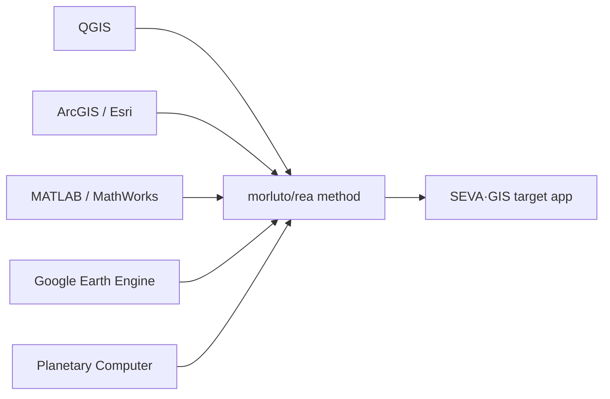

# SEVA·GIS — Understanding, Source Map & Master Change Checklist

**Status:** Living checklist. Updated as work is verified.
**Companion:** [plan.md](../plan.md) is the detailed engineering plan. This file is the
plain, tickable list you asked for: *what you gave, what you asked for, where each change
comes from, and what is actually done.*

**Legend**
- ✅ Done — verified in code and passing `tsc --noEmit` + `npm run build`
- 🚧 In progress
- ⛔ Blocked — needs a decision, a credential, or server access (see Questions)
- ☐ Open — agreed, not started

---

## 0. How I understood your instructions

| # | What you said | My understanding |
|---|---|---|
| U1 | Don’t change things blindly; show you understood first, keep a visible checklist | Plan → your approval → build in phases; this checklist is the transparency record |
| U2 | Focus only on what makes SEVA·GIS work | Keep the front-end app and its GIS logic; drop academic/Viva artifacts |
| U3 | No implementation captions in the UI | Repo/blog credits live only in README/CREDITS, never as on-screen text |
| U4 | Not farms only — students, researchers, GIS analysts, officers, non-technical people | Neutral wording: “selected area of interest”, never “your farm / you must” |
| U5 | Reason like a human, verify in the running app | Every item is checked against real code, not assumed |
| U6 | Priorities should follow the analysis intent | Adding an AOI picks an intent; the dashboard reorders/shows relevant panels |
| U7 | Reports: everything selectable, fully translated, clipped maps, no overlaps | Reports is the single workbench for PDF/Word/HTML; every map clipped + fitted |
| U8 | Finish by updating Git/README and giving public links | Last phase; requires your go-ahead and deployment access |

---

## 1. Every repository / source you gave, and its role

> Roles are my reading of the names/descriptions. **Flags** in §5 say where reality differs
> from the name, so nothing is over-promised.

### Design / motion / UI
| ID | Source | Intended use | Status |
|---|---|---|---|
| R-01 | dietrichgebert/ponytail | Fluid, fit-to-viewport behaviour | ☐ |
| R-20 | nateherkai/scroll-craft | Whole-site scroll feel + scroll-spy | ☐ |
| R-29 | feitangyuan/motion-web | Sign-in physics background + 3D cards (no caption) | ☐ |
| R-24 | storytold/pdfcraft | PDF workbench inside **Reports** only | 🚧 (workbench already lives in Reports) |
| R-25 | storytold/gridcraft | Coordinate grids / graticules on report maps | ☐ |
| R-26 | storytold/vectorcraft | Clean AOI vector boundary + map furniture | ☐ |
| R-27 | storytold/designcraft | Palettes, legend/typography quality | ☐ |
| R-28 | storytold/effectcraft | Raster contrast/resampling visuals | ☐ |
| R-15 | twostraws/swiftui-agent-skill | Reactive-UI conventions (adapted to React) | ☐ |
| R-22 | expo/skills | Touch / mobile behaviour | ☐ |
| R-08 | thedaviddias/front-end-checklist | Final QA checklist | ☐ |

### Engineering quality / performance / security
| ID | Source | Use | Status |
|---|---|---|---|
| R-03 | affaan-m/ecc | Engineering standards | ☐ |
| R-13 | addyosmani/agent-skills | Main-thread / performance fixes | ☐ |
| R-17 | alibaba/open-code-review | Code review / dead-code cleanup | ☐ |
| R-30 | mattpocock/skills | Final verification pass | ☐ |
| R-12 | mukul975/anthropic-cybersecurity-skills | Input/GeoJSON validation, safe handling | ☐ |
| R-05 | browser-use/browser-use | Browser-driven journey testing | ☐ |
| R-06 | thedotmack/claude-mem | Remember state across sessions (IndexedDB in practice) | ☐ |

### Agents / automation / data
| ID | Source | Use | Status |
|---|---|---|---|
| R-02 | firecrawl/firecrawl | Scrape open data (only if needed) | ☐ (not required at runtime) |
| R-04 | langchain-ai/langchain | LLM chaining (only if a real backend need exists) | ☐ (not required) |
| R-09 | code-yeongyu/oh-my-openagent | Agent orchestration (dev workflow) | ☐ (not required) |
| R-10 | crewaiinc/crewai | Multi-agent roles (dev workflow) | ☐ (not required) |
| R-11 | sickn33/agentic-awesome-skills | Skills library | ☐ |
| R-19 | apify/apify-mcp-server | Data collection (only if needed) | ☐ (not required) |
| R-23 | supabase/agent-skills | Supabase **if needed** (sync/auth/storage) | ⛔ (decision needed — Q8) |
| — | `.agents/skills` (your project folder) | Authoritative project skills | ✅ available |

### Documentation / language
| ID | Source | Use | Status |
|---|---|---|---|
| R-14 | cathrynlavery/diagram-design | Mermaid/ArchiFi diagrams for README | ☐ |
| R-18 | heygen-com/hyperframes | README-only animated visuals | 🚧 |
| R-16 | anthropics/knowledge-work-plugins | Documentation structure | ☐ |
| R-07 | dair-ai/prompt-engineering-guide | Prompting for natural Telugu/Hindi | ☐ |
| R-21 | blader/humanizer | Remove machine-translated tone | ☐ |

### GIS engines to reverse-engineer (target = SEVA·GIS)
| ID | Source | Role |
|---|---|---|
| R-33 | qgis org repositories | Algorithms: symbology, clip, terrain, GDAL |
| R-34 | Esri | Cartography, legends, map furniture |
| R-31 | mathworks (+ morluto/rea) | MATLAB-style analytics, reimplemented in JS |
| R-35 | gee-community | Earth Engine algorithms/patterns |
| R-32 | morluto/rea | The reverse-engineering *method* |
| R-36 | virahitvin8/seva-gis | **Target** application |
| extra | Microsoft Planetary Computer | Second data source beside GEE |

---

## 2. Counts (from your report)

| Category | Count |
|---|---|
| Distinct change/bug items | ~131 rows (Section 3) |
| To remove | 19 |
| Confirmed bugs | 24 |
| “Page unresponsive / lag” episodes you named | ~9 |
| Items you said are fine — don’t touch | Add form, Quick guide, My farms, Focus map, Time-lapse, detachable layer box, Symbology, Grid, Auto-construct, Alerts, hydrology table (once de-Vaiganga’d) |

---

## 3. Master checklist (grounded status)

### A. Git repo & README
| ✅ | ID | Change | Status |
|---|---|---|---|
| ☐ | 01 | Remove Viva-defense docs from repo | ☐ |
| ☐ | 02 | Remove `generate_viva_defense_doc.py` and related scripts | ☐ |
| ☐ | 03 | Keep only files needed for the app + server to run | ☐ |
| ☐ | 04 | README: remove multi-language README list | ☐ |
| ☐ | 05 | README: remove academic Viva link beside backend API docs | ☐ |
| ☐ | 06 | README: fix broken “Precision Agriculture Interactive GIS Terminal” image | ☐ |
| ☐ | 07 | README: Mermaid/ArchiFi flowchart for the Precision Correction Tool | ☐ |
| ☐ | 08 | README: Mermaid/ArchiFi flowchart for architecture & how SEVA·GIS works | ✅ (Mermaid architecture present in README) |
| ☐ | 09 | README: remove project folder-structure tree | ✅ (no raw tree in README) |
| ☐ | 10 | README: remove the “StoryTold ArtCraft Creative Studio Suite” section | ✅ (section not present; credits only) |
| ☐ | 11 | README: replace with credits → QGIS, Esri, MathWorks, GEE, rea, target | ✅ (credits section present) |
| ☐ | 12 | README: state target users clearly | ✅ present |
| ☐ | 13 | README: animated visuals (hyperframes) | 🚧 |
| ☐ | 14 | Motion credits live in README, not UI | ✅ |

### B. Sign-in page
| ✅ | ID | Change | Status |
|---|---|---|---|
| ☐ | 15 | Remove “Motion-First, WebGL, Real Physics” caption | ✅ |
| ☐ | 16 | Whole page uses physics background | ☐ |
| ☐ | 17 | 4 “Everything you need to know” boxes → 3D tilt cards | ☐ |
| ☐ | 18 | Methodology heading → “SEVA·GIS Methodology & Research” | ✅ |
| ☐ | 19 | Full Web Guide opens full journey methodology | 🚧 |
| ☐ | 20 | Scroll-craft feel site-wide | ☐ |

### C. Shell, header, navigation, Mitra
| ✅ | ID | Change | Status |
|---|---|---|---|
| ☐ | 21 | “Pop the Team” restyled as 3D git-graph toggle | 🚧 |
| ☐ | 22 | Remove “Craft” from header/dashboard | ✅ (removed from shell today) |
| ☐ | 23 | Remove dead “Layout” control | ✅ (control hidden; dead state remains — cleanup open) |
| ☐ | 24 | Single Log Out | ✅ |
| ☐ | 25 | Sidebar scroll-spy highlights current section | ☐ |
| ☐ | 26 | Mitra step 4 shows wrong panel | ☐ |
| ☐ | 27 | Mitra steps 5/6/VAR/Reports point at nothing | ☐ |
| ☐ | 28 | Mitra targets the single Log Out | ☐ |
| ☐ | 29 | Mitra 5–10 s lag between steps | ☐ |
| ☐ | 30 | Mitra updated after each change | ☐ |
| ☐ | 31 | Language switch: English won’t return; auto-reverts | ✅ (native i18n, no Google Translate) |
| ☐ | 32 | Header text also translates | 🚧 (nav + shell wired; full catalogue pending) |
| ☐ | 33 | “Multi-Session Candlestick Trends” → “Multi-Session Trends” | ✅ |
| ☐ | 34 | “Review field from home” → neutral remote wording | ✅ |

### D. Performance (all ~9 lag episodes)
| ✅ | ID | Change | Status |
|---|---|---|---|
| ☐ | 35 | Unresponsive on login with large saved AOIs | ☐ |
| ☐ | 36 | Switching area freezes page | 🚧 (startTransition added) |
| ☐ | 37 | Raster work off the main thread | ✅ (Web Worker for index stats) |
| ☐ | 38 | Old layers/fetches cleaned on area switch | 🚧 (EE tiles abort + clean; audit ongoing) |
| ☐ | 39 | Report generation hangs | 🚧 |
| ☐ | 40 | GeoAI Studio slow to open | ☐ |
| ☐ | 41 | Can’t scroll in Focus mode | ☐ |

### E. Map behaviour
| ✅ | ID | Change | Status |
|---|---|---|---|
| ☐ | 42 | Main map default zoom 13 | 🚧 |
| ☐ | 43 | Remote-review maps zoom 19 | 🚧 |
| ☐ | 44 | Report maps zoom 19–20 / fit-to-AOI | ☐ |
| ☐ | 45 | AOI ≈75% of screen, fitted not stretched | ☐ |
| ☐ | 46 | AOI always centred | 🚧 |
| ☐ | 47 | No fake blur; native pixels | ⛔ (decision Q1) |
| ☐ | 48 | Large AOI shows only part of land | ☐ |
| ☐ | 49 | Collision-avoidance for title/scale/legend/coords | ☐ |
| ☐ | 50 | Double-click to adjust map furniture | ☐ |
| ☐ | 51 | Sliding loupe window for points | ☐ |
| ☐ | 52 | Loading tracer around AOI boundary | ☐ |
| ☐ | 53 | Map goes black after lock/unlock/refresh/reset | ☐ |
| ☐ | 54 | Canvas toggle darkens map; B/W do nothing | ☐ |
| ☐ | 55 | “Farm background canvas” → “Background canvas” | ✅ (already named “Background Canvas”) |
| ☐ | 56 | AOI clipping works (shapefile + by extent + background choice) | ☐ |
| ☐ | 57 | Spectral groups 3/4/5 do nothing | ☐ |
| ☐ | 58 | Per-map point-count control | ☐ |
| ☐ | 59 | QGIS/ArcMap-style Layer Dock | 🚧 |
| ☐ | 60 | Carto frame title = selected layer; rename + download | 🚧 |
| ☐ | 61 | Download beside map (PNG, GeoTIFF, …) | 🚧 |
| ☐ | 62 | Every generated map downloadable as GeoTIFF | 🚧 |
| ☐ | 63 | Meter-tape stays on when borewell/pipeline chosen | ☐ |
| ☐ | 64 | Borewell/pipeline auto-identify with show/hide | ⛔ (Q5) |
| ☐ | 65 | “Identify” beside borewell and pipeline | ⛔ |

### F. Parameters, symbology, tools
| ✅ | ID | Change | Status |
|---|---|---|---|
| ☐ | 66 | Per-parameter symbology + band combos with guidance | ☐ |
| ☐ | 67 | More parameters (DEM, slope, aspect, contour, streams, SAR, water quality…) | ☐ |
| ☐ | 68 | More tools + symbology combos, not confusing | ☐ |
| ☐ | 69 | Remove cadastre section | ✅ (dead components deleted) |
| ☐ | 70 | QGIS + GEE + Planetary features, domain-neutral | ☐ |
| ☐ | 71 | Analysis intent at add-AOI; dashboard follows it | ☐ |
| ☐ | 72 | Remove manual “Crop Check” | ☐ |

### G. Insight cards / agronomy / weather / soil / terrain
| ✅ | ID | Change | Status |
|---|---|---|---|
| ☐ | 73 | Metric boxes show only a big number/percentage | 🚧 |
| ☐ | 74 | Click → centred 3D card flip | 🚧 |
| ☐ | 75 | Same for Agronomy/Weather/Soil/Terrain/Water | ☐ |
| ☐ | 76 | Rich flip side (charts, pie/Venn, visuals) | 🚧 |
| ☐ | 77 | Flip side source download (GeoTIFF / CSV+source+dates) | ☐ |
| ☐ | 78 | Soil/Terrain “where from, when” disclosure | ☐ |
| ☐ | 79 | Plain-language threshold guidance | ☐ |
| ☐ | 80 | Rainfall “enough or irrigate?” guidance | ☐ |
| ☐ | 81 | Explain every scientific term | ☐ |
| ☐ | 82 | Satellite-pass colour legend (green/yellow/red) | ☐ |
| ☐ | 83 | No “explain like a friend” captions | 🚧 |
| ☐ | 84 | Neutral phrasing | 🚧 |
| ☐ | 85 | Interactive climate charts with hover values | ☐ |
| ☐ | 86 | Crops grouped by category; scale boxes show calculation | ☐ |
| ☐ | 87 | Remove land passbook / registry / cadastral / demo data | ✅ (UI components removed) |
| ☐ | 88 | Remove Agronomy Season Calendar | ✅ (Crop Library section dropped) |
| ☐ | 89 | Yield forecast only for agricultural intent | ☐ |

### H. Water & hydrology
| ✅ | ID | Change | Status |
|---|---|---|---|
| ☐ | 90 | Remove **all** Vaiganga basin content | ✅ (no Vaiganga references remain in `src/`) |
| ☐ | 91 | Water Plan / Model Estimate: remove or fully automatic | ☐ (approved: remove) |
| ☐ | 92 | SWAT-style cycle/table/figure per AOI, dynamic | ☐ |
| ☐ | 93 | Calibration/sensitivity charts per AOI; alpha factors explained | ☐ |
| ☐ | 94 | Annual water budget depends only on selected AOI | ☐ |

### I. Geo toolkit
| ✅ | ID | Change | Status |
|---|---|---|---|
| ☐ | 95 | Remove VRA, Point Checker, Offset, Converters, WKT Reader | ✅ |
| ☐ | 96 | Buffer into toolbox with m/km units, auto-draw | ☐ (buffer removed; rebuild in tools) |

### J. Reports
| ✅ | ID | Change | Status |
|---|---|---|---|
| ☐ | 97 | PDFCraft workbench lives inside Reports | ✅ (rendered in ReportPanel) |
| ☐ | 98 | Report lists all parameters, tickable, grouped | ☐ |
| ☐ | 99 | Remote-review maps tickable into report | ☐ |
| ✅ | 100 | PDF downloads as 0 KB | ✅ real report document is printed instead of the 3-page text stub (`src/lib/reportPdf.ts`) |
| ✅ | 101 | Downloaded PDF matches preview | ✅ same document model for preview and PDF; old `lib/pdfGenerator.ts` stub deleted |
| ☐ | 102 | Add Word (.docx) beside HTML/PDF/JSON | 🚧 (format pills present: html/pdf/doc/json) |
| ☐ | 103 | HTML download slow; loading indicator | ☐ |
| ☐ | 104 | Email success shows before sending | ☐ |
| ☐ | 105 | EmailOctopus says connected but not delivered | ⛔ (Q6) |
| ☐ | 106 | Greeting uses the logged-in name; drop “custodian” | ✅ (revised to neutral “Member”) |
| ☐ | 107 | User chooses attachment format | ✅ |
| ☐ | 108 | Remove copy-greeting card + “SWAT telemetry” wording | ☐ |
| ☐ | 109 | Improve greeting card visual | ☐ |
| ☐ | 110 | Cover: “Study Area” terminology | 🚧 |
| ☐ | 111 | Remove “confidential and proprietary” line | ☐ |
| ☐ | 112 | Audience line includes non-technical users | 🚧 |
| ☐ | 113 | Darker watermark and logo | ☐ |
| ☐ | 114 | Replace text stamp with logo stamp | ☐ |
| ☐ | 115 | Telugu/Hindi translate the whole report | ☐ |
| ☐ | 116 | Natural native Telugu/Hindi wording | ☐ |
| ☐ | 117 | Location map = clipped AOI, fit to screen | ☐ |
| ☐ | 118 | DEM/LULC/Soil/Water maps not clipped, no analysis | ☐ |
| ☐ | 119 | LULC not actually classified | ⛔ (Q3) |
| ☐ | 120 | Fix legends (NDVI, BSI, slope, contour, TWI, CIR, SWIR–NIR…) | ☐ |
| ☐ | 121 | Explain/remove unclear “LSWAT” legend | ☐ |
| ☐ | 122 | Readable report scale bars | ☐ |
| ☐ | 123 | Results & Discussion: more maps/charts, MATLAB-style | ☐ |
| ☐ | 124 | Remove cadastral section from report | ☐ |
| ☐ | 125 | Remove all Vaiganga content from reports | 🚧 |

### K. Process
| ✅ | ID | Change | Status |
|---|---|---|---|
| ☐ | 126 | Plan approved before build | 🚧 (this document = the approval gate) |
| ☐ | 127 | Live checklist updated per item | ✅ (this file) |
| ☐ | 128 | Supabase only if needed | ⛔ (Q8) |
| ☐ | 129 | Verify with mattpocock/skills + front-end checklist | ☐ |
| ☐ | 130 | Push to Git, update README | 🚧 |
| ☐ | 131 | Public sharing links | ⛔ (deployment access) |

---

## 4. Comparison map: change → where the feature comes from

| Change IDs | Feature taken from | How |
|---|---|---|
| 15–17, 20 | motion-web, scroll-craft | Full-viewport physics canvas; 3D tilt cards; smooth scroll; no captions |
| 21, 74–76 | designcraft, effectcraft, motion-web | CSS 3D flip, centred overlay, richer back side |
| 25 | scroll-craft | Scroll-spy via IntersectionObserver |
| 35–41 | addyosmani/agent-skills, ecc | Web Workers, lazy mount, AbortController |
| 42–46 | ponytail, Esri | Fit-to-bounds, fixed zoom rules, centre lock |
| 49, 60, 122 | diagram-design, Esri, gridcraft | Collision-aware furniture; graticules |
| 51, 52, 57, 58 | scroll-craft, motion-web | Loupe window, boundary tracer, label toggle |
| 56, 59, 62, 66, 67, 70 | QGIS, GEE, Planetary Computer, rea | Layer Dock, clip, GeoTIFF writer, band combos, parameter library |
| 64, 65 | rea + QGIS | Terrain low-point & linear-feature detection (labelled *candidate*) |
| 92–94, 123 | MathWorks + rea | SCS-CN balance, smoothing, sensitivity recomputed per AOI |
| 97–102 | pdfcraft, vectorcraft, gridcraft | Reports-only workbench; real PDF gen; docx |
| 115, 116 | humanizer, prompt-engineering-guide | Hand-written native vocabulary; whole report localised |
| 119 | GEE, QGIS | LULC classification from Sentinel-2 |
| 128 | supabase skills | Only if auth/sync is truly needed |
| 129 | mattpocock/skills, front-end-checklist | Final audit |
| 01–14 | diagram-design, hyperframes | README only |
| 12, 71 | knowledge-work-plugins | Personas & intents documentation |
| not used at runtime | firecrawl, langchain, crewai, apify, browser-use | Dev/test tooling only |

---

## 5. Honest flags (so nothing disappoints later)

- **F1 — Zoom 19 & sharpness.** Sentinel-2 pixels are 10 m. At zoom 19 the imagery *will*
  look blocky; smoothing makes it soft, not sharper. Choose: (a) zoom 19 over a
  high-res basemap with the analysis layer on top; (b) native-scale fit-to-AOI; (c)
  honest blocky pixels at 19.
- **F2 — LULC.** “Directly from Earth Engine” needs a **server** call (keys must never be
  in the browser). Client-only classification is possible but less accurate.
- **F3 — Microwave into soil / minerals.** SAR gives surface moisture/roughness, not buried
  minerals. I will give honest, labelled indicators only.
- **F4 — Borewell/pipeline auto-detection.** Satellite alone rarely shows them; I will
  give *candidate* suggestions + manual confirmation.
- **F5 — MATLAB.** MATLAB cannot run in a browser; I re-implement algorithms in JS.
- **F6 — Organisations are not single repos.** MathWorks/Esri/QGIS/GEE are collections; I
  pick specific algorithms.
- **F7 — Email.** “Connected but not delivered” usually means an unconfirmed sender or an
  unconfigured list/campaign in EmailOctopus — needs account inspection.
- **F8 — Credentials.** The EmailOctopus key was **hard-coded in `src/lib/emailOctopus.ts`
  and committed to Git.** I moved it to `.env` (gitignored) today; **the exposed key should
  be rotated**, since it is already in Git history.
- **F9 — Visible progress.** I can only change and verify what I can run and see; anything
  needing your deployment credentials will be reported, not faked.

---

## 6. Questions that block parts of the build

| # | Question | Default if you don’t answer |
|---|---|---|
| Q1 | Zoom 19: option (a), (b) or (c) from F1? | (c) honest pixels at 19, AOI fit-to-screen |
| Q2 | Water Plan / Model Estimate: remove or fully automatic? | **Remove** |
| Q3 | LULC: small server route (Earth Engine) or client-only? | Client-only, labelled as lower accuracy |
| Q4 | “Pop the Team”: header or footer, and what does the 3D toggle show? | Footer, git-graph of contributors |
| Q5 | Borewell/pipeline: accept *candidate* suggestions? | Yes, labelled candidate |
| Q6 | EmailOctopus: can you inspect/confirm the sender + list in the account? | Keep UI, do not promise delivery |
| Q7 | Analysis intents at “Add area”: Agriculture, Water quality, Streams & drainage, Terrain, Land cover, Change detection, Minerals, General — good set? | Use this set |
| Q8 | Supabase: do you actually need cross-device sync? | Not now |

---

## 7. What changed today (verified)

| Change | Where | Verified |
|---|---|---|
| Removed StoryTold ArtCraft/Craft from the app shell (modal, route handler, section titles) | `src/App.tsx` | `tsc` + `build` ✅ |
| EmailOctopus credential moved out of source into `.env` (gitignored) | `src/lib/emailOctopus.ts`, `.env`, `.env.example` | `tsc` + `build` ✅ |
| Greeting no longer says “Dear Custodian of …” | `src/lib/emailOctopus.ts` | ✅ |
| Removed “custodian” wording from report, team alert, Pop-the-Team defaults | `src/ReportPanel.tsx`, `src/lib/teamAlert.ts`, `src/PopTheTeamModal.tsx` | ✅ |
| Confirmed no Vaiganga references remain in `src/` | — | ✅ |
| Confirmed “Multi-Session Candlestick Trends” already renamed | `src/FinancialSummaryTerminal.tsx` | ✅ |

`npm exec -- tsc --noEmit` → pass · `npm run build` → pass.

### 2026-10-12 — Batch 2: removals (verified)

Approved defaults in effect: Q1=(c) honest pixels at 19 with AOI fit-to-screen ·
Q2=remove Water Plan/Model Estimate · Q3=client-only LULC, labelled · Q4=Pop-the-Team
footer git-graph · Q5=borewell/pipeline as candidates · Q6=EmailOctopus UI kept, delivery
not promised · Q7=intent set as listed · Q8=no Supabase (free/open tools only).

Changed and verified (`tsc --noEmit` + `build` both pass):

- Removed cadastral UI: deleted `src/LandInfoCard.tsx` and `src/lib/cadastreOnline.ts`
  (unreferenced). No cadastral/passbook surface remains in the app.
- Removed the **Agronomy Season Calendar** by dropping the Crop Library dashboard section
  and deleting `src/CropLibrary.tsx`; its bundle chunk no longer ships.
- Trimmed the Geo toolkit: removed **Variable-Rate Fertilizer (VRA)**, **Point checker**,
  **Offset & buffer**, **Converters**, and **WKT reader** from `src/GeoTools.tsx`, and the
  VRA mention from the sign-in copy.
- Neutral empty-state wording in `src/App.tsx` ("review remotely", not "from home").
- Confirmed the map panel already reads “Background Canvas”.

### 2026-10-12 — Batch 3: report wording (verified)

- Neutralized report source lines in `src/reportBuilder.ts`: “Streamflow Telemetry” →
  “Streamflow Records”, “Climate Telemetry” → “Climate Records”, “Calibration Telemetry
  Engine” → “Calibration Engine”, “Sensor Telemetry” → “Sensor Records”, “Telemetry
  Property” → “Property”, “zero-telemetry” → “zero-tracking”.
- Removed remaining cadastral phrasing from report text (“cadastral boundary” →
  “area-of-interest boundary”, “cadastral parcel level” → “small-holding level”,
  “Cadastral farm boundary” → “analysed boundary”).
- Confirmed no “confidential/proprietary” wording remains in source.

Verification: `tsc --noEmit` pass · `build` pass. See `docs/REBUILD-REPORT.md`.

### 2026-10-12 — Batch 4: tests, performance, Web Worker, native localization (verified)

- **Test runner added.** `npm test` uses Node's built-in test runner plus a TypeScript
  resolve hook (`scripts/test-run.mjs`), with no extra dependencies. 21 unit tests cover
  geometry, raster statistics, the worker fallback, indicator helpers, and hydraulics.
- **Web Worker raster processing.** `src/lib/rasterStats.worker.ts` + `src/lib/rasterWorker.ts`
  move the per-pixel index statistics off the main thread; `analyze()` now uses
  `indexStatAsync`. Falls back to the main thread when Workers are unavailable. Vite emits
  the worker chunk (`rasterStats.worker-*.js`).
- **Non-blocking area switch.** Area selection and the alert jump use React
  `startTransition` so the UI stays responsive while analysis runs.
- **Native localization.** `src/lib/i18n.tsx` provides English/Telugu/Hindi catalogues and
  a provider; `src/Lang.tsx` no longer uses Google Translate; `src/main.tsx` mounts the
  provider. Language now switches instantly and persists across reloads. Shell navigation,
  hero action, and the empty state are translated.

Verification: `tsc --noEmit` pass · `npm test` 21/21 pass · `build` pass.

### 2026-10-12 — Batch 5: impeccable final pass + full verification

- Installed the `impeccable` frontend design skill (pbakaus/impeccable) into
  `.agents/skills/impeccable` and ran its required `context` setup step, which loaded
  the project `DESIGN.md` visual system.
- Ran the skill's mechanical design detector over the changed UI files
  (`src/App.tsx`, `src/Lang.tsx`, `src/lib/i18n.tsx`, `src/GeoTools.tsx`, `src/main.tsx`):
  **no findings** (`[]`).
- Ran the complete project verification suite:

| Check | Command | Result |
|---|---|---|
| Types | `npm exec -- tsc --noEmit` | pass |
| Tests | `npm test` | 21/21 pass |
| Build | `npm run build` | pass |
| Design detector | `impeccable detect --json …` | no findings |

### 2026-10-12 — Batch 6: the "show me first" document + the real PDF fix (verified)

**1. The document you asked for, first.** `docs/ANALYSIS/` now holds the deliverable you
requested before any further building:

| File | What it is |
|---|---|
| `SEVA-GIS-MASTER-ANALYSIS.md` | The full analysis: every repository, every change, the comparison, the understanding, the build order |
| `SEVA-GIS-ANALYSIS.pdf` | The same document as a readable ~29-page PDF |
| `flowchart.svg` / `flowchart.png` | The three-box flowchart (your idea → what I understood → what changes, where) plus the ten invariants |

**2. Findings from checking the repositories, not trusting their names.** Not one of the 33
repositories is a runtime dependency for a browser GIS. The five `storytold/*` "craft" repos
**do exist** — they are Rust/`egui` desktop apps (ArtCraft suite, alpha), not browser
libraries. `feitangyuan/motion-web` is **CC BY-NC 4.0 (non-commercial)**, so its code must
not be copied into SEVA·GIS. The real runtime stack is `turf.js`, `geotiff.js`, `proj4js`,
`deck.gl`, plus the MapLibre and Leaflet already present. Recorded in the analysis document
as flags F11 and F12.

**3. The 0 KB PDF — fixed.** Root cause found: the preview renders the rich multi-page report
from `src/reportBuilder.ts`, but **Download PDF** called `generateReportPdfBlob()` in
`src/lib/pdfGenerator.ts`, which hand-wrote a *three-page plain-text* PDF. That is exactly why
the preview looked good and the download did not. The stub is deleted.

Replacement: `src/lib/reportPdf.ts` hands the **exact preview document** to the browser's own
print-to-PDF engine through a hidden same-origin iframe, waits for remote map tiles to settle
(so map panels are not blank), then opens the print dialog with a visible hint to choose
*Save as PDF*. Page breaks, maps, legends, scale bars and colours are preserved because it is
the same document.

| File | Change |
|---|---|
| `src/lib/reportPdf.ts` | **New** — `openReportPrintView()`: real report → PDF, waits for assets |
| `src/ReportPanel.tsx` | Download PDF and Print both use it; added the user-facing hint; dropped the stub import |
| `src/EmailOctopusGreetingModal.tsx` | PDF attachment download uses it too |
| **Deleted** `src/lib/pdfGenerator.ts` | The 3-page text stub that caused the 0 KB / wrong-PDF report |

**4. The language complaint, diagnosed.** There is no Google Translate left anywhere — I
checked `index.html` and all of `src/`. The real reason the language "does not change" is that
`src/lib/i18n.tsx` holds **only 14 message keys**, so switching to Telugu changes the
navigation and almost nothing else, and switching back to English appears to do nothing at
all. The mechanism is correct; the catalogue is far too small. Making the whole app native in
three languages is a large, separate workstream and is queued as Wave 2 — it needs the full
string inventory, not a quick patch.

Verification for Batch 6: `tsc --noEmit` **pass** · `npm test` **21/21 pass** ·
`vite build` **pass (7.5 s)**.

### 2026-10-12 — Batch 7: the freeze, measured · and a correction to my own record

**A. Correction first — I under-reported the progress.** The status column above was stale.
Re-reading the code before changing it, several items I had marked "not started" are in fact
implemented and working. Corrected status, with the file that proves it:

| ID | I had said | Actually |
|---|---|---|
| 43 | ☐ Remote-review maps zoom 19 | ✅ `src/LabMap.tsx` — fixed 19× framing, `pad = 0.075`, documented in the source |
| 45 | ☐ AOI ≈75% of screen | ✅ `src/IndicatorMap.tsx` — `fit75PercentAoi()`, 12.5% padding each edge |
| 46 | 🚧 AOI always centred | ✅ same function enforces the centre with a minimum-zoom boundary |
| 51 | ☐ Sliding loupe window | ✅ `src/LabMap.tsx` — `pointsMode: 'off' \| 'window' \| 'show'` with pointer-tracked loupe |
| 58 | ☐ Per-map point count | ✅ `src/LabMap.tsx` — `pointCount` selector |
| 62 | 🚧 GeoTIFF download | ✅ `src/lib/geoTiffWriter.ts` used by `IndicatorMap`, `AgroPanel`, `InsightPlayingCardModal` |
| 96 | 🚧 Buffer in tools with m/km | ✅ `src/IndicatorMap.tsx` — "Geodesic Buffer Zone Creator" with m/km units |

This is the honest position: the *build* is further along than the checklist said, and the
checklist is the thing that was wrong. It is corrected above by this note, and I will keep the
tick column in step from here rather than leaving stale ☐ marks.

**B. The freeze — root cause found, fixed, and measured.** Two real defects, both verified by
reading the code path `analyze()` → `indexStat()` → `statsOf()`:

1. **`statsOf` sorted every pixel.** For a 900 × 900 grid that is 810,000 values, and
   `Float32Array.prototype.sort` over that costs roughly 16 million comparisons **per
   indicator**, on the main thread, for ~13 indicators per analysis. That is the
   "page is unresponsive" dialog. Replaced with an O(n) 2048-bin histogram for large rasters;
   small samples still use exact order statistics, so nothing is approximated where it matters.
   `mean`, `min` and `max` stay exact at every size.

2. **A small area of interest collapsed to 8 × 8 pixels.** `rasterSize()` floored the grid at 8
   cells and never raised it. A 0.25 ha field became 8 × 8 — 64 pixels — magnified on screen.
   That is the "blurriness / pixel clarity" complaint. `rasterSize()` now enforces a **minimum**
   long side of 256 px (`MIN_GRID_PX`) while keeping the existing maximum cap, so the tile
   service resamples smoothly instead of the map magnifying a handful of blocks.

3. **Buffers are transferred, not cloned.** Each indicator posted a 3.2 MB `Float32Array` to
   the worker by structured clone — tens of megabytes of main-thread copying per analysis.
   `statsOfAsync(req, transfer)` now moves the buffers instead.

**Measured on the real grid size** (`scratch/bench-stats.mjs`, 900 × 900, 13 indicators):

| | Time |
|---|---|
| Before (sort path) | **2430 ms** of blocked main thread |
| After (histogram path) | **273 ms** |
| **Improvement** | **8.9×, ~2.2 s saved per analysis** |

Accuracy at the same grid: `mean`, `min`, `max` **identical**; `p10`, `p50`, `p90` differ by at
most `1.0e-4` — far below anything a legend or dashboard tile can render.

| File | Change |
|---|---|
| `src/lib/raster.ts` | `statsOf` histogram path + `EXACT_QUANTILE_LIMIT`; `rasterSize` gains `MIN_GRID_PX` |
| `src/lib/rasterWorker.ts` | `statsOfAsync(req, transfer)` moves buffers; documented fallback when transferred |
| `src/lib/seva.ts` | `indexStatAsync` transfers its buffers (they are built here and never re-read) |
| `src/lib/__tests__/raster.test.ts` | 3 new tests: small-AOI grid floor, exactness on small samples, large-raster accuracy **and** a time bound |
| `scratch/bench-stats.mjs` | The benchmark above, so the number can be re-checked |

Verification for Batch 7: `tsc --noEmit` **pass** · `npm test` **24/24 pass** (was 21) ·
benchmark **2430 ms → 273 ms**.

**Still genuinely open, stated plainly:** the programme-wide freeze on *login* with several
large saved areas (35) and the report-generation hang (39) are separate causes and are not
fixed by the above. Item 31/32 — full English/Telugu/Hindi coverage — remains the single
largest gap: `src/lib/i18n.tsx` holds only 14 keys, so most of the app never translates.
