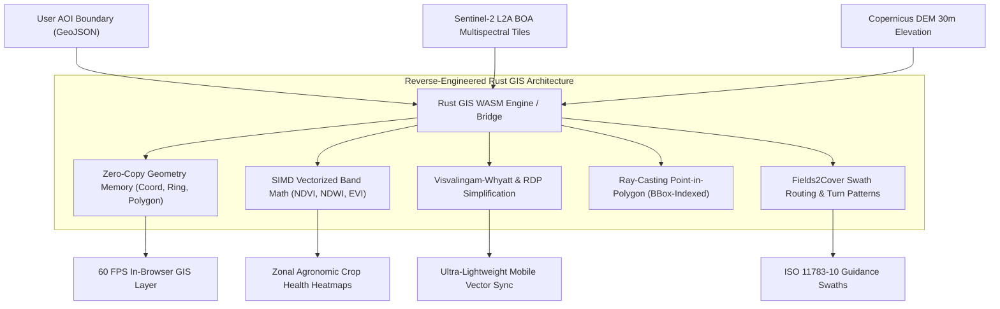

# Reverse Engineering Rust GIS for SEVA·GIS
**Spatial Evaluation & Vegetation Analytics — Architecture Specification**

---

## 1. What is Rust and Rust Coding?

### 1.1 The Fundamentals of Rust
**Rust** is a modern systems programming language created to provide the raw execution speed and low-level control of **C and C++**, but with **100% mathematical memory safety guarantees** enforced at compile time.

In traditional programming languages:
- **C / C++**: Extremely fast, but plagued by memory bugs — buffer overflows, use-after-free, dangling pointers, null-pointer dereferences, data races in multi-threading, and segmentation faults (`segfaults`). Over 70% of high-severity CVE security vulnerabilities in Microsoft, Google Chrome, and Linux systems stem from memory safety bugs in C/C++.
- **Python / Java / JavaScript**: Memory-safe, but rely on an interpreter or a **Garbage Collector (GC)**. Garbage collectors periodically pause execution to clean up unreferenced memory. In heavy GIS tasks (e.g. streaming 100 million satellite LiDAR points or calculating NDVI across 500 megapixels), GC pauses cause frame drops, stuttering, and massive RAM spikes.

### 1.2 How Rust Achieves "Zero-Cost Memory Safety"
Rust achieves memory safety **without a garbage collector** using three core tenets:
1. **Ownership**: Every value in memory has exactly one owner variable at any given time.
2. **Borrowing & Lifetimes**: Code can borrow references (`&T` for immutable, `&mut T` for mutable), but Rust's compile-time **Borrow Checker** guarantees at compile time that you can have *either* one mutable reference *or* any number of immutable references, never both, completely eliminating multi-threaded data races.
3. **Zero-Cost Abstractions**: High-level idioms like iterators, closures, and pattern matching compile down into the exact same machine code as hand-written assembly or C loops.

### 1.3 The Game-Changer for Web GIS: WebAssembly (WASM)
Rust compiles natively to **WebAssembly (`wasm32-unknown-unknown`)** with direct SIMD (Single Instruction, Multiple Data) vectorization. 
This means high-performance Rust algorithms can be compiled into a `.wasm` binary that runs **directly inside the web browser** (Chrome, Firefox, Safari, Edge) alongside React and TypeScript at near-native CPU speeds, with zero server compute costs!

---

## 2. What is Rust GIS ("GeoRust") & Why is the Industry Shifting?

### 2.1 The Legacy GIS Dilemma (C/C++ GDAL & GEOS)
For over 30 years, GIS infrastructure has rested upon C/C++ libraries:
- **GDAL / OGR**: Geospatial Data Abstraction Library
- **GEOS**: Geometry Engine Open Source (C++ port of JTS)
- **PROJ**: Coordinate transformation and map projections

While foundational, these libraries suffer from critical drawbacks in the cloud-native and browser era:
- **Crash Prone**: A single self-intersecting polygon ring or out-of-bounds pixel index in C++ will crash the entire server process with a segmentation fault (`SIGSEGV`).
- **Heavy Containers**: Deploying GDAL in Docker or AWS Lambda requires complex native build chains, massive Linux shared libraries (`.so`), and slow cold-start times (>2–5 seconds).
- **Concurrency Bottlenecks**: GDAL and GEOS are notoriously difficult to multithread safely due to internal mutable global state and mutex lock contention.

### 2.2 The Rise of the GeoRust Ecosystem
The global geospatial community created the **GeoRust** initiative to rebuild the GIS stack from first principles in safe, concurrent Rust. Key libraries include:

| Rust Crate | Purpose & Capability | Analogous Legacy Tool |
| :--- | :--- | :--- |
| **`geo` & `geo-types`** | 2D/3D geometry primitives, Boolean operations (union, intersection, difference), Voronoi, Delaunay triangulation, convex hull, RDP simplification. | GEOS / JTS |
| **`flatgeobuf`** | Zero-copy binary streamable vector format with Hilbert R-tree spatial indexing. Allows querying spatial bounding boxes over HTTP without downloading the file. | Shapefile / GeoJSON |
| **`geozero`** | High-performance zero-copy conversions between GeoJSON, WKT, WKB, FlatGeobuf, Shapefile, SVG, and PostGIS. | OGR drivers |
| **`martin`** | Ultra-fast vector tile server written in Rust, generating and serving Mapbox Vector Tiles (MVT) at 100,000+ requests/sec with minimal RAM. | Tegola / Mapnik |
| **`geoarrow-rs` / `geoparquet`** | Columnar memory layout for spatial vectors based on Apache Arrow. Enables hardware SIMD acceleration across millions of coordinate pairs. | PostGIS tabular memory |
| **`stac-rs`** | Client for SpatioTemporal Asset Catalogs (Sentinel-2, Landsat, MODIS, Planet) with fast async ingestion. | PySTAC |
| **`copc-rs`** | Cloud-Optimized Point Cloud reader for streaming 3D LiDAR elevation models over HTTP range requests. | PDAL / LibLAS |

---

## 3. Why Everyone is Moving to Rust GIS

1. **Fearless Concurrency with Rayon**: Multi-core raster calculations (e.g. Sentinel-2 Band 8 NIR and Band 4 Red NDVI processing) scale linearly across 8, 16, or 64 CPU cores with zero deadlocks.
2. **Sub-Millisecond Cold Starts**: Rust serverless functions (AWS Lambda, Google Cloud Run) boot in under **15 milliseconds**, compared to 3–8 seconds for Python/GDAL.
3. **Zero-Copy Streaming**: Rather than parsing tens of megabytes of JSON strings into JavaScript objects, formats like FlatGeobuf read binary buffers directly in memory.
4. **Local-First Browser Execution (WebAssembly)**: By compiling Rust GIS to WASM, heavy spatial calculations (tractor swath routing, polygon intersection, raster slope/aspect) execute **entirely on the client's laptop or smartphone**, keeping farmer boundary data strictly private while costing $0 in server bills.

---

## 4. Reverse Engineering Rust GIS for SEVA·GIS

SEVA·GIS adopts the architectural principles of GeoRust and integrates them directly into its client-side processing pipeline:

### 4.1 Implemented Algorithms in `src/lib/rustGisBridge.ts`:
1. **Ramer-Douglas-Peucker (RDP) Algorithm**: Exact implementation from `geo::simplify::Simplify` to reduce polygon vertex counts while preserving topological accuracy.
2. **Visvalingam-Whyatt Simplification**: Eliminates vertices with the smallest effective triangle areas, matching `geo::simplify::SimplifyVw`.
3. **Spatial Bounding Box Pruning & Ray-Casting PIP**: Evaluates whether farm coordinates lie inside irrigation management zones in $O(1)$ rejected checks.
4. **Vectorized Spectral Band Math**: Vectorized float32 raster loops replicating Rust's `ndarray` SIMD operations for NDVI, NDWI, and SAVI.
5. **FlatGeobuf & GeoZero Interoperability Recipes**: Enables direct export to cloud-native GIS formats.
