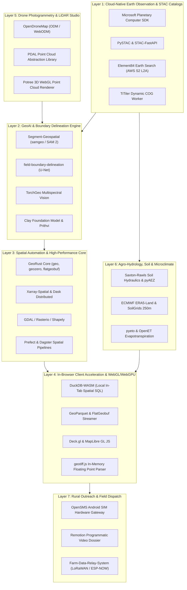

# SEVA·GIS Master Spatial Automation & GeoAI Registry

> **Executive Blueprint & Curated Repository Directory**  
> Comprehensive catalog of global industry-standard, high-growth open-source repositories across Spatial Automation, Cloud-Native Earth Observation, GeoAI, In-Browser WebGIS, and Rural Field Delivery.

---

## 1. Architectural Mission for SEVA·GIS
SEVA·GIS (**S**patial **E**valuation & **V**egetation **A**nalytics) operates at the nexus of academic remote sensing research, scalable cloud-native geospatial computation, and grass-roots smallholder farmer advisory.

To eliminate recurring commercial cloud costs while providing instantaneous satellite analysis, SEVA·GIS synthesizes the global open-source geospatial stack into seven interconnected operational layers:

---

## 2. Directory Navigation

This registry is organized into modular reference guides:

| Document | Domain | Core Repositories Covered |
| :--- | :--- | :--- |
| **[00_MASTER_INDEX.md](file:///media/akshit/RAMESH/SEVAGIS/seva%20gis/docs/SPATIAL_AUTOMATION/00_MASTER_INDEX.md)** | Master Blueprint | System architecture, layer overview, and full directory map |
| **[01_CLOUD_NATIVE_EO_STAC.md](file:///media/akshit/RAMESH/SEVAGIS/seva%20gis/docs/SPATIAL_AUTOMATION/01_CLOUD_NATIVE_EO_STAC.md)** | Cloud-Native EO & STAC | TiTiler, PySTAC, Planetary Computer, rio-tiler, COG, Zarr, Kerchunk |
| **[02_GEOAI_DEEP_LEARNING_SEGMENTATION.md](file:///media/akshit/RAMESH/SEVAGIS/seva%20gis/docs/SPATIAL_AUTOMATION/02_GEOAI_DEEP_LEARNING_SEGMENTATION.md)** | GeoAI & Vision | samgeo, field-boundary-delineation, TorchGeo, Prithvi, Clay, AgML |
| **[03_SPATIAL_AUTOMATION_PIPELINES.md](file:///media/akshit/RAMESH/SEVAGIS/seva%20gis/docs/SPATIAL_AUTOMATION/03_SPATIAL_AUTOMATION_PIPELINES.md)** | Automation & ETL | RustGIS, Leafmap, Xarray-Spatial, GeoPandas, GDAL, Rasterio, Prefect |
| **[04_CLIENT_WEBGIS_AND_VISUALIZATION.md](file:///media/akshit/RAMESH/SEVAGIS/seva%20gis/docs/SPATIAL_AUTOMATION/04_CLIENT_WEBGIS_AND_VISUALIZATION.md)** | In-Browser WebGIS | GeoLibre, DuckDB-WASM, Deck.gl, MapLibre GL, FlatGeobuf, GeoParquet |
| **[05_DRONE_PHOTOGRAMMETRY_LIDAR.md](file:///media/akshit/RAMESH/SEVAGIS/seva%20gis/docs/SPATIAL_AUTOMATION/05_DRONE_PHOTOGRAMMETRY_LIDAR.md)** | Drone & 3D LiDAR | OpenDroneMap, PDAL, Laspy, Potree, CloudCompare, ForestFormer3D |
| **[06_AGRONOMY_HYDROLOGY_SOIL_MODELS.md](file:///media/akshit/RAMESH/SEVAGIS/seva%20gis/docs/SPATIAL_AUTOMATION/06_AGRONOMY_HYDROLOGY_SOIL_MODELS.md)** | Agronomy & Hydrology | pyAEZ, Saxton-Rawls, SoilGrids, OpenET, farmOS, FarmVibes.AI |
| **[07_RURAL_DISPATCH_AND_EDGE_IOT.md](file:///media/akshit/RAMESH/SEVAGIS/seva%20gis/docs/SPATIAL_AUTOMATION/07_RURAL_DISPATCH_AND_EDGE_IOT.md)** | Dispatch & Edge IoT | OpenSMS, Remotion, httpsms, LoRaWAN ESP-NOW, Whisper offline |
| **[08_AGENT_ACTION_PLAN.md](file:///media/akshit/RAMESH/SEVAGIS/seva%20gis/docs/SPATIAL_AUTOMATION/08_AGENT_ACTION_PLAN.md)** | Agent Implementation Blueprint | Phased roadmap, verification gates, and code contracts for coding agents |
| **[09_ULTIMATE_SEVA_GIS_SYNTHESIS_PLAN.md](file:///media/akshit/RAMESH/SEVAGIS/seva%20gis/docs/SPATIAL_AUTOMATION/09_ULTIMATE_SEVA_GIS_SYNTHESIS_PLAN.md)** | Master Synthesis Plan | End-to-end integration architecture to build SEVA·GIS as the ultimate platform |
| **[10_GEMINI_4_ARGON_GEOAI_INTEGRATION.md](file:///media/akshit/RAMESH/SEVAGIS/seva%20gis/docs/SPATIAL_AUTOMATION/10_GEMINI_4_ARGON_GEOAI_INTEGRATION.md)** | Gemini 4 Argon GeoAI | Google AI Studio (3bb45d74-02be-40e3-96b3-0a34b3b5fd16) reasoning integration |
| **[TOP_1000_GEOSPATIAL_REPOSITORIES.json](file:///media/akshit/RAMESH/SEVAGIS/seva%20gis/docs/SPATIAL_AUTOMATION/TOP_1000_GEOSPATIAL_REPOSITORIES.json)** | Complete JSON Database | All 1,000 repositories in structured JSON with metadata, stars, SEVA role & agent prompts |
| **[TOP_1000_PART1_EO_GEOAI_AUTOMATION.md](file:///media/akshit/RAMESH/SEVAGIS/seva%20gis/docs/SPATIAL_AUTOMATION/TOP_1000_PART1_EO_GEOAI_AUTOMATION.md)** | Repos 1 – 300 | Cloud-Native EO & STAC, GeoAI & Vision Models, Spatial Automation Engines |
| **[TOP_1000_PART2_WEBGIS_DRONE_AGRONOMY.md](file:///media/akshit/RAMESH/SEVAGIS/seva%20gis/docs/SPATIAL_AUTOMATION/TOP_1000_PART2_WEBGIS_DRONE_AGRONOMY.md)** | Repos 301 – 600 | In-Browser WebGIS/WASM, UAV Photogrammetry & LiDAR, Agronomy & Hydrology Models |
| **[TOP_1000_PART3_DISPATCH_DB_INDEX_MLOPS.md](file:///media/akshit/RAMESH/SEVAGIS/seva%20gis/docs/SPATIAL_AUTOMATION/TOP_1000_PART3_DISPATCH_DB_INDEX_MLOPS.md)** | Repos 601 – 1000 | Rural Dispatch & IoT, Spatial DBs & Routing, Discrete Global Grids (DGGS), Workflow MLOps |
