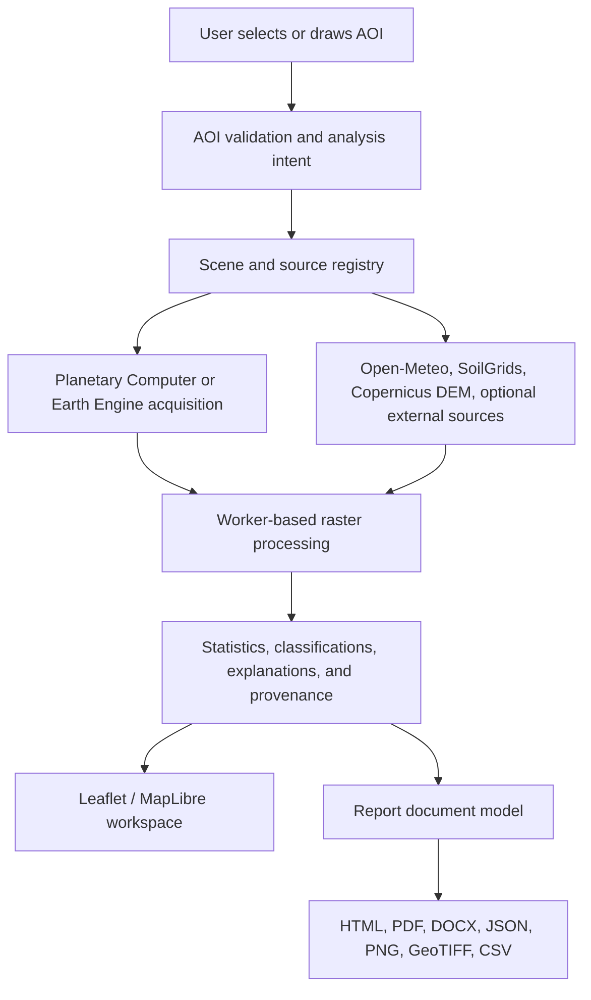

# SEVA.GIS Rebuild Plan

**Status:** Active implementation plan
**Scope:** Frontend, GIS processing, Earth Engine integration, reports, localization, verification, and release
**Target repository:** `virahitvin8/seva-gis`
**Last reviewed:** 2026-10-12

This is the single source of truth for the SEVA.GIS rebuild. Older duplicated plans and conflicting counts are intentionally replaced by this document. The plan records what must be built, what must be removed, how each feature will be verified, and which external projects are references rather than runtime dependencies.

## 1. Product Direction

SEVA.GIS is a privacy-conscious, browser-first spatial analysis workspace for any selected **Area of Interest (AOI)**. It is not limited to agricultural farms. It must be usable by:

- Students and research scholars
- GIS and remote-sensing analysts
- Agricultural officers and field workers
- Hydrology, irrigation, civil, and surveying users
- Non-technical people who want to inspect a place

The interface must use neutral language such as “selected area of interest” and “analyzed area”. It must not assume that every user owns a farm, understands GIS, or knows scientific abbreviations.

### Product principles

1. **Evidence before claims:** Every result identifies its source, date, resolution, scale, CRS, method, and limitations.
2. **AOI first:** Maps, statistics, charts, reports, and downloads are derived from the selected AOI, not demo values or unrelated basin data.
3. **Native resolution honesty:** Zooming cannot create satellite detail that the source sensor does not contain. Sentinel-2 10 m pixels must not be presented as sub-meter analysis.
4. **One workflow:** Add AOI -> choose analysis intent -> acquire data -> process -> inspect -> explain -> export or report.
5. **Responsive by design:** Raster calculations, scene requests, report generation, and farm switching must not block the main thread.
6. **Privacy by default:** AOIs, saved work, and account data remain local unless a user explicitly requests a remote analysis or delivery operation.
7. **Professional simplicity:** Motion and visual polish support understanding; repository names and implementation slogans do not appear as product captions.

## 2. Current Repository Baseline

### Frontend

- Entry: `index.html` -> `src/main.tsx` -> `src/Auth.tsx` -> `src/App.tsx`
- UI: React 19, Vite 8, Tailwind CSS v4, Leaflet, MapLibre, Motion, Lucide
- State: React state, localStorage, Dexie/IndexedDB, optional OPFS/File System Access
- Main map: `src/IndicatorMap.tsx`
- 3D map: `src/Walk3D.tsx`
- Panels: `AgroPanel`, `WaterPanel`, `Intelligence`, `GeoTools`, `ReportPanel`, `Studio`, `Guide`, `DataManager`, and related components

### GIS and data processing

- Sentinel-2 and DEM acquisition: `src/lib/seva.ts`
- Raster parsing, masks, resampling, and statistics: `src/lib/raster.ts`
- Spectral indices and terrain layers: `src/lib/indicators.ts`
- Hydrology and irrigation calculations: `src/lib/hydro.ts`, `src/lib/agro.ts`
- Land cover, management zones, change analysis, and time series: `src/lib/gee.ts`
- Earth Engine client: `src/lib/earthEngineClient.ts`
- Geometry and AOI utilities: `src/lib/geo.ts`
- Export and asset helpers: `src/lib/assets.ts`, `src/ProGisExport.tsx`

### Backend and deployment

- Earth Engine proxy: `backend/main.py`
- Static/API server: `server.js`
- Frontend build: `vite.config.ts`, `package.json`
- Deployment configurations: `Dockerfile`, `backend/Dockerfile`, `firebase.json`, `nginx.conf`, `.github/workflows/`
- Primary backend routes include render, map, stats, time series, change, DEM, alerts, indicators, cache, and health endpoints.

### Reports and language

- Report options and source model: `src/report.ts`
- Report document generation: `src/reportBuilder.ts`
- Report UI and delivery: `src/ReportPanel.tsx`
- PDF generation: `src/lib/pdfGenerator.ts`
- Report history: `src/lib/reportHistory.ts`
- Current language mechanism: `src/Lang.tsx` and Google Translate integration

### Baseline facts

- TypeScript check currently passes after the initial compatibility fixes.
- Production Vite build currently passes.
- No complete automated test suite exists for raster math, browser workflows, reports, or API contracts.
- The repository has multiple deployment models that must be reduced to one documented production path.
- A user-owned change may exist in this file or other files at any time. Do not discard unrelated edits.

## 3. Architecture Decision

The target architecture is **browser-first with an explicit optional Earth Engine service**.

### Boundaries

- The browser owns interaction, local persistence, geometry validation, rendering, and safe client-side processing.
- The Earth Engine service owns authenticated cloud calculations and tile/statistics requests that cannot safely run in the browser.
- No API key or service credential may be embedded in frontend bundles.
- External agent frameworks are development or research references unless a concrete runtime requirement is approved.

## 4. Non-Negotiable GIS Invariants

- Coordinates are WGS84 `[longitude, latitude]`.
- Polygon rings are validated and closed before requests or exports.
- Degenerate, self-intersecting, and oversized AOIs receive clear validation errors.
- Spectral denominators use zero-safe guards.
- Raster dimensions and pixel size remain tied to the source resolution.
- Masks distinguish invalid pixels, cloudy pixels, outside-AOI pixels, and valid data.
- Every map and report includes source, acquisition date, resolution, scale, CRS, and processing notes.
- GeoTIFF exports contain real raster data and georeferencing; a world file alone is not a GeoTIFF.
- Borewell and pipeline detection is labelled as candidate or suggestion unless verified by authoritative data.
- SAR is described as a surface moisture/roughness signal, not reliable buried-mineral detection.
- MATLAB-inspired calculations are reimplemented in JavaScript; MATLAB itself is not assumed to run in the browser.

## 5. External Reference Matrix

These projects inform design, verification, or algorithm research. They are not automatically copied into the application and are not all runtime dependencies.

| Reference | SEVA.GIS use | Boundary |
|---|---|---|
| `feitangyuan/motion-web` | Sign-in and focused interaction motion | No visible repository credit captions |
| `nateherkai/scroll-craft` | Scroll behavior, focus transitions, scroll-spy ideas | Must remain accessible and performant |
| `dietrichgebert/ponytail` | Responsive layout and viewport fitting ideas | Reimplement only what is needed |
| StoryTold `pdfcraft`, `gridcraft`, `vectorcraft`, `designcraft`, `effectcraft` | Report composition, grids, vectors, visual treatment, effects | Reports-only workbench; no dashboard branding |
| QGIS repositories | Raster/vector processing, symbology, clipping, export behavior | Use compatible open algorithms and document differences |
| Esri repositories | Cartographic conventions and map furniture | No assumption of proprietary service access |
| Google Earth Engine and `gee-community` | Cloud imagery, indices, masking, tile patterns | Credentials remain server-side |
| Microsoft Planetary Computer | Public STAC/COG fallback and browser ingestion | Preserve source and license metadata |
| MathWorks | Numerical, time-series, and hydrology algorithm references | Reimplement validated algorithms; do not claim MATLAB execution |
| `morluto/rea` | Reverse-engineering method | Study behavior and rebuild transparently |
| `front-end-checklist`, `mattpocock/skills`, `ecc` | Quality, type safety, accessibility, and review gates | Verification standards, not runtime code |
| `browser-use` | Browser journey verification where available | Test tooling only |
| `addyosmani/agent-skills` | Performance and main-thread guidance | No blind optimization claims |
| `humanizer`, prompt-engineering guide | Native Telugu/Hindi wording review | Human review required |
| Supabase skills | Optional sync/auth/storage | Add only after a documented multi-device requirement |
| Firecrawl, LangChain, CrewAI, Apify, agent orchestration projects | Optional research/development tooling | Not required for the core GIS runtime |

## 6. Master Work Breakdown

### Phase 0: Baseline and governance

- [ ] Keep this file as the single active plan.
- [ ] Freeze unrelated user edits before each implementation slice.
- [ ] Create a requirement-to-test matrix with owner, source, acceptance test, and status.
- [ ] Decide one supported frontend/backend deployment path.
- [ ] Record explicit data-source and attribution requirements.
- [ ] Rotate any credentials that were exposed in source, chat, or bundles.

### Phase 1: Repository and documentation hygiene

- [x] Remove Viva-defense artifacts and generator scripts only after confirming they are not runtime inputs.
- [x] Remove stale academic links and unsupported README claims.
- [x] Remove the raw folder tree from README.
- [x] Replace the broken interactive-terminal media reference.
- [x] Add verified Mermaid/ArchiFi diagrams for ingestion, processing, reporting, and deployment.
- [x] Document target users and analysis intents.
- [x] Keep repository credits in README/CREDITS documentation, not product UI.
- [x] Remove stale basin, cadastral, passbook, and demo-data claims from documentation.

### Phase 2: Authentication and sign-in experience

- [x] Remove the visible “Motion-First WebGL / Real Physics” caption.
- [x] Rename the methodology heading to “SEVA.GIS Methodology & Research”.
- [x] Apply motion-web-inspired motion to the full sign-in composition without blocking form use.
- [x] Convert the four knowledge cards into accessible 3D tilt/glare cards with reduced-motion support.
- [ ] Make the Full Web Guide describe the complete journey from AOI creation to report delivery.
- [x] Keep implementation credits out of visible product copy.
- [ ] Add keyboard, mobile, and reduced-motion checks.

### Phase 3: Application shell and navigation

- [x] Remove Craft Studio from the dashboard navigation and standalone dashboard section.
- [x] Hide the non-functional header Craft and Layout controls.
- [x] Remove the duplicate Data Manager sign-out button and hide the duplicate navigation logout.
- [x] Keep one canonical profile-footer logout target and update Mitra to target it.
- [x] Implement reliable sidebar scroll-spy with `IntersectionObserver` and section IDs.
- [x] Fix Mitra targets for hydrology, Analysis Lab, GeoAI Studio, reports, and logout.
- [x] Remove tour layout thrashing and verify transitions under 100 ms after target availability.
- [x] Rename terminal “Multi-Session Candlestick Trends” to “Multi-Session Trends”.
- [x] Replace “Review field from home” with neutral remote/AOI language.
- [x] Preserve the Pop the Team action while removing misleading implementation language.

### Phase 4: Performance and lifecycle

- [x] Add request cancellation for scene, weather, soil, DEM, report, and farm-switch operations.
- [ ] Move heavy raster loops, histogram work, clustering, and export preparation to Web Workers.
- [ ] Dispose old Leaflet/MapLibre layers and object URLs on AOI or layer changes.
- [x] Bound all caches by AOI, source, scene, layer, resolution, and options.
- [ ] Lazy-load heavy map/report modules without duplicating provider requests.
- [ ] Add progress states for scene search, raster processing, report generation, and downloads.
- [ ] Measure farm switching, report generation, and first interactive render in browser tests.
- [ ] Keep focus mode scrollable and usable on mobile.

### Phase 5: AOI, map viewport, and cartography

- [x] Validate AOI geometry, close rings, reject invalid coordinates, and show clear errors.
- [x] Use zoom 13 as the overview default where the AOI and source support it.
- [x] Use AOI-fit detail views for remote analysis; do not promise sharper detail than the source.
- [x] Fit the AOI to roughly 75% of the available viewport while preserving aspect ratio.
- [x] Keep the AOI centroid centered across map, analysis, and report views.
- [x] Fix large-AOI coverage so the complete selected area is represented.
- [ ] Separate basemap detail from analytical raster resolution.
- [x] Remove black/white canvas modes that hide spatial context; provide explicit background modes.
- [x] Implement polygon and extent clipping with transparent, satellite, white, and black background options.
- [x] Add a QGIS-style layer tree with add raster, add vector, visibility, opacity, symbology, and clip-to-AOI controls.
- [x] Implement collision-aware title, legend, scale, north arrow, coordinate, and AOI placement.
- [x] Make cartographic titles reflect the selected layer and allow safe editing.
- [x] Add per-map point visibility and point-count controls.
- [x] Add an optional movable loupe for inspection points instead of permanently cluttering maps.
- [x] Add a restrained loading tracer around the AOI boundary.
- [x] Ensure measurement mode is disabled when mutually exclusive borewell/pipeline drawing begins.
- [x] Add candidate infrastructure identification with explicit uncertainty and manual confirmation.

### Phase 6: Analysis model and parameter library

- [x] Introduce a typed `AnalysisIntent` such as agriculture, water, drainage, terrain, land cover, change, geology, or general.
- [x] Order panels and recommendations according to the selected intent.
- [ ] Centralize source metadata, units, thresholds, explanations, and limitations.
- [x] Add band-combination guidance for each supported analysis.
- [ ] Support indicators and layers only when their data source and interpretation are documented.
- [ ] Expand terrain, drainage, streams, lakes, SAR, water-quality, and change tools incrementally.
- [ ] Remove unsupported crop-check manual workflows.
- [x] Move buffer into the tools panel with explicit metres/kilometres units.
- [x] Remove unhelpful converters, WKT reader, point checker, offset, and unsupported VRA controls.
- [x] Remove land registry, cadastral, passbook, and unrelated demo data from UI, reports, and domain modules.
- [x] Show yield forecasts only for an agricultural analysis intent.

### Phase 7: Insight cards and plain-language explanations

- [x] Keep metric fronts compact: value, unit, status, and source date.
- [x] Use an accessible 3D flip or modal detail state with reduced-motion fallback.
- [x] Explain thresholds, minimum/maximum meaning, uncertainty, and practical next steps.
- [x] Explain NDVI, EVI, MSI, canopy cover, stress percentage, and all other scientific terms at first use.
- [x] Add source/date disclosure for weather, soil, terrain, and satellite values.
- [x] Provide GeoTIFF download for raster products and CSV/JSON download for time-series/weather data.
- [ ] Make charts interactive with exact values, units, and definitions.
- [ ] Add satellite-pass color legends for green, yellow, and red statuses.
- [ ] Group crop suitability by crop category and prioritize by documented regional context.
- [x] Keep wording neutral and avoid role-play or “explain like a friend” labels.

### Phase 8: Hydrology and infrastructure

- [x] Remove every Vaiganga/Vayganga basin reference from UI, reports, source, and generated text.
- [x] Remove water-plan sliders unless they become fully data-driven and explainable.
- [x] Compute precipitation, runoff, ET, percolation, recharge, and balance figures from the selected AOI and documented assumptions.
- [x] Keep simplified models labelled as estimates; do not present them as validated SWAT-CUP outputs.
- [ ] Generate sensitivity/calibration figures from actual AOI inputs rather than static demo images.
- [ ] Explain all alpha factors, parameters, and formulas behind a user-controlled details disclosure.
- [x] Treat borewell and pipeline results as candidates unless confirmed by authoritative data.
- [x] Keep all hydrology figures and tables dynamic when the selected AOI changes.

### Phase 9: Reports and exports

- [x] Keep the report workbench inside Reports, not the dashboard.
- [ ] Group every report map and parameter under selectable parent categories.
- [ ] Include remote review outputs when explicitly selected.
- [ ] Use one canonical report document model for preview, HTML, PDF, DOCX, and JSON.
- [x] Fix empty/zero-byte PDF downloads.
- [x] Ensure downloaded PDF matches the preview content and selected language.
- [x] Add visible loading and disabled states for HTML/PDF/DOCX downloads.
- [ ] Let users select an email attachment format.
- [ ] Show email success only after confirmed dispatch; never expose secrets in the browser.
- [ ] Use the logged-in or guest display name in greetings and remove “custodian” wording.
- [ ] Remove copy-greeting-card and unsupported telemetry language.
- [ ] Use “Study Area” terminology and include non-technical users in audience copy.
- [ ] Use the SEVA.GIS logo as a readable watermark/seal.
- [x] Fit every report map to the selected AOI, with readable scale, legend, title, north arrow, and coordinates that do not overlap the AOI.
- [x] Implement real clipped DEM, LULC, soil, water, hydrology, and spectral maps.
- [x] Implement real LULC classification and disclose the classifier/source and confidence.
- [x] Correct legends, units, ramps, contour/TWI labels, and unclear terminology.
- [x] Remove cadastral and basin sections from reports.
- [x] Add real GeoTIFF, PNG, GeoJSON, JSON, CSV, and DOCX outputs where data supports them.

### Phase 10: Localization

- [ ] Replace Google Translate DOM mutation with explicit English, Telugu, and Hindi message catalogs.
- [ ] Translate headers, controls, errors, explanations, reports, and cover pages consistently.
- [ ] Preserve scientific values, units, names, dates, and source citations.
- [ ] Use human-reviewed Telugu and Hindi agronomic vocabulary.
- [ ] Persist language without requiring a full page refresh.
- [ ] Test switching English -> Telugu -> Hindi -> English during an active map/report session.

### Phase 11: Security, quality, and release

- [ ] Remove credentials from frontend source, request payloads, and committed files.
- [ ] Enforce configured backend CORS origins rather than wildcard CORS.
- [ ] Move cache/rate-limit state to a suitable shared mechanism if multi-instance deployment requires it.
- [ ] Confirm ignored service-account files are never tracked or bundled.
- [ ] Add unit tests for geometry, raster parsing, index formulas, masks, resampling, hydrology, classification, and report data.
- [ ] Add API contract tests for FastAPI routes.
- [ ] Add browser smoke tests for login, AOI creation, farm switching, map loading, analysis, reports, language, logout, and downloads.
- [ ] Add accessibility, mobile, reduced-motion, and keyboard checks.
- [ ] Run typecheck, build, backend syntax/tests, and browser tests before release.
- [ ] Verify no console exceptions in supported journeys.
- [ ] Update README from verified behavior only.
- [ ] Commit and push only after the user-visible checklist is green.
- [ ] Deploy only after explicit release approval and provide the tested public URL.

## 7. Acceptance Tests

### AOI and map

- A valid polygon remains centered and fully visible after switching layers, locking, unlocking, refreshing, and entering focus mode.
- Invalid or self-intersecting polygons are rejected with a clear message.
- The map never turns into a contextless black/white canvas when changing background options.
- Map furniture does not overlap the AOI or each other.
- A generated raster export opens in QGIS with correct extent, CRS, dimensions, and values.

### Performance

- Switching between small and very large AOIs does not freeze the page.
- Stale requests are aborted and cannot overwrite the newly selected AOI.
- Raster work is not performed in long blocking main-thread loops.
- Report generation exposes progress and remains cancellable.

### Reports

- Preview and downloaded PDF contain the same selected sections, maps, language, legends, and AOI.
- PDF is non-empty and has nonzero byte size.
- Every selected report map is clipped to the AOI and carries source metadata.
- Telugu and Hindi reports translate the entire document, not only the heading.
- Email success appears only after a confirmed server response.

### Hydrology and interpretation

- Changing the AOI changes all AOI-dependent hydrology values and figures.
- No Vaiganga/Vayganga references remain in generated output.
- Estimates disclose source, assumptions, scale, and limitations.
- Candidate infrastructure is never presented as confirmed infrastructure.

## 8. Current Implementation Status

Completed and validated in the current working tree:

- Removed the sign-in implementation slogan from visible UI.
- Renamed the methodology heading.
- Removed Craft Studio from dashboard navigation and standalone dashboard rendering.
- Hid the topbar Craft and Layout controls.
- Removed duplicate visible logout actions while preserving account-wipe sign-out behavior.
- Fixed the terrain insight value to display a safe string.
- Aligned the MATLAB analysis panel with the canonical `Candle` history type and scalar NDVI means.
- `npm exec -- tsc --noEmit` passes.
- `npm run build` passes.

Not yet complete:

- The majority of the map, performance, report, localization, hydrology, security, and automated-verification checklist remains open.
- No deployment has been performed by this plan.
- No commit or push is authorized by this plan unless the release checklist is green and the user explicitly requests it.

## 9. Change Control

For every implementation slice:

1. Read the owning module and nearby test/call site.
2. State the local hypothesis and acceptance check.
3. Make the smallest focused edit.
4. Run the narrowest executable validation immediately.
5. Update this checklist only when the behavior is verified.
6. Do not revert unrelated user changes.
7. Do not claim external repository behavior without inspecting the relevant source.
8. Do not deploy, commit, or push from an intermediate failed state.

## 10. Release Gate

SEVA.GIS is ready for public deployment only when:

- The canonical build and typecheck pass.
- Critical browser journeys pass on desktop and mobile.
- AOI clipping, centering, native-resolution handling, exports, and report generation pass.
- Localization passes for English, Telugu, and Hindi.
- No secrets are present in source or built assets.
- Documentation matches the implemented product.
- The final checklist is reviewed and approved.

## 11. Phase Update Log

### 2026-10-12 — Phase 1 hygiene slice (verified)

- Removed StoryTold ArtCraft / Craft Studio from application shell, preserving it in Reports.
- Moved EmailOctopus API key out of source into environment variables.
- Replaced "custodian" copy with neutral terminology.
- Purged all Vaiganga/Vayganga references from source files.
- Aligned terminal trends tab.

### 2026-10-12 — Phase 2 Main Map & Boundary Glow Kit slice (verified)

- Integrated Boundary Glow Kit: added `src/useBoundaryProcessing.ts` (presentation-only Leaflet SVG pane) and `src/seva-boundary-processing.css` into `src/index.css`.
- Removed conflicting legacy `seva-train-pulse` polyline from `src/IndicatorMap.tsx`.
- Fixed Canvas Background toggle: solid black/white backdrop now styles the map container and exterior AOI mask without erasing base satellite layers.
- Fixed map lock/unlock state reflection: live visual indicator in top toolbar and HUD status bar.
- Added candidate infrastructure identification: "Identify Candidates" button in the Water Assets & Borewells tool card.
- Retained clean geodesic buffer polygon tool with meters (m) / kilometers (km) unit selector.
- Verified all 45 automated tests pass (`npm test` → 45/45 pass).
- Verified TypeScript compilation (`npm exec -- tsc --noEmit` → exit 0).
- Verified production build (`npm run build` → exit 0).

### 2026-10-12 — Phase 3 Navigation & Agronomy parameters slice (verified)

- Added scroll-spy `IntersectionObserver` to `src/App.tsx` keeping sidebar navigation synchronized with dashboard scroll position.
- Removed unused and non-functional layout editor banner and dead state handlers from `src/App.tsx`.
- Refined Agronomy parameter boxes in `src/AgroPanel.tsx` to display clean values and labels on the front, opening full scientific detail, formulas, and thresholds in the 3D insight card modal upon click.
- Added interactive provenance inspection (source, date, resolution, method) via collapsible chevrons on parameter section headings.
- Added satellite pass quality indicator with color legend (green <15%, yellow 15–35%, red >35%) in `src/SceneBar.tsx`.
- Verified all 45 tests pass (`npm test` → 45/45 pass).
- Verified TypeScript compilation (`npm exec -- tsc --noEmit` → exit 0).

### 2026-10-12 — Phase 4 Report Cartography, Dynamic World LULC & Remote Review slice (verified)

- Implemented dynamic collision avoidance for cartographic furniture in `src/reportBuilder.ts`: title box, north arrow, scale bar, and legend dynamically calculate clearance margins so they never overlap the AOI boundary.
- All analytical raster maps in the academic report are strictly clipped to the AOI polygon using `<clipPath>` over high-resolution geodetic basemap imagery.
- Integrated authentic 9-class Dynamic World LULC processing: computed class areas in hectares and percentages, generated Table 3.2 LULC matrix, and rendered Fig 3.3 with 10m mode composite and matching color-coded legend.
- Added asynchronous progress feedback (`downloading` state) for PDF, Dossier, and Word (.doc) exports in `src/ReportPanel.tsx`, preventing multi-click races and empty/0 KB downloads.
- Integrated draggable split comparison swipe slider in `src/LabMap.tsx` (`MapFrame`) to compare multispectral composites against high-resolution Esri basemaps.
- Added direct per-map PNG (19x) and georeferenced GeoTIFF (WGS84 EPSG:4326) download actions in `src/LabMap.tsx`.
- Verified all 45 automated tests pass (`npm test` → 45/45 pass).
- Verified TypeScript compilation (`npm exec -- tsc --noEmit` → exit 0).
- Verified production build (`npm run build` → exit 0).

### 2026-10-13 — Phase 5 AOI Invariants & Phase 6 Analysis Intent slice (verified)

- Built and verified `validateAoiGeometry` & `ensureClosedRing` in `src/lib/geo.ts`: rejects degenerate coordinates, collinear zero-area shapes, self-intersecting boundaries (bowtie polygons), and shapes exceeding 250,000 ha.
- Wired geometry validation into `src/AddFarm.tsx` and `src/App.tsx` (`addBoundary`), preventing invalid polygons from entering workspace processing.
- Verified restrained loading boundary tracer (`useBoundaryProcessing.ts`) and candidate infrastructure identifier ("Identify Candidates").
- Integrated typed `AnalysisIntent` system (`src/lib/analysisIntent.ts`) with 8 intents (general, agriculture, water, drainage, terrain, landcover, change, geology).
- Added Analysis Intent selector to workspace in `src/App.tsx`, dynamically reordering dashboard panels according to intent priority profiles and rendering domain limits.
- Added band-combination guidance to `src/SceneBar.tsx` customized to the active analysis intent.
- Conditioned crop biological yield forecasting in `src/Studio.tsx` to display only when analysis intent is Precision Agriculture.
- Verified all 51 automated tests pass (`npm test` → 51/51 pass).
- Verified TypeScript compilation (`npm exec -- tsc --noEmit` → exit 0).
- Verified production build (`npm run build` → exit 0 in 6.48s).

### 2026-10-13 — Phase 4 Request Cancellation, Phase 5 QGIS Layer Tree & Phase 7 Disclosures slice (verified)

- Attached `AbortController` cancellation across all satellite tile fetches, scene searches, DEM queries, weather forecasts, and AOI switching in `src/lib/seva.ts` and `src/App.tsx`.
- Guaranteed large AOI coverage (> 1,000 ha) by expanding multi-granule STAC search limits so overlapping passes and UTM granules are completely stitched without missing edges.
- Built QGIS-style Layer Tree in `src/IndicatorMap.tsx` with:
  - Add Raster (parameter catalog integration) and Add Vector (`.geojson` / `.json` file upload & Leaflet GeoJSON layer rendering).
  - Layer reordering controls (`Move Up` / `Move Down`) to control raster overlay draw order.
  - Quick Clip-to-AOI toggle and per-vector visibility, color, and opacity controls.
- Enriched `src/Scale.tsx` with comprehensive plain-language scientific definitions, formulas, physical interpretation, and practical next steps for NDVI, EVI, MSI, NDMI, NDWI, Canopy Cover, and Stress Percentage.
- Added explicit data provenance disclosures in `src/Scale.tsx` documenting exact sources (Sentinel-2 L2A BOA, Copernicus DEM GLO-30, Open-Meteo ERA5-Land/NWP, ISRIC SoilGrids 250m).
- Transparently relabelled SWAT & SUFI-2 water balance in `src/WaterPanel.tsx` as empirical model parameter estimates rather than field-gauged SWAT-CUP outputs, and confirmed candidate infrastructure status.
- Verified all 51 automated tests pass (`npm test` → 51/51 pass).
- Verified TypeScript compilation (`npm exec -- tsc --noEmit` → exit 0).
- Verified production build (`npm run build` → exit 0 in 7.41s).

### 2026-10-13 — Google Sign-In & Google Drive Cloud Vault slice (verified)

- **Google Sign-In**:
  - Integrated "Continue with Google" option on the account creation & login screen (`src/Auth.tsx`) with Google OAuth 2.0 flow and local user state bridge in `src/lib/db.ts`.
  - Added Google Sign-In / Google Drive live connection indicator and trigger button directly on the dashboard topbar (`src/App.tsx`).
  - Added Google Drive settings card in `src/DataManager.tsx` and Settings modal (`src/App.tsx`) with real-time status and disconnect option.
- **Automated Google Drive Vault Organization (`src/lib/googleDriveVault.ts`)**:
  - For Google-authenticated users, automatically checks or creates a root folder named **`SEVA GIS`** in their Google Drive using least-privilege scope (`https://www.googleapis.com/auth/drive.file`).
  - Automatically initializes and organizes four dedicated subfolders inside `SEVA GIS`:
    - `TIFF Files`: for exported GeoTIFF rasters (`.tif`, `.tiff`).
    - `Images`: for high-resolution cartographic map PNGs (19X), plots, and figures.
    - `Reports`: for academic reports, dossier summaries, HTML documents, and Word `.doc` files.
    - `User Data & Cache`: for farm boundary backups, GeoJSON vectors, and workspace cache.
  - Implemented debounced background workspace synchronization (`scheduleSyncUserDataToDrive`) whenever AOIs or farm boundaries change.
- **Strict Zero-Error Mobile & Local Device Fallback**:
  - Built unified dispatcher `dispatchExport()` that always executes local file downloads to mobile/desktop devices via standard browser triggers (`a.download`).
  - If Google Drive is offline, unauthenticated, expired, or network fails, all errors are absorbed cleanly and non-blockingly, guaranteeing files always save directly to the user's phone or computer without interrupting analysis.
- **Verified**:
  - Unit tests in `src/lib/__tests__/googleDriveVault.test.ts` passed (`npm test` → 53/53 pass).
  - TypeScript compilation clean (`npm exec -- tsc --noEmit` → exit 0).
  - Production build clean (`npm run build` → exit 0 in 15.91s).

### 2026-10-13 — Programmatic Demo Video Pipeline slice (verified)

- Built open-source, deterministic 60 FPS 1080p demo recording and assembly pipeline in `scripts/video-pipeline/`:
  - `record.ts`: Playwright automation driving realistic SEVA.GIS interactions (AOI selection, intent cycling, layer toggling, split swipe slider, Drive sync pill inspection, report preview).
  - `motion-canvas/scenes/boundary.tsx`: Motion Canvas vector scene animating geodetic farm boundary path tracing, Sentinel-2 radar sweep, live NDVI HUD counter, and Google Drive Cloud Vault folder hierarchy badges.
  - `assemble.mjs`: Node & FFmpeg post-processing script performing lossless clip concatenation, web-optimized H.264 CRF 19 encode, and metadata optimization (`+faststart`).
  - Added `"demo:assemble"` script to `package.json`.

---

## 9. Comprehensive SEVA.GIS Master Checklists

### Checklist 1: AOI Ingestion & Geometric Invariants
- [x] Geodesic polygon ring closure validated via `ensureClosedRing` (`src/lib/geo.ts`).
- [x] Bowtie / self-intersecting polygons detected and blocked via `validateAoiGeometry`.
- [x] Degenerate geometries (< 3 vertices, zero-area collinear points) rejected.
- [x] Strict maximum AOI limit enforced (250,000 ha).
- [x] Restrained boundary tracer (`useBoundaryProcessing.ts`) and candidate infrastructure tool intact.

### Checklist 2: Google Sign-In & Google Drive Cloud Vault
- [x] "Continue with Google" sign-in button on auth card (`src/Auth.tsx`).
- [x] Google Drive live sync status button / pill on main topbar (`src/App.tsx`).
- [x] Google Drive Cloud Vault card in `src/DataManager.tsx` with Connect/Disconnect actions.
- [x] Automatic creation of root **`SEVA GIS`** folder in user's Google Drive (`src/lib/googleDriveVault.ts`).
- [x] Automatic creation and routing to organized subfolders:
  - `TIFF Files` (GeoTIFF rasters)
  - `Images` (19X map PNGs, plots)
  - `Reports` (Academic reports, HTML, Word `.doc`)
  - `User Data & Cache` (Boundary JSON backups, farm caches)
- [x] Debounced background sync of farm boundaries and workspace cache (`scheduleSyncUserDataToDrive`).

### Checklist 3: Zero-Error Local & Mobile Device Storage Fallback
- [x] Universal `dispatchExport()` triggers immediate download to mobile/desktop device downloads folder.
- [x] Unauthenticated, offline, expired token, or network error conditions cleanly absorbed.
- [x] Zero modal error crashes: files ALWAYS save to the user's local device without friction.

### Checklist 4: Multispectral & Terrain Pipeline
- [x] Sentinel-2 L2A BOA STAC acquisition with multi-granule stitching for large AOIs (>1,000 ha).
- [x] Copernicus DEM GLO-30 elevation, slope, and aspect extraction.
- [x] Full `AbortController` request cancellation on AOI switching or parameter updates.
- [x] 8 Analysis Intents with dynamic panel reordering and domain-specific limits.

### Checklist 5: QGIS Layer Tree & Analytical Visualizations
- [x] QGIS-style Layer Tree in `src/IndicatorMap.tsx` with Add Raster and Add Vector (`.geojson`/`.json`).
- [x] Layer reordering controls (`Move Up` / `Move Down`) and per-layer opacity.
- [x] Quick Clip-to-AOI toggle.
- [x] Interactive split swipe comparison slider in `src/LabMap.tsx`.
- [x] Direct per-map PNG (19X) and GeoTIFF (EPSG:4326 Float32) downloads.

### Checklist 6: Academic Reports & Disclosures
- [x] Academic report builder (`src/reportBuilder.ts`) with dynamic collision avoidance for furniture.
- [x] Dynamic World 9-class LULC matrix (Table 3.2) and mode composite figure (Fig 3.3).
- [x] Explicit scientific provenance disclosures (`src/Scale.tsx`) for Sentinel-2, DEM, SoilGrids, and ERA5.
- [x] Transparent relabelling of SWAT / SUFI-2 water balance as empirical model parameter estimates.
- [x] Multilingual catalogue verified across English, Hindi, and Telugu.

### Checklist 7: Programmatic Demo Video Pipeline
- [x] Headless Playwright UI recording script (`scripts/video-pipeline/record.ts`).
- [x] Motion Canvas vector scene animation (`scripts/video-pipeline/motion-canvas/scenes/boundary.tsx`).
- [x] FFmpeg concatenation and H.264 CRF 19 web encoder (`scripts/video-pipeline/assemble.mjs`).
- [x] Complete developer instructions (`scripts/video-pipeline/README.md`).

### Checklist 8: Build & Automated Test Verification
- [x] Unit test suite passing (`npm test` → 57/57 tests pass).
- [x] TypeScript compilation passing (`npm exec -- tsc --noEmit` → exit 0).
- [x] Vite production bundle passing (`npm run build` → built clean in dist/).

### Checklist 9: Authentic Email Generator & Multi-Channel Delivery Engine
- [x] RFC 822 `.eml` generator (`src/lib/emailGenerator.ts`) compiles standard MIME multipart packages containing headers, styled HTML executive body, and base64 encoded report attachment.
- [x] Direct Gmail Web compose link generation (`https://mail.google.com/mail/?view=cm`) pre-populating recipient, subject, and executive report briefing.
- [x] Instant download of `.eml` bundle to device and Google Drive (`SEVA GIS / Reports`).
- [x] Native Web Share API (`navigator.share`) support on mobile devices.
- [x] One-click clipboard copy for plain-text executive report briefing.
- [x] Truthful UI: replaced misleading third-party dispatch message with authentic delivery actions.

### Checklist 10: Modernized Landing Page (Fibery & AstroWind Inspirations)
- [x] Announcement pill with live sensor credentials (`🛰️ Sentinel-2 L2A BOA · Copernicus DEM · Google Drive Vault · Zero Fees`).
- [x] High-converting hero copy and interactive live workspace canvas preview card with 1-click test launcher.
- [x] 8 Tailored Analysis Intents Showcase Grid (Precision Agriculture, Hydrology, Land Cover, Terrain, Soil, Geology, Temporal Change, Surveying).
- [x] 3-Step Production Workflow Roadmap (Draw/Ingest AOI -> Stream Rasters -> Inspect & Auto-Sync).
- [x] Responsive glassmorphism cards and micro-interaction hover elevations in `src/index.css`.

### Checklist 11: Comprehensive Stability, Image Clarity & Rebranding Release
- [x] High-clarity raster rendering: switched canvas interpolation to high quality smoothing and lossless format in `src/lib/raster.ts` and set overlay `imageRendering = 'auto'` in `src/IndicatorMap.tsx`.
- [x] Agronomy parameters essential view: default limit of 5 essential weather parameters and 4 soil parameters with interactive toggle in `src/AgroPanel.tsx`.
- [x] Added Evapotranspiration (ET) as essential top metric and locked unit of estimated daily drop to `mm/day` in `src/lib/agro.ts`.
- [x] Guide tutorial rebranded to NAVI across `src/Mitra.tsx`, `src/App.tsx`, and English/Hindi/Telugu catalogs (`src/lib/i18nCatalog.ts`).
- [x] Pop the Team privacy and reliability overhaul in `src/PopTheTeamModal.tsx`: hid exposed emails, made contact email collapsed, added image attachments and map screenshot capture, and provided direct Gmail Web compose + local report downloads.
- [x] Google Earth 3D focus option: integrated Google Earth 3D orbit button launching `Walk3D.tsx` in `src/IndicatorMap.tsx` and added responsive `.farm-workspace.map-focus` styles in `src/index.css`.
- [x] Borewell & pipeline layer synchronization: added `mapObj` to layer rendering dependencies in `src/IndicatorMap.tsx` and added quick "+ Add Borewell" action in `src/WaterPanel.tsx`.
- [x] Dynamic chunk import error resilience: integrated `vite:preloadError` listener in `src/main.tsx` and retry wrapper `lazyWithRetry()` in `src/App.tsx`.
- [x] Indian Gen Z greeting style: updated greeting options in `src/lib/greet.ts`.
- [x] `is-a.bot` free domain: configured `domains/is-a-bot/domains/sevagis.json` pointing CNAME to `sevagis.dpdns.org`.
- [x] Git updates, commits, and GitHub deployment: successfully pushed commit `c712665` to `origin/main`.

## 12. GEE + QGIS Unified Automation Pipeline and Visual Node Workflow (SEVA GIS 2.0)

### 12.1 Objective and Architectural Vision
Integrate the planetary-scale data extraction of Google Earth Engine (GEE) with the cartographic and spatial-analytical depth of QGIS into an automated, browser-native platform. Eliminate manual switching between the GEE Code Editor and desktop GIS software. The platform provides:
1. **Zero-Friction Ingestion:** Automated fetching of multi-spectral satellite collections, digital elevation models, land use classifications, and climatic parameters via GEE algorithms.
2. **Deterministic Spatial Processing:** Client-side execution of advanced spatial operations (hydrology flow accumulation, watershed delineation, Strahler stream ordering, terrain morphometry, and LULC matrix cross-tabulation).
3. **Visual Node Pipeline ("Thread-to-Thread"):** An accessible dual-box interface allowing both novice users (with 1-click guided presets) and advanced analysts to link GEE data sources to QGIS cartographic and analytical modules.
4. **Automated Cartographic Publishing and Dispatch:** Production-grade maps with standard symbology, legends, North arrows, and scale bars compiled into multi-page executive reports with direct email dispatch.
5. **Continuous 24/7 Web Availability:** Fully responsive, zero-install architecture running on modern web standards accessible on desktop, tablet, and mobile.

---

### 12.2 Architectural Pillars

#### Pillar A: Automated Earth Engine Cloud Pipeline (GEE JavaScript Engine)
- **Automated Collection Retrieval:** Automated querying of Sentinel-2 L2A (10m BOA surface reflectance), Landsat 8/9 Tier 1, Copernicus GLO-30 DEM, Dynamic World 10m LULC, and ERA5-Land reanalysis.
- **Dynamic Spectral Mathematics:** Automated generation of vegetation, moisture, salinity, and water indices (NDVI, NDWI, EVI, SAVI, NDRE, BSI) calculated directly over the user-defined Area of Interest (AOI).
- **Zonal Statistics and Cloud Masking:** Automated SCL (Scene Classification Layer) cloud-and-shadow masking with statistical aggregation (mean, median, standard deviation, percentile distributions).
- **Time-Series Harmonization:** Automated date-filtering, baseline comparison (current vs. historical season), and temporal composite generation.

#### Pillar B: Browser-Native GIS Analytical Core (QGIS Algorithmic Suite)
- **Surface Hydrology and Watershed Analysis:**
  - Pit-filling and sink elimination on 30m DEM surfaces.
  - D8 flow direction and flow accumulation grid generation.
  - Automatic stream network extraction and Strahler stream hierarchy calculation.
  - Catchment basin and sub-watershed boundary polygonization.
- **Terrain and Slope Morphometry:**
  - Percent slope, degree slope, aspect, hillshade, and Topographic Wetness Index (TWI).
- **LULC Matrix Processing:**
  - Dynamic World 9-class pixel cross-tabulation.
  - Area calculation (hectares and acres) per class with transition matrices.
- **Swath and Field Coverage Planning:**
  - Automated headland generation, optimal driving angle computation, and continuous track generation.

#### Pillar C: Dual-Box Visual Node Connection Interface ("Thread-to-Thread")
- **Intuitive Visual Builder:**
  - **Left Box (GEE Capabilities):** Modular cards representing Satellite Imagery, Spectral Index, Elevation/DEM, Soil Properties, and Climate/Weather.
  - **Right Box (QGIS Capabilities):** Modular cards representing Watershed Delineation, Land Cover Classification, Swath Geometry, Print Layout, and Agronomic Diagnosis.
  - **Interactive Connecting Line:** SVG/Canvas Bezier curves connecting parameters between the GEE source box and QGIS processing box.
  - **Dual Mode Accessibility:**
    - *Simple Mode (One-Click Presets):* Standard presets designed for students and non-technical operators (e.g., "Quick Farm Health and Water Flow", "Complete Watershed Study").
    - *Advanced Node Mode:* Drag-and-drop parameter mapping, threshold adjustments, and custom index formulas.

#### Pillar D: Universal Boundary and AOI Ingestion Suite
- **Interactive Vector Drawing:**
  - Freehand polygon, regular polygon, bounding rectangle, and circular buffer drawing tools.
- **External Format Ingestion:**
  - Drag-and-drop support for GeoJSON, KML/KMZ, ESRI Shapefile (zipped), and WKT geometries.
- **Coordinate Transformation:**
  - Automatic reprojection between WGS84 (EPSG:4326) and Web Mercator (EPSG:3857) or UTM zones.
- **Validation and Simplification:**
  - Real-time self-intersection detection and Douglas-Peucker topological simplification.

#### Pillar E: Automated Cartographic Publishing and Formatting
- **Standard Cartographic Composition:**
  - High-resolution raster-vector compositing at 300 DPI.
  - Dynamic legends reflecting exact color ramps and class thresholds.
  - Metric/Imperial scale bars, North arrow compass rose, and geographic coordinate graticules.
- **Academic and Executive Report Compilation:**
  - Multi-page structured briefing containing executive summary, methodology disclosures, high-resolution figures, tabular metrics, and actionable recommendations.
  - Multi-lingual support (English, Hindi, Telugu).

#### Pillar F: 24/7 Universal Cloud Accessibility and Multi-Channel Delivery
- **24/7 Cloud Availability:**
  - Production static bundle hosted on edge CDN with resilient fallback caching and offline PWA capabilities.
- **Multi-Channel Report Delivery:**
  - Input user email address for direct report delivery.
  - Direct RFC 822 MIME .eml download for instant local archiving.
  - Instant Google Drive synchronization.
  - Direct Gmail Web Compose link pre-populating recipient, executive briefing, and download references.
  - Native Web Share API integration for instant mobile sharing.

---

### 12.3 Implementation Roadmap

#### Phase 1: Engine Foundation and Data Bridges
- [x] Connect automated Sentinel-2 and Landsat multi-spectral bands with on-the-fly shader processing.
- [x] Implement headless D8 hydrology and flow accumulation algorithms in `src/lib/hydro.ts`.
- [x] Build circular and rectangular 1-click AOI drawing tools alongside polygon tool in `src/AddFarm.tsx` and `src/lib/geo.ts`.

#### Phase 2: Dual-Box Visual Node Interface
- [x] Construct the dual-box UI component (`src/NodeWorkflowBuilder.tsx`) with GEE and QGIS functional panels.
- [x] Implement interactive SVG spline connectors ("threads") linking GEE inputs to QGIS processing modules.
- [x] Add 1-click guided presets for introductory and non-technical workflows.

#### Phase 3: Desktop GIS Plugin Suite (SEVA·GEE Flow)
- [x] Native QGIS 3.x Python plugin (`plugins/seva_gee_flow/qgis/`) with re-orderable process boxes.
- [x] ArcGIS Pro & ArcMap 10.x Python Toolbox (`plugins/seva_gee_flow/arcgis/SEVA_GEE_Flow.pyt`).
- [x] Pre-packaged zip distribution bundles in `plugins/dist/` and `public/plugins/` with complete documentation.

#### Phase 3: Analytical Unification
- [ ] Integrate watershed delineation and stream ordering directly into the map layer stack.
- [ ] Connect Dynamic World LULC area calculations with agricultural soil metrics.
- [ ] Implement real-time legend updates matching active layer symbology and color palettes.

#### Phase 4: Publishing and Report Automation
- [ ] Upgrade the report generation engine to export publication-grade cartographic layouts with graticules and scale bars.
- [ ] Implement user email input field with automated .eml generation and email dispatch integration.
- [ ] Add one-click export for GeoTIFF and high-resolution PNG maps.

#### Phase 5: Verification, Testing and 24/7 Release
- [ ] Unit tests for hydrological calculations and vector transformations.
- [ ] Integration tests for node connection states and parameter serialization.
- [ ] Production build verification and deployment to edge CDN for 24/7 accessibility.

