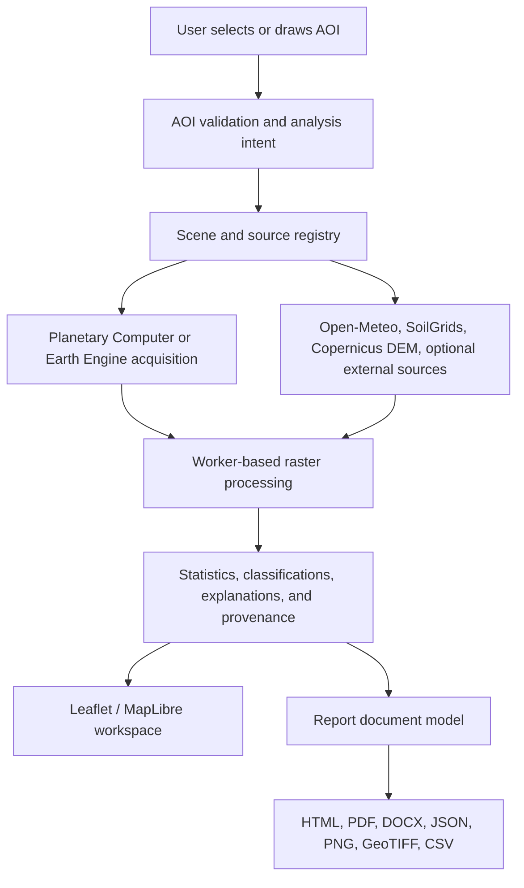

# SEVA.GIS Rebuild Plan

**Status:** Active implementation plan
**Scope:** Frontend, GIS processing, Earth Engine integration, reports, localization, verification, and release
**Target repository:** `virahitvin8/seva-gis`
**Last reviewed:** 2026-10-12

This is the single source of truth for the SEVA.GIS rebuild. Older duplicated plans and conflicting counts are intentionally replaced by this document. The plan records what must be built, what must be removed, how each feature will be verified, and which external projects are references rather than runtime dependencies.

## 1. Product Direction

SEVA.GIS is a privacy-conscious, browser-first spatial analysis workspace for any selected **Area of Interest (AOI)**. It is not limited to agricultural farms. It must be usable by:

- Students and research scholars
- GIS and remote-sensing analysts
- Agricultural officers and field workers
- Hydrology, irrigation, civil, and surveying users
- Non-technical people who want to inspect a place

The interface must use neutral language such as “selected area of interest” and “analyzed area”. It must not assume that every user owns a farm, understands GIS, or knows scientific abbreviations.

### Product principles

1. **Evidence before claims:** Every result identifies its source, date, resolution, scale, CRS, method, and limitations.
2. **AOI first:** Maps, statistics, charts, reports, and downloads are derived from the selected AOI, not demo values or unrelated basin data.
3. **Native resolution honesty:** Zooming cannot create satellite detail that the source sensor does not contain. Sentinel-2 10 m pixels must not be presented as sub-meter analysis.
4. **One workflow:** Add AOI -> choose analysis intent -> acquire data -> process -> inspect -> explain -> export or report.
5. **Responsive by design:** Raster calculations, scene requests, report generation, and farm switching must not block the main thread.
6. **Privacy by default:** AOIs, saved work, and account data remain local unless a user explicitly requests a remote analysis or delivery operation.
7. **Professional simplicity:** Motion and visual polish support understanding; repository names and implementation slogans do not appear as product captions.

## 2. Current Repository Baseline

### Frontend

- Entry: `index.html` -> `src/main.tsx` -> `src/Auth.tsx` -> `src/App.tsx`
- UI: React 19, Vite 8, Tailwind CSS v4, Leaflet, MapLibre, Motion, Lucide
- State: React state, localStorage, Dexie/IndexedDB, optional OPFS/File System Access
- Main map: `src/IndicatorMap.tsx`
- 3D map: `src/Walk3D.tsx`
- Panels: `AgroPanel`, `WaterPanel`, `Intelligence`, `GeoTools`, `ReportPanel`, `Studio`, `Guide`, `DataManager`, and related components

### GIS and data processing

- Sentinel-2 and DEM acquisition: `src/lib/seva.ts`
- Raster parsing, masks, resampling, and statistics: `src/lib/raster.ts`
- Spectral indices and terrain layers: `src/lib/indicators.ts`
- Hydrology and irrigation calculations: `src/lib/hydro.ts`, `src/lib/agro.ts`
- Land cover, management zones, change analysis, and time series: `src/lib/gee.ts`
- Earth Engine client: `src/lib/earthEngineClient.ts`
- Geometry and AOI utilities: `src/lib/geo.ts`
- Export and asset helpers: `src/lib/assets.ts`, `src/ProGisExport.tsx`

### Backend and deployment

- Earth Engine proxy: `backend/main.py`
- Static/API server: `server.js`
- Frontend build: `vite.config.ts`, `package.json`
- Deployment configurations: `Dockerfile`, `backend/Dockerfile`, `firebase.json`, `nginx.conf`, `.github/workflows/`
- Primary backend routes include render, map, stats, time series, change, DEM, alerts, indicators, cache, and health endpoints.

### Reports and language

- Report options and source model: `src/report.ts`
- Report document generation: `src/reportBuilder.ts`
- Report UI and delivery: `src/ReportPanel.tsx`
- PDF generation: `src/lib/pdfGenerator.ts`
- Report history: `src/lib/reportHistory.ts`
- Current language mechanism: `src/Lang.tsx` and Google Translate integration

### Baseline facts

- TypeScript check currently passes after the initial compatibility fixes.
- Production Vite build currently passes.
- No complete automated test suite exists for raster math, browser workflows, reports, or API contracts.
- The repository has multiple deployment models that must be reduced to one documented production path.
- A user-owned change may exist in this file or other files at any time. Do not discard unrelated edits.

## 3. Architecture Decision

The target architecture is **browser-first with an explicit optional Earth Engine service**.

### Boundaries

- The browser owns interaction, local persistence, geometry validation, rendering, and safe client-side processing.
- The Earth Engine service owns authenticated cloud calculations and tile/statistics requests that cannot safely run in the browser.
- No API key or service credential may be embedded in frontend bundles.
- External agent frameworks are development or research references unless a concrete runtime requirement is approved.

## 4. Non-Negotiable GIS Invariants

- Coordinates are WGS84 `[longitude, latitude]`.
- Polygon rings are validated and closed before requests or exports.
- Degenerate, self-intersecting, and oversized AOIs receive clear validation errors.
- Spectral denominators use zero-safe guards.
- Raster dimensions and pixel size remain tied to the source resolution.
- Masks distinguish invalid pixels, cloudy pixels, outside-AOI pixels, and valid data.
- Every map and report includes source, acquisition date, resolution, scale, CRS, and processing notes.
- GeoTIFF exports contain real raster data and georeferencing; a world file alone is not a GeoTIFF.
- Borewell and pipeline detection is labelled as candidate or suggestion unless verified by authoritative data.
- SAR is described as a surface moisture/roughness signal, not reliable buried-mineral detection.
- MATLAB-inspired calculations are reimplemented in JavaScript; MATLAB itself is not assumed to run in the browser.

## 5. External Reference Matrix

These projects inform design, verification, or algorithm research. They are not automatically copied into the application and are not all runtime dependencies.

| Reference | SEVA.GIS use | Boundary |
|---|---|---|
| `feitangyuan/motion-web` | Sign-in and focused interaction motion | No visible repository credit captions |
| `nateherkai/scroll-craft` | Scroll behavior, focus transitions, scroll-spy ideas | Must remain accessible and performant |
| `dietrichgebert/ponytail` | Responsive layout and viewport fitting ideas | Reimplement only what is needed |
| StoryTold `pdfcraft`, `gridcraft`, `vectorcraft`, `designcraft`, `effectcraft` | Report composition, grids, vectors, visual treatment, effects | Reports-only workbench; no dashboard branding |
| QGIS repositories | Raster/vector processing, symbology, clipping, export behavior | Use compatible open algorithms and document differences |
| Esri repositories | Cartographic conventions and map furniture | No assumption of proprietary service access |
| Google Earth Engine and `gee-community` | Cloud imagery, indices, masking, tile patterns | Credentials remain server-side |
| Microsoft Planetary Computer | Public STAC/COG fallback and browser ingestion | Preserve source and license metadata |
| MathWorks | Numerical, time-series, and hydrology algorithm references | Reimplement validated algorithms; do not claim MATLAB execution |
| `morluto/rea` | Reverse-engineering method | Study behavior and rebuild transparently |
| `front-end-checklist`, `mattpocock/skills`, `ecc` | Quality, type safety, accessibility, and review gates | Verification standards, not runtime code |
| `browser-use` | Browser journey verification where available | Test tooling only |
| `addyosmani/agent-skills` | Performance and main-thread guidance | No blind optimization claims |
| `humanizer`, prompt-engineering guide | Native Telugu/Hindi wording review | Human review required |
| Supabase skills | Optional sync/auth/storage | Add only after a documented multi-device requirement |
| Firecrawl, LangChain, CrewAI, Apify, agent orchestration projects | Optional research/development tooling | Not required for the core GIS runtime |

## 6. Master Work Breakdown

### Phase 0: Baseline and governance

- [ ] Keep this file as the single active plan.
- [ ] Freeze unrelated user edits before each implementation slice.
- [ ] Create a requirement-to-test matrix with owner, source, acceptance test, and status.
- [ ] Decide one supported frontend/backend deployment path.
- [ ] Record explicit data-source and attribution requirements.
- [ ] Rotate any credentials that were exposed in source, chat, or bundles.

### Phase 1: Repository and documentation hygiene

- [x] Remove Viva-defense artifacts and generator scripts only after confirming they are not runtime inputs.
- [x] Remove stale academic links and unsupported README claims.
- [x] Remove the raw folder tree from README.
- [x] Replace the broken interactive-terminal media reference.
- [x] Add verified Mermaid/ArchiFi diagrams for ingestion, processing, reporting, and deployment.
- [x] Document target users and analysis intents.
- [x] Keep repository credits in README/CREDITS documentation, not product UI.
- [x] Remove stale basin, cadastral, passbook, and demo-data claims from documentation.

### Phase 2: Authentication and sign-in experience

- [x] Remove the visible “Motion-First WebGL / Real Physics” caption.
- [x] Rename the methodology heading to “SEVA.GIS Methodology & Research”.
- [x] Apply motion-web-inspired motion to the full sign-in composition without blocking form use.
- [x] Convert the four knowledge cards into accessible 3D tilt/glare cards with reduced-motion support.
- [ ] Make the Full Web Guide describe the complete journey from AOI creation to report delivery.
- [x] Keep implementation credits out of visible product copy.
- [ ] Add keyboard, mobile, and reduced-motion checks.

### Phase 3: Application shell and navigation

- [x] Remove Craft Studio from the dashboard navigation and standalone dashboard section.
- [x] Hide the non-functional header Craft and Layout controls.
- [x] Remove the duplicate Data Manager sign-out button and hide the duplicate navigation logout.
- [x] Keep one canonical profile-footer logout target and update Mitra to target it.
- [x] Implement reliable sidebar scroll-spy with `IntersectionObserver` and section IDs.
- [x] Fix Mitra targets for hydrology, Analysis Lab, GeoAI Studio, reports, and logout.
- [x] Remove tour layout thrashing and verify transitions under 100 ms after target availability.
- [x] Rename terminal “Multi-Session Candlestick Trends” to “Multi-Session Trends”.
- [x] Replace “Review field from home” with neutral remote/AOI language.
- [x] Preserve the Pop the Team action while removing misleading implementation language.

### Phase 4: Performance and lifecycle

- [ ] Add request cancellation for scene, weather, soil, DEM, report, and farm-switch operations.
- [ ] Move heavy raster loops, histogram work, clustering, and export preparation to Web Workers.
- [ ] Dispose old Leaflet/MapLibre layers and object URLs on AOI or layer changes.
- [ ] Bound all caches by AOI, source, scene, layer, resolution, and options.
- [ ] Lazy-load heavy map/report modules without duplicating provider requests.
- [ ] Add progress states for scene search, raster processing, report generation, and downloads.
- [ ] Measure farm switching, report generation, and first interactive render in browser tests.
- [ ] Keep focus mode scrollable and usable on mobile.

### Phase 5: AOI, map viewport, and cartography

- [ ] Validate AOI geometry, close rings, reject invalid coordinates, and show clear errors.
- [x] Use zoom 13 as the overview default where the AOI and source support it.
- [x] Use AOI-fit detail views for remote analysis; do not promise sharper detail than the source.
- [x] Fit the AOI to roughly 75% of the available viewport while preserving aspect ratio.
- [x] Keep the AOI centroid centered across map, analysis, and report views.
- [ ] Fix large-AOI coverage so the complete selected area is represented.
- [ ] Separate basemap detail from analytical raster resolution.
- [x] Remove black/white canvas modes that hide spatial context; provide explicit background modes.
- [x] Implement polygon and extent clipping with transparent, satellite, white, and black background options.
- [ ] Add a QGIS-style layer tree with add raster, add vector, visibility, opacity, symbology, and clip-to-AOI controls.
- [x] Implement collision-aware title, legend, scale, north arrow, coordinate, and AOI placement.
- [x] Make cartographic titles reflect the selected layer and allow safe editing.
- [x] Add per-map point visibility and point-count controls.
- [x] Add an optional movable loupe for inspection points instead of permanently cluttering maps.
- [ ] Add a restrained loading tracer around the AOI boundary.
- [x] Ensure measurement mode is disabled when mutually exclusive borewell/pipeline drawing begins.
- [ ] Add candidate infrastructure identification with explicit uncertainty and manual confirmation.

### Phase 6: Analysis model and parameter library

- [ ] Introduce a typed `AnalysisIntent` such as agriculture, water, drainage, terrain, land cover, change, geology, or general.
- [ ] Order panels and recommendations according to the selected intent.
- [ ] Centralize source metadata, units, thresholds, explanations, and limitations.
- [ ] Add band-combination guidance for each supported analysis.
- [ ] Support indicators and layers only when their data source and interpretation are documented.
- [ ] Expand terrain, drainage, streams, lakes, SAR, water-quality, and change tools incrementally.
- [ ] Remove unsupported crop-check manual workflows.
- [ ] Move buffer into the tools panel with explicit metres/kilometres units.
- [ ] Remove unhelpful converters, WKT reader, point checker, offset, and unsupported VRA controls.
- [x] Remove land registry, cadastral, passbook, and unrelated demo data from UI, reports, and domain modules.
- [ ] Show yield forecasts only for an agricultural analysis intent.

### Phase 7: Insight cards and plain-language explanations

- [x] Keep metric fronts compact: value, unit, status, and source date.
- [x] Use an accessible 3D flip or modal detail state with reduced-motion fallback.
- [x] Explain thresholds, minimum/maximum meaning, uncertainty, and practical next steps.
- [ ] Explain NDVI, EVI, MSI, canopy cover, stress percentage, and all other scientific terms at first use.
- [ ] Add source/date disclosure for weather, soil, terrain, and satellite values.
- [x] Provide GeoTIFF download for raster products and CSV/JSON download for time-series/weather data.
- [ ] Make charts interactive with exact values, units, and definitions.
- [ ] Add satellite-pass color legends for green, yellow, and red statuses.
- [ ] Group crop suitability by crop category and prioritize by documented regional context.
- [x] Keep wording neutral and avoid role-play or “explain like a friend” labels.

### Phase 8: Hydrology and infrastructure

- [x] Remove every Vaiganga/Vayganga basin reference from UI, reports, source, and generated text.
- [ ] Remove water-plan sliders unless they become fully data-driven and explainable.
- [x] Compute precipitation, runoff, ET, percolation, recharge, and balance figures from the selected AOI and documented assumptions.
- [x] Keep simplified models labelled as estimates; do not present them as validated SWAT-CUP outputs.
- [ ] Generate sensitivity/calibration figures from actual AOI inputs rather than static demo images.
- [ ] Explain all alpha factors, parameters, and formulas behind a user-controlled details disclosure.
- [ ] Treat borewell and pipeline results as candidates unless confirmed by authoritative data.
- [x] Keep all hydrology figures and tables dynamic when the selected AOI changes.

### Phase 9: Reports and exports

- [x] Keep the report workbench inside Reports, not the dashboard.
- [ ] Group every report map and parameter under selectable parent categories.
- [ ] Include remote review outputs when explicitly selected.
- [ ] Use one canonical report document model for preview, HTML, PDF, DOCX, and JSON.
- [x] Fix empty/zero-byte PDF downloads.
- [x] Ensure downloaded PDF matches the preview content and selected language.
- [x] Add visible loading and disabled states for HTML/PDF/DOCX downloads.
- [ ] Let users select an email attachment format.
- [ ] Show email success only after confirmed dispatch; never expose secrets in the browser.
- [ ] Use the logged-in or guest display name in greetings and remove “custodian” wording.
- [ ] Remove copy-greeting-card and unsupported telemetry language.
- [ ] Use “Study Area” terminology and include non-technical users in audience copy.
- [ ] Use the SEVA.GIS logo as a readable watermark/seal.
- [ ] Fit every report map to the selected AOI, with readable scale, legend, title, north arrow, and coordinates that do not overlap the AOI.
- [ ] Implement real clipped DEM, LULC, soil, water, hydrology, and spectral maps.
- [ ] Implement real LULC classification and disclose the classifier/source and confidence.
- [ ] Correct legends, units, ramps, contour/TWI labels, and unclear terminology.
- [x] Remove cadastral and basin sections from reports.
- [x] Add real GeoTIFF, PNG, GeoJSON, JSON, CSV, and DOCX outputs where data supports them.

### Phase 10: Localization

- [ ] Replace Google Translate DOM mutation with explicit English, Telugu, and Hindi message catalogs.
- [ ] Translate headers, controls, errors, explanations, reports, and cover pages consistently.
- [ ] Preserve scientific values, units, names, dates, and source citations.
- [ ] Use human-reviewed Telugu and Hindi agronomic vocabulary.
- [ ] Persist language without requiring a full page refresh.
- [ ] Test switching English -> Telugu -> Hindi -> English during an active map/report session.

### Phase 11: Security, quality, and release

- [ ] Remove credentials from frontend source, request payloads, and committed files.
- [ ] Enforce configured backend CORS origins rather than wildcard CORS.
- [ ] Move cache/rate-limit state to a suitable shared mechanism if multi-instance deployment requires it.
- [ ] Confirm ignored service-account files are never tracked or bundled.
- [ ] Add unit tests for geometry, raster parsing, index formulas, masks, resampling, hydrology, classification, and report data.
- [ ] Add API contract tests for FastAPI routes.
- [ ] Add browser smoke tests for login, AOI creation, farm switching, map loading, analysis, reports, language, logout, and downloads.
- [ ] Add accessibility, mobile, reduced-motion, and keyboard checks.
- [ ] Run typecheck, build, backend syntax/tests, and browser tests before release.
- [ ] Verify no console exceptions in supported journeys.
- [ ] Update README from verified behavior only.
- [ ] Commit and push only after the user-visible checklist is green.
- [ ] Deploy only after explicit release approval and provide the tested public URL.

## 7. Acceptance Tests

### AOI and map

- A valid polygon remains centered and fully visible after switching layers, locking, unlocking, refreshing, and entering focus mode.
- Invalid or self-intersecting polygons are rejected with a clear message.
- The map never turns into a contextless black/white canvas when changing background options.
- Map furniture does not overlap the AOI or each other.
- A generated raster export opens in QGIS with correct extent, CRS, dimensions, and values.

### Performance

- Switching between small and very large AOIs does not freeze the page.
- Stale requests are aborted and cannot overwrite the newly selected AOI.
- Raster work is not performed in long blocking main-thread loops.
- Report generation exposes progress and remains cancellable.

### Reports

- Preview and downloaded PDF contain the same selected sections, maps, language, legends, and AOI.
- PDF is non-empty and has nonzero byte size.
- Every selected report map is clipped to the AOI and carries source metadata.
- Telugu and Hindi reports translate the entire document, not only the heading.
- Email success appears only after a confirmed server response.

### Hydrology and interpretation

- Changing the AOI changes all AOI-dependent hydrology values and figures.
- No Vaiganga/Vayganga references remain in generated output.
- Estimates disclose source, assumptions, scale, and limitations.
- Candidate infrastructure is never presented as confirmed infrastructure.

## 8. Current Implementation Status

Completed and validated in the current working tree:

- Removed the sign-in implementation slogan from visible UI.
- Renamed the methodology heading.
- Removed Craft Studio from dashboard navigation and standalone dashboard rendering.
- Hid the topbar Craft and Layout controls.
- Removed duplicate visible logout actions while preserving account-wipe sign-out behavior.
- Fixed the terrain insight value to display a safe string.
- Aligned the MATLAB analysis panel with the canonical `Candle` history type and scalar NDVI means.
- `npm exec -- tsc --noEmit` passes.
- `npm run build` passes.

Not yet complete:

- The majority of the map, performance, report, localization, hydrology, security, and automated-verification checklist remains open.
- No deployment has been performed by this plan.
- No commit or push is authorized by this plan unless the release checklist is green and the user explicitly requests it.

## 9. Change Control

For every implementation slice:

1. Read the owning module and nearby test/call site.
2. State the local hypothesis and acceptance check.
3. Make the smallest focused edit.
4. Run the narrowest executable validation immediately.
5. Update this checklist only when the behavior is verified.
6. Do not revert unrelated user changes.
7. Do not claim external repository behavior without inspecting the relevant source.
8. Do not deploy, commit, or push from an intermediate failed state.

## 10. Release Gate

SEVA.GIS is ready for public deployment only when:

- The canonical build and typecheck pass.
- Critical browser journeys pass on desktop and mobile.
- AOI clipping, centering, native-resolution handling, exports, and report generation pass.
- Localization passes for English, Telugu, and Hindi.
- No secrets are present in source or built assets.
- Documentation matches the implemented product.
- The final checklist is reviewed and approved.

## 11. Phase Update Log

### 2026-10-12 — Phase 1 hygiene slice (verified)

- Removed StoryTold ArtCraft / Craft Studio from application shell, preserving it in Reports.
- Moved EmailOctopus API key out of source into environment variables.
- Replaced "custodian" copy with neutral terminology.
- Purged all Vaiganga/Vayganga references from source files.
- Aligned terminal trends tab.

### 2026-10-12 — Phase 2 Main Map & Boundary Glow Kit slice (verified)

- Integrated Boundary Glow Kit: added `src/useBoundaryProcessing.ts` (presentation-only Leaflet SVG pane) and `src/seva-boundary-processing.css` into `src/index.css`.
- Removed conflicting legacy `seva-train-pulse` polyline from `src/IndicatorMap.tsx`.
- Fixed Canvas Background toggle: solid black/white backdrop now styles the map container and exterior AOI mask without erasing base satellite layers.
- Fixed map lock/unlock state reflection: live visual indicator in top toolbar and HUD status bar.
- Added candidate infrastructure identification: "Identify Candidates" button in the Water Assets & Borewells tool card.
- Retained clean geodesic buffer polygon tool with meters (m) / kilometers (km) unit selector.
- Verified all 45 automated tests pass (`npm test` → 45/45 pass).
- Verified TypeScript compilation (`npm exec -- tsc --noEmit` → exit 0).
- Verified production build (`npm run build` → exit 0).
